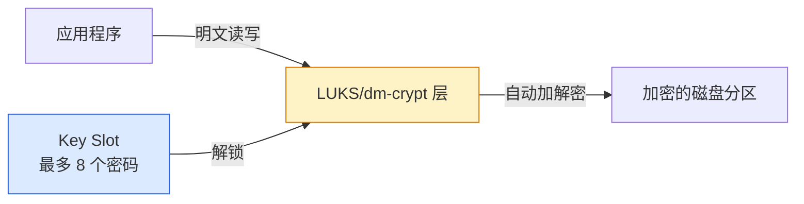

# LUKS 全盘加密：Linux 磁盘加密从入门到实践

## 前言

如果你的笔记本电脑丢失、服务器硬盘被盗——未加密的磁盘意味着所有数据直接暴露。LUKS（Linux Unified Key Setup）是 Linux 下标准的磁盘加密方案，基于内核的 `dm-crypt` 子系统，提供透明加密：使用时和普通磁盘一样，但数据在磁盘上始终以密文存储。

!!! info "LUKS 能做什么？"
    -   **静态数据保护**：硬盘被拔走也读不出内容
    -   **合规要求**：满足 GDPR、等保等数据加密要求
    -   **云环境**：加密 EBS/云硬盘，防止云厂商侧数据泄露
    -   **性能损耗**：现代 CPU（AES-NI 指令集）下约 3~5%

---

## LUKS 基础概念



| 概念 | 说明 |
| --- | --- |
| **LUKS Header** | 磁盘开头的元数据区，存储加密算法、密钥槽等信息。**Header 损坏 = 数据永久丢失** |
| **Key Slot** | 密码槽，最多 8 个。可以有多个密码解锁同一个磁盘 |
| **Master Key** | 实际加密数据的密钥，被每个 Key Slot 中的密码加密保存 |
| **dm-crypt** | 内核模块，执行实际的数据加解密 |

---

## 创建 LUKS 加密分区

### 准备工作

确认 CPU 支持 AES-NI 加速：

```bash
grep -c aes /proc/cpuinfo
# 返回值 > 0 表示支持硬件加速
```

### 创建加密分区

```bash
# 假设 /dev/sdb1 是要加密的分区
# ⚠️ 此操作会清空分区上的所有数据！

# LUKS2 格式 + aes-xts 加密（推荐）
sudo cryptsetup luksFormat --type luks2 \
    --cipher aes-xts-plain64 \
    --key-size 512 \
    --hash sha512 \
    --pbkdf argon2id \
    /dev/sdb1

# 确认操作（输入 YES 大写）
# 设置加密密码（务必牢记！）
```

!!! danger "密码丢失 = 数据永久丢失"
    LUKS 没有后门。忘记密码且没有备份 Header，数据**无法恢复**。务必用密码管理器保存。

### 验证 Header

```bash
sudo cryptsetup luksDump /dev/sdb1
# LUKS header information
# Version:        2
# Cipher name:    aes
# Cipher mode:    xts-plain64
# Hash spec:      sha512
# Keyslots:       0: luks2 (active), 1-7: (empty)
```

---

## 挂载与使用

```bash
# 1. 打开（解锁）加密设备
sudo cryptsetup luksOpen /dev/sdb1 encrypted_data
# 输入密码后，/dev/mapper/encrypted_data 可用

# 2. 创建文件系统
sudo mkfs.ext4 /dev/mapper/encrypted_data

# 3. 挂载
sudo mkdir /mnt/secret
sudo mount /dev/mapper/encrypted_data /mnt/secret

# 4. 正常使用
echo "sensitive data" | sudo tee /mnt/secret/file.txt

# 5. 卸载并锁定
sudo umount /mnt/secret
sudo cryptsetup luksClose encrypted_data
```

---

## 开机自动解锁

### 方案一：Keyfile（适合服务器）

```bash
# 生成随机密钥文件
sudo dd if=/dev/urandom of=/root/luks-keyfile bs=4096 count=1
sudo chmod 400 /root/luks-keyfile

# 添加为新的 Key Slot
sudo cryptsetup luksAddKey /dev/sdb1 /root/luks-keyfile

# /etc/crypttab（开机自动解锁）
# <mapper名> <设备> <密钥文件> <选项>
encrypted_data /dev/sdb1 /root/luks-keyfile luks
```

### 方案二：TPM 2.0 自动解锁（现代服务器）

```bash
# 安装 clevis（TPM 绑定工具）
sudo apt install clevis clevis-luks clevis-tpm2

# 将 LUKS 分区绑定到 TPM 2.0
sudo clevis luks bind -d /dev/sdb1 tpm2 '{"pcr_ids":"7"}'

# /etc/crypttab
encrypted_data /dev/sdb1 - tpm2-device=auto
```

### 方案三：Tang 网络解锁（数据中心）

```bash
sudo apt install clevis clevis-luks clevis-systemd

# 部署 Tang 服务器后，绑定
sudo clevis luks bind -d /dev/sdb1 tang '{"url":"http://tang-server"}'
```

---

## 加密分区扩容

```bash
# 假设需要扩大加密分区（先扩展底层分区/磁盘）

# 1. 解锁
sudo cryptsetup luksOpen /dev/sdb1 encrypted_data

# 2. 扩展 LUKS 容器（会自动适配新大小）
sudo cryptsetup resize encrypted_data

# 3. 扩展文件系统
sudo resize2fs /dev/mapper/encrypted_data    # ext4
# 或
sudo xfs_growfs /mnt/secret                   # XFS
```

---

## LUKS Header 备份与恢复

Header 损坏是 LUKS 最致命的故障——没有备份就等于数据永别：

```bash
# 备份 Header（务必保存在安全的地方！）
sudo cryptsetup luksHeaderBackup /dev/sdb1 \
    --header-backup-file /secure/location/sdb1-header-backup.bin

# 恢复 Header
sudo cryptsetup luksHeaderRestore /dev/sdb1 \
    --header-backup-file /secure/location/sdb1-header-backup.bin
```

!!! danger "Header 备份的安全问题"
    Header 包含 Master Key 的加密副本——拿到 Header 备份 + 密码就能解密数据。备份文件必须加密存储或离线保存在保险柜。

---

## 密码管理

```bash
# 添加新密码（增加到下一个空 Key Slot）
sudo cryptsetup luksAddKey /dev/sdb1

# 更换密码（替换指定 Key Slot）
sudo cryptsetup luksChangeKey /dev/sdb1 -S 0

# 删除密码（撤销某个 Key Slot——例如员工离职）
sudo cryptsetup luksKillSlot /dev/sdb1 0

# 查看所有 Key Slot 状态
sudo cryptsetup luksDump /dev/sdb1 | grep -A4 Keyslots
```

---

## 性能影响

```bash
# 基准测试：加密 vs 未加密
cryptsetup benchmark
# aes-xts   512b  加密速度
# aes-xts   512b  解密速度

# 查看 CPU 是否支持 AES-NI
grep -o aes /proc/cpuinfo | wc -l
```

| 场景 | AES-NI 支持 | 性能损失 |
| --- | :---: | :---: |
| 现代 x86_64 CPU | ✓ | 3~5%（基本无感） |
| ARM 服务器 | 部分支持 | 5~15% |
| 老旧 CPU / 无 AES-NI | ✗ | 20~40% |
| NVMe SSD 高吞吐 | ✓ | 可能成为瓶颈（软件加密 vs 硬件加密） |

---

## 常见问题

### 忘记密码怎么办？

没有备份 Header + 没有密码 = **无法恢复**。这就是加密的目的，也是加密的代价。

### 能不能加密已有数据的磁盘？

不能直接加密。需要：备份数据 → 创建 LUKS → 格式化 → 恢复数据。或使用 LUKS 原地加密（`cryptsetup-reencrypt`，高风险，不推荐新手操作）。

---

## 总结

LUKS 是 Linux 数据安全的最后一道防线：

1. **创建**：`cryptsetup luksFormat` + `luksOpen` + `mkfs` + `mount` 四步
2. **自动解锁**：服务器用 keyfile，现代设备用 TPM 2.0 + Clevis
3. **Header 是命根**：备份并存放在安全的地方
4. **性能无忧**：有 AES-NI 的现代 CPU 下加密开销 < 5%
5. **密码管理**：多个 Key Slot 实现一人一密、离职可撤销

加密不是可选项——它是现代 IT 基础设施的标配。 🚀
