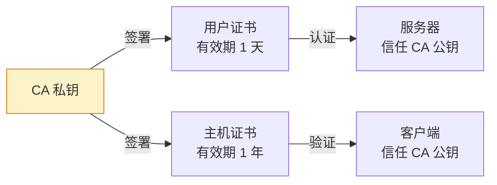

# SSH 安全加固：从端口修改到证书认证

## 前言

SSH 是 Linux 服务器的远程管理入口。一台暴露在公网的服务器，每天都会被成千上万次暴力破解尝试光顾。如果不加固 SSH，你的服务器就像一扇没锁的门——只是时间问题。

本文从最基础的配置入手，逐步深入到密钥认证、证书认证，帮你把 SSH 从「默认不安全」加固到「生产就绪」。

!!! warning "修改 SSH 配置前的重要提醒"
    1. **始终保持一个已连接的 SSH 会话**——在另一个终端测试新配置，确认能连上后再关闭旧会话
    2. **用 `sshd -t` 检查配置语法**再重启服务
    3. **重启 sshd 不会断开现有连接**（`systemctl restart sshd` 是安全的）

---

## 基础加固：五项必做

### 1. 禁用 root 直接登录

```bash
# /etc/ssh/sshd_config
PermitRootLogin no
```

用普通用户登录后 `sudo -i` 提权，而不是直接 root 登录。

---

### 2. 禁用密码登录，只用密钥

```bash
# /etc/ssh/sshd_config
PasswordAuthentication no
PubkeyAuthentication yes
```

**先确保你已配置好密钥认证**，否则你会把自己锁在外面。

---

### 3. 配置密钥认证

**客户端生成密钥对：**

```bash
ssh-keygen -t ed25519 -C "your_email@example.com"
# ed25519 比 RSA 更安全、更快、更短
```

**将公钥上传到服务器：**

```bash
ssh-copy-id user@server
# 或手动：
cat ~/.ssh/id_ed25519.pub | ssh user@server "mkdir -p ~/.ssh && cat >> ~/.ssh/authorized_keys"
```

**服务器端确保权限正确：**

```bash
chmod 700 ~/.ssh
chmod 600 ~/.ssh/authorized_keys
```

---

### 4. 修改默认端口

```bash
# /etc/ssh/sshd_config
Port 2222    # 改成非标准端口，减少自动化扫描
```

修改后防火墙放行新端口：

```bash
sudo ufw allow 2222/tcp
```

---

### 5. 限制可登录用户

```bash
# /etc/ssh/sshd_config
AllowUsers alice bob       # 只允许这些用户
AllowGroups sshusers       # 或按组限制
```

---

## 进阶加固：SSH 配置文件模板

```ini
# /etc/ssh/sshd_config — 生产环境推荐配置

# 端口与监听
Port 2222
AddressFamily inet              # 仅 IPv4

# 认证
PermitRootLogin no
PasswordAuthentication no
PubkeyAuthentication yes
ChallengeResponseAuthentication no
KerberosAuthentication no
GSSAPIAuthentication no

# 限制
MaxAuthTries 3                  # 最多尝试 3 次
MaxSessions 5                   # 单连接最多 5 个会话
MaxStartups 10:30:60           # 未认证连接限制

# 空闲超时
ClientAliveInterval 300         # 每 300 秒发保活包
ClientAliveCountMax 2           # 2 次无响应则断开（共 10 分钟）

# 禁止的功能
X11Forwarding no
AllowTcpForwarding no           # 禁止端口转发（按需开启）
PermitTunnel no
AllowAgentForwarding no

# 日志
LogLevel VERBOSE

# 版本（隐藏系统信息）
DebianBanner no

# 加密算法（仅允许安全的）
Ciphers chacha20-poly1305@openssh.com,aes256-gcm@openssh.com
MACs hmac-sha2-512-etm@openssh.com,hmac-sha2-256-etm@openssh.com
KexAlgorithms curve25519-sha256,curve25519-sha256@libssh.org
```

```bash
# 测试配置
sudo sshd -t

# 无报错则重载
sudo systemctl reload sshd
```

---

## SSH 证书认证（进阶）

密钥认证的问题是：每台服务器都要部署公钥。当你有 50 台服务器时，这变得难以管理。

SSH 证书认证通过引入 **CA（证书颁发机构）** 解决了这个问题：



**生成 CA 密钥：**

```bash
# 在安全环境（离线）生成 CA 密钥
ssh-keygen -t ed25519 -f ca_key -C "SSH CA"
```

**签署主机证书（服务器上）：**

```bash
# 将服务器公钥复制到 CA 服务器，签署
ssh-keygen -s ca_key -I server_identity -h -n server.example.com -V +52w /path/to/ssh_host_ed25519_key.pub

# 将生成的证书复制回服务器
# /etc/ssh/sshd_config 中添加：
HostCertificate /etc/ssh/ssh_host_ed25519_key-cert.pub
```

**签署用户证书：**

```bash
ssh-keygen -s ca_key -I alice@company -n alice -V +1d alice_id_ed25519.pub
# 生成 alice_id_ed25519-cert.pub（有效期 1 天）
```

**服务器信任 CA：**

```bash
# /etc/ssh/sshd_config
TrustedUserCAKeys /etc/ssh/ca_key.pub
```

现在用户只要持有 CA 签发的有效证书（无需在各服务器上部署公钥），就能登录所有信任该 CA 的服务器。

---

## 使用 Fail2Ban 防暴力破解

即使改了端口，公网服务器仍可能被扫描。Fail2Ban 自动封禁多次失败的 IP：

```bash
sudo apt install fail2ban
```

创建 `/etc/fail2ban/jail.local`：

```ini
[sshd]
enabled = true
port    = 2222
filter  = sshd
logpath = /var/log/auth.log
maxretry = 3
bantime  = 3600        # 封禁 1 小时
findtime = 600         # 10 分钟内
```

```bash
sudo systemctl enable fail2ban --now
sudo fail2ban-client status sshd
```

详细配置见 [Fail2Ban 实践](fail2ban.md)。

---

## SSH 安全审计

### 查看当前连接

```bash
ss -tnp | grep :2222
who
```

### 查看登录历史

```bash
last -20                    # 最近 20 次登录
lastb -20                   # 最近 20 次失败登录
grep "Failed password" /var/log/auth.log | tail -20
```

### 查看所有 authorized_keys

```bash
find /home -name authorized_keys -exec ls -la {} \; -exec cat {} \;
```

!!! danger "定期审计"
    每季度检查所有服务器上的 `authorized_keys`，确认每个密钥都对应一个已知的人。离职员工的密钥必须立即删除。

---

## 常见问题

### 把自己锁在外面了怎么办？

如果服务器在云端，通过 **VNC/控制台** 登录（云厂商都提供这个功能）。如果是物理机，接显示器键盘。

### ed25519 vs RSA 怎么选？

| | RSA 4096 | Ed25519 |
| --- | :---: | :---: |
| 安全性 | 高 | 更高 |
| 密钥长度 | 较长 | 非常短 |
| 速度 | 较慢 | 快 |
| 兼容性 | 所有系统 | OpenSSH 6.5+ |

**结论**：选 Ed25519。除非你需要连接非常老的系统（< 2014 年的 OpenSSH）。

---

## 总结

SSH 加固不是一次性工作，而是持续的安全实践：

1. **五件必做**：禁用 root、禁用密码、换端口、限制用户、配置 Fail2Ban
2. **密钥优于密码**：Ed25519 是现代首选
3. **审计是习惯**：定期检查 `authorized_keys` 和登录日志
4. **证书是未来**：超过 10 台服务器就考虑用 SSH CA

安全没有终点——今天的「足够安全」可能是明天的「不堪一击」。 🚀
