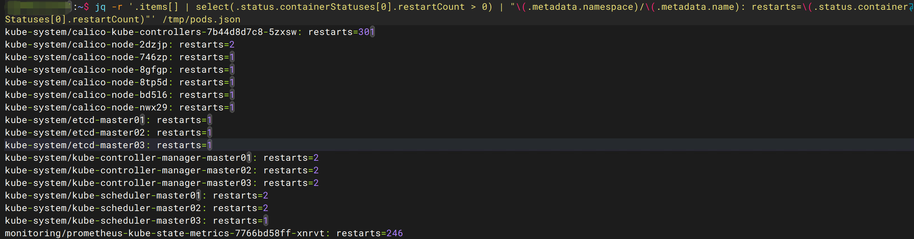

# jq 命令详解：从语法到脚本实战的 JSON 处理指南

JSON 是现代运维和开发中最常见的数据格式之一。`kubectl get pods -o json` 的输出、API 接口的返回结果、容器日志中的结构化数据——都离不开 JSON。

`grep` 和 `awk` 处理 JSON 往往很痛苦，因为 JSON 是层级结构化数据，不是简单的文本行。`jq` 的核心价值在于把 JSON 当作数据结构来处理，支持按层级提取字段、条件筛选、格式转换和聚合统计。

本文从基础语法讲起，逐步覆盖 jq 的核心过滤器、管道、选项和脚本写法，最后结合 Kubernetes 场景给出实战示例。所有命令均在测试集群（3 Master + 3 Worker，K8s 1.36.1）上实际运行验证。

## 准备数据

本文所有示例基于以下数据文件，先在集群上生成：

```bash
# 导出所有 Pod 的完整 JSON
kubectl get pods -A -o json > /tmp/pods.json
```

这个文件包含 40 个 Pod 的完整信息。先看看第一个 Pod 的结构：

```bash
jq '.items[0]' /tmp/pods.json | head -30
```

输出：

```json
{
  "apiVersion": "v1",
  "kind": "Pod",
  "metadata": {
    "annotations": {
      "cni.projectcalico.org/containerID": "8c8e6cf36296d7ec...",
      "cni.projectcalico.org/podIP": "10.244.30.112/32",
      "cni.projectcalico.org/podIPs": "10.244.30.112/32"
    },
    "creationTimestamp": "2026-06-11T06:38:32Z",
    "generateName": "headlamp-97894bf98-",
    "generation": 1,
    "labels": {
      "app.kubernetes.io/instance": "headlamp",
      "app.kubernetes.io/name": "headlamp",
      "pod-template-hash": "97894bf98"
    },
    "name": "headlamp-97894bf98-mw8bz",
    "namespace": "headlamp",
    ...
  }
}
```

一个 Pod 的 JSON 少说几百行。40 个 Pod 加起来，直接看根本看不过来。接下来看看 jq 怎么从这个结构中提取需要的信息。

## 一、jq 的安装

=== "Ubuntu / Debian"

    ```bash
    sudo apt update
    sudo apt install jq
    ```

=== "CentOS / Rocky / RHEL"

    ```bash
    sudo yum install jq
    ```

=== "macOS"

    ```bash
    brew install jq
    ```

验证安装：

```bash
jq --version
# jq-1.7.1
```

## 二、jq 的基本工作方式

jq 的核心思路：读取 JSON，用**过滤器**（filter）选择、转换、处理数据。

基本结构：

```bash
jq '<过滤器>' <输入文件>
# 或通过管道
cat data.json | jq '<过滤器>'
```

例如：

```bash
jq '.items[0].metadata.name' /tmp/pods.json
# "headlamp-97894bf98-mw8bz"
```

过滤器 `.items[0].metadata.name` 的含义：取 `items` 数组的第一个元素，再取它的 `metadata.name` 字段。

## 三、基础语法：字段提取与数组遍历

### 3.1 直接输出整个 JSON

`.` 表示整个输入对象，相当于"原样输出"：

```bash
jq '.' /tmp/pods.json
```

配合 `head` 可以快速查看 JSON 结构的开头部分：

```bash
jq '.items[0]' /tmp/pods.json | head -30
```

### 3.2 取字段

```bash
jq '.items[0].metadata.name' /tmp/pods.json
# "headlamp-97894bf98-mw8bz"
```

### 3.3 取嵌套字段

```bash
jq '.items[0].metadata.namespace' /tmp/pods.json
# "headlamp"
```

### 3.4 取数组中的元素

```bash
jq '.items[0]' /tmp/pods.json | head -5
# 取 items 数组的第 0 个元素
```

### 3.5 遍历数组

`.[]` 遍历数组的每一个元素，逐个输出：

```bash
jq -r '.items[].metadata.name' /tmp/pods.json | head -10
```

输出：

```
headlamp-97894bf98-mw8bz
calico-kube-controllers-7b44d8d7c8-5zxsw
calico-node-2dzjp
calico-node-746zp
calico-node-8gfgp
calico-node-8tp5d
coredns-6c5ff5b6b7-2qlgc
coredns-6c5ff5b6b7-wm9lz
etcd-master01
etcd-master02
```

加上 `-r` 选项输出纯文本（不带引号），方便后续处理。

## 四、核心过滤器

### 4.1 `.`：当前输入

```bash
jq '.' /tmp/pods.json
```

原样输出整个 JSON，通常用于格式化查看。

### 4.2 `.field`：取对象字段

```bash
jq '.items[0].metadata.name' /tmp/pods.json
# "headlamp-97894bf98-mw8bz"
```

### 4.3 `.[index]`：取数组下标

```bash
jq '.items[0]' /tmp/pods.json | jq 'keys'
# 取第一个 Pod 的所有字段名
```

### 4.4 `.[]`：遍历数组

```bash
jq -r '.items[].metadata.name' /tmp/pods.json | head -5
```

### 4.5 `|`：管道

管道是 jq 最强大的特性之一。前一个过滤器的输出作为后一个过滤器的输入：

```bash
jq -r '.items[] | .metadata.name' /tmp/pods.json | head -5
```

等价于先遍历 `items` 数组，再对每个元素取 `metadata.name`。

### 4.6 `select()`：条件筛选

```bash
jq -r '.items[] | select(.status.phase == "Running") | .metadata.name' /tmp/pods.json | head -5
```

### 4.7 `length`：统计长度

```bash
jq '.items | length' /tmp/pods.json
# 40
```

统计 items 数组有多少个元素。

### 4.8 `keys`：取字段名

```bash
jq '.items[0] | keys' /tmp/pods.json
```

输出：

```json
[
  "apiVersion",
  "kind",
  "metadata",
  "spec",
  "status"
]
```

### 4.9 `map()`：映射

```bash
jq '.items | map(.metadata.name) | .[0:3]' /tmp/pods.json
```

输出前 3 个 Pod 的名称数组。

### 4.10 `//`：空值兜底

`//` 运算符在左侧为 `null` 时返回右侧的值，适合处理可选字段：

```bash
jq -r '.items[] | "\(.metadata.name): \(.metadata.annotations["cni.projectcalico.org/podIP"] // "无CNI注解")"' /tmp/pods.json | head -10
```

输出：

```
headlamp-97894bf98-mw8bz: 10.244.30.112/32
calico-kube-controllers-7b44d8d7c8-5zxsw: 无CNI注解
calico-node-2dzjp: 无CNI注解
...
```

有些 Pod（如静态 Pod 和 DaemonSet Pod）没有 CNI 注解，`//` 保证了输出不为 null。

## 五、管道：组合使用

jq 的管道可以把多个过滤器串联起来，完成复杂的查询。

### 5.1 先取字段，再继续处理

```bash
jq -r '.items[] | .metadata.name' /tmp/pods.json | head -5
```

### 5.2 先筛选，再输出

```bash
jq -r '.items[] | select(.status.phase == "Running") | .metadata.name' /tmp/pods.json | head -5
```

### 5.3 输出成更简洁的结构

```bash
jq '.items[] | {name: .metadata.name, namespace: .metadata.namespace, phase: .status.phase}' /tmp/pods.json | head -12
```

输出：

```json
{
  "name": "headlamp-97894bf98-mw8bz",
  "namespace": "headlamp",
  "phase": "Running"
}
{
  "name": "calico-kube-controllers-7b44d8d7c8-5zxsw",
  "namespace": "kube-system",
  "phase": "Running"
}
...
```

## 六、输出格式与常用选项

### 6.1 `-r`：输出原始字符串

默认输出 JSON 字符串带引号：

```bash
jq '.items[0].metadata.name' /tmp/pods.json
# "headlamp-97894bf98-mw8bz"
```

加 `-r` 去掉引号：

```bash
jq -r '.items[0].metadata.name' /tmp/pods.json
# headlamp-97894bf98-mw8bz
```

在 Shell 脚本中用变量接收 jq 输出时，`-r` 几乎必加。

### 6.2 `-c`：紧凑一行输出

```bash
jq -c '.items[0] | {name: .metadata.name, namespace: .metadata.namespace}' /tmp/pods.json
# {"name":"headlamp-97894bf98-mw8bz","namespace":"headlamp"}
```

适合管道传递给后续命令处理。

### 6.3 `-n`：不从文件读取，直接构造输入

```bash
jq -n '{name: "test-pod", status: "Running"}'
# {"name":"test-pod","status":"Running"}
```

### 6.4 `-f`：从文件读取过滤器

```bash
echo '.items[] | .metadata.name' > /tmp/filter.jq
jq -r -f /tmp/filter.jq /tmp/pods.json | head -5
```

适合复用复杂的过滤器。

### 6.5 `-M`：禁用颜色输出

```bash
jq -M '.' /tmp/pods.json | head -5
```

输出重定向到文件时建议加上，避免 ANSI 颜色码污染输出。

## 七、条件筛选：select()

`select()` 是 jq 中最重要的条件过滤函数。

### 7.1 基础筛选

```bash
jq -r '.items[] | select(.status.phase == "Running") | .metadata.name' /tmp/pods.json | head -5
```

### 7.2 多条件筛选

```bash
jq -r '.items[] | select(.status.phase == "Running" and .metadata.namespace == "kube-system") | .metadata.name' /tmp/pods.json | head -5
```

### 7.3 取反筛选

```bash
jq -r '.items[] | select(.status.phase != "Running") | .metadata.name' /tmp/pods.json
```

如果所有 Pod 都 Running，这条命令没有输出。这在脚本中可以作为集群健康检查：

```bash
#!/bin/bash
NOT_RUNNING=$(jq -r '.items[] | select(.status.phase != "Running") | .metadata.name' /tmp/pods.json)
if [ -z "$NOT_RUNNING" ]; then
    echo "所有 Pod 正常运行"
else
    echo "异常 Pod: $NOT_RUNNING"
fi
```

### 7.4 按数值筛选

```bash
jq -r '.items[] | select(.status.containerStatuses[0].restartCount > 0) | "\(.metadata.namespace)/\(.metadata.name): restarts=\(.status.containerStatuses[0].restartCount)"' /tmp/pods.json
```

输出：

```
kube-system/calico-kube-controllers-7b44d8d7c8-5zxsw: restarts=301
monitoring/prometheus-kube-state-metrics-7766bd58ff-xnrvt: restarts=246
kube-system/calico-node-2dzjp: restarts=2
kube-system/calico-node-746zp: restarts=1
kube-system/calico-node-8gfgp: restarts=1
kube-system/calico-node-8tp5d: restarts=1
kube-system/calico-node-bd5l6: restarts=1
kube-system/calico-node-nwx29: restarts=1
kube-system/etcd-master01: restarts=1
kube-system/etcd-master02: restarts=1
kube-system/etcd-master03: restarts=1
kube-system/kube-controller-manager-master01: restarts=2
kube-system/kube-controller-manager-master02: restarts=2
kube-system/kube-controller-manager-master03: restarts=2
kube-system/kube-scheduler-master01: restarts=2
kube-system/kube-scheduler-master02: restarts=2
kube-system/kube-scheduler-master03: restarts=2
```

一眼定位重启次数异常的 Pod。`calico-kube-controllers` 重启 301 次需要重点排查。

!!! warning "多容器 Pod 的限制"

    `.status.containerStatuses[0]` 只取第一个容器的重启次数。多容器 Pod（如 grafana 有 3 个容器）的其他容器会被忽略。如果要遍历所有容器，需要额外嵌套一层遍历。

## 八、映射与聚合：map()、reduce

### 8.1 map()

```bash
jq '.items | map(.metadata.namespace)' /tmp/pods.json | head -3
```

将每个 Pod 映射为它的 namespace。

### 8.2 reduce / add

```bash
jq '.items | map(.spec.containers | length) | add' /tmp/pods.json
```

统计所有 Pod 的容器总数。

### 8.3 group_by()

```bash
jq -r '[.items[] | .metadata.namespace] | group_by(.) | map({ns: .[0], count: length})' /tmp/pods.json
```

输出：

```json
[
  {"ns": "headlamp", "count": 1},
  {"ns": "kube-system", "count": 28},
  {"ns": "monitoring", "count": 11}
]
```

按 namespace 分组统计 Pod 数量。

## 九、对象构造：生成新的 JSON

jq 不只是读取，也可以生成新的 JSON 结构。

### 9.1 从旧对象构造新对象

```bash
jq '.items[] | {name: .metadata.name, namespace: .metadata.namespace, phase: .status.phase}' /tmp/pods.json | head -9
```

### 9.2 构造数组

```bash
jq '[.items[] | .metadata.name] | .[0:5]' /tmp/pods.json
```

输出：

```json
[
  "headlamp-97894bf98-mw8bz",
  "calico-kube-controllers-7b44d8d7c8-5zxsw",
  "calico-node-2dzjp",
  "calico-node-746zp",
  "calico-node-8gfgp"
]
```

用 `[]` 包裹表示把结果收集成数组，而不是逐个输出。

### 9.3 构造字符串

```bash
jq -r '.items[] | "\(.metadata.namespace)/\(.metadata.name) \(.status.phase)"' /tmp/pods.json | head -5
```

输出：

```
headlamp/headlamp-97894bf98-mw8bz Running
kube-system/calico-kube-controllers-7b44d8d7c8-5zxsw Running
kube-system/calico-node-2dzjp Running
kube-system/calico-node-746zp Running
kube-system/calico-node-8gfgp Running
```

## 十、Kubernetes 实战场景

### 10.1 提取所有 Pod 的名称和命名空间

```bash
jq -r '.items[] | "\(.metadata.namespace)\t\(.metadata.name)"' /tmp/pods.json | head -10
```

输出：

```
headlamp    headlamp-97894bf98-mw8bz
kube-system    calico-kube-controllers-7b44d8d7c8-5zxsw
kube-system    calico-node-2dzjp
kube-system    calico-node-746zp
kube-system    calico-node-8gfgp
kube-system    calico-node-8tp5d
kube-system    calico-node-bd5l6
kube-system    calico-node-nwx29
kube-system    coredns-6c5ff5b6b7-2qlgc
kube-system    coredns-6c5ff5b6b7-wm9lz
```

### 10.2 提取所有容器镜像

```bash
jq -r '.items[].spec.containers[].image' /tmp/pods.json | sort -u
```

输出：

```
m.daocloud.io/docker.io/calico/cni:v3.28.2
m.daocloud.io/docker.io/calico/kube-controllers:v3.28.2
m.daocloud.io/docker.io/calico/node:v3.28.2
m.daocloud.io/docker.io/registry.k8s.io/coredns/coredns:v1.12.1
quay.io/prometheus/alertmanager:v0.28.0
quay.io/prometheus/node-exporter:v1.9.1
quay.io/prometheus/prometheus:v3.4.0
registry.cn-hangzhou.aliyuncs.com/google_containers/coredns:v1.12.0
registry.cn-hangzhou.aliyuncs.com/google_containers/pause:3.10
swr.cn-north-9.myhuaweicloud.com/k8s.gcr.io/kube-apiserver:v1.36.1
swr.cn-north-9.myhuaweicloud.com/k8s.gcr.io/kube-controller-manager:v1.36.1
swr.cn-north-9.myhuaweicloud.com/k8s.gcr.io/kube-proxy:v1.36.1
swr.cn-north-9.myhuaweicloud.com/k8s.gcr.io/kube-scheduler:v1.36.1
```

一眼看出集群用了 4 个镜像仓库：华为云 SWR、DaoCloud、quay.io、阿里云。升级集群前拿这个清单逐一确认新版本是否兼容。

!!! tip "多容器 Pod"

    `grafana` Pod 有 3 个容器（grafana、grafana-sc-dashboard、grafana-sc-ds），上面的命令会遍历所有容器。

### 10.3 查找重启次数异常的 Pod

```bash
jq -r '.items[] | select(.status.containerStatuses[0].restartCount > 0) | "\(.metadata.namespace)/\(.metadata.name): restarts=\(.status.containerStatuses[0].restartCount)"' /tmp/pods.json
```

输出：

```
kube-system/calico-kube-controllers-7b44d8d7c8-5zxsw: restarts=301
monitoring/prometheus-kube-state-metrics-7766bd58ff-xnrvt: restarts=246
kube-system/calico-node-2dzjp: restarts=2
kube-system/calico-node-746zp: restarts=1
...
```



### 10.4 按命名空间统计 Pod 数量

```bash
jq -r '[.items[] | .metadata.namespace] | group_by(.) | map({ns: .[0], count: length})' /tmp/pods.json
```

输出：

```json
[
  {"ns": "headlamp", "count": 1},
  {"ns": "kube-system", "count": 28},
  {"ns": "monitoring", "count": 11}
]
```

### 10.5 提取 Pod 的 IP 地址

```bash
jq -r '.items[] | "\(.metadata.name)\t\(.status.podIP // "无IP")"' /tmp/pods.json | head -5
```

输出：

```
headlamp-97894bf98-mw8bz    10.244.30.112
calico-kube-controllers-7b44d8d7c8-5zxsw    10.244.30.113
calico-node-2dzjp    无IP
calico-node-746zp    无IP
calico-node-8gfgp    无IP
```

HostNetwork 模式的 Pod（如 calico-node）没有 PodIP，用 `//` 兜底显示"无IP"。

## 十一、常见踩坑

### 11.1 字段名包含点或连字符

K8s 的 annotation 和 label 字段名经常包含点和连字符，例如 `deployment.kubernetes.io/revision`。直接用点号访问会报错：

```bash
jq '.items[0].metadata.annotations.deployment.kubernetes.io/revision' /tmp/pods.json 2>&1
```

报错：

```
jq: error: revision/0 is not defined at <top-level>, line 1:
.items[0].metadata.annotations.deployment.kubernetes.io/revision
jq: 1 compile error
```

jq 把字段名里的 `.` 解释成了层级分隔符，`/` 解释成了除法。

正确写法是用方括号引号：

```bash
jq '.items[0].metadata.annotations["deployment.kubernetes.io/revision"]' /tmp/pods.json
```

### 11.2 空值未处理

K8s JSON 中很多字段是可选的，直接访问可能返回 `null`：

```bash
jq -r '.items[0].metadata.annotations["deployment.kubernetes.io/revision"]' /tmp/pods.json
# null
```

如果后续脚本对输出做字符串拼接，`null` 会混进结果。用 `//` 运算符兜底：

```bash
jq -r '.items[0].metadata.annotations["deployment.kubernetes.io/revision"] // "N/A"' /tmp/pods.json
# N/A
```

### 11.3 把 JSON 当文本处理

用 `grep` 搜 JSON 字段，容易匹配到无关内容。例如 `grep image` 会匹配到 annotation 里的 JSON 片段、label 里的值，甚至 `last-applied-configuration` 中的字符串。jq 按数据结构提取，不存在这个问题。

### 11.4 忘记加 -r

```bash
# 不加 -r，输出带引号
jq '.items[0].metadata.name' /tmp/pods.json
# "headlamp-97894bf98-mw8bz"

# 加 -r，输出纯文本
jq -r '.items[0].metadata.name' /tmp/pods.json
# headlamp-97894bf98-mw8bz
```

在脚本中用变量接收时，引号会导致匹配失败。养成习惯：脚本中用 jq 必加 `-r`。

## 十二、脚本实战

### 12.1 检查重启次数超过阈值的 Pod

```bash
#!/bin/bash
# check_restarts.sh - 检查重启次数超过阈值的 Pod
# 用法: ./check_restarts.sh [阈值]

THRESHOLD=${1:-5}
PODS_JSON="/tmp/pods.json"

RESULT=$(jq -r --argjson threshold "$THRESHOLD" \
    '.items[] | select(.status.containerStatuses[0].restartCount > $threshold) | "\(.metadata.namespace)/\(.metadata.name): restarts=\(.status.containerStatuses[0].restartCount)"' \
    "$PODS_JSON")

if [ -z "$RESULT" ]; then
    echo "没有 Pod 重启次数超过 $THRESHOLD"
else
    echo "以下 Pod 重启次数超过 $THRESHOLD："
    echo "$RESULT"
fi
```

运行：

```bash
chmod +x check_restarts.sh
./check_restarts.sh 50
```

输出：

```
以下 Pod 重启次数超过 50：
kube-system/calico-kube-controllers-7b44d8d7c8-5zxsw: restarts=301
monitoring/prometheus-kube-state-metrics-7766bd58ff-xnrvt: restarts=246
```

!!! note "`--argjson` 传参"

    脚本中用 `--argjson threshold "$THRESHOLD"` 把 Shell 变量传入 jq，避免在过滤器中直接拼接字符串导致引号冲突。`--argjson` 传的是 JSON 值（数字、布尔等），`--arg` 传的是字符串。

### 12.2 提取镜像清单用于升级前检查

```bash
#!/bin/bash
# list_images.sh - 列出集群所有镜像并去重

kubectl get pods -A -o json | jq -r '.items[].spec.containers[].image' | sort -u
```

### 12.3 按命名空间统计 Pod 分布

```bash
#!/bin/bash
# pod_count.sh - 按命名空间统计 Pod 数量

kubectl get pods -A -o json | \
    jq -r '[.items[] | .metadata.namespace] | group_by(.) | map("\(.[0])\t\(length)") | .[]'
```

输出：

```
headlamp    1
kube-system    28
monitoring    11
```

## 十三、最佳实践

**先格式化再分析。** 拿到一坨 JSON 先 `jq '.'` 格式化看结构，再决定怎么取字段。比直接盯着原始 JSON 猜路径高效得多。

**脚本中必加 `-r`。** 用变量接收 jq 输出时，不加 `-r` 会带引号，导致后续字符串匹配失败。

**复杂查询拆成多步。** 过滤条件复杂时，分成多个管道步骤更易读，也方便调试：

```bash
# 一步到位（难调试）
jq '.items[] | select(.status.phase == "Running" and .metadata.namespace == "kube-system") | .metadata.name' /tmp/pods.json

# 拆成多步（易调试）
jq '.items[] | select(.metadata.namespace == "kube-system")' /tmp/pods.json | jq -r '.metadata.name'
```

**用 `--arg`/`--argjson` 传参。** 不要在过滤器中直接拼接 Shell 变量，容易出引号问题和注入风险。

**用方括号语法访问特殊字段名。** K8s 的 annotation 和 label 字段名包含 `.` 和 `/` 时，必须用 `["字段名"]` 方括号语法。

## 相关阅读

- [yq 命令详解](yq-command-guide.md)：处理 YAML 的工具，与 jq 配合使用
- [文本处理三剑客](text-processing.md)：grep、sed、awk 基础
