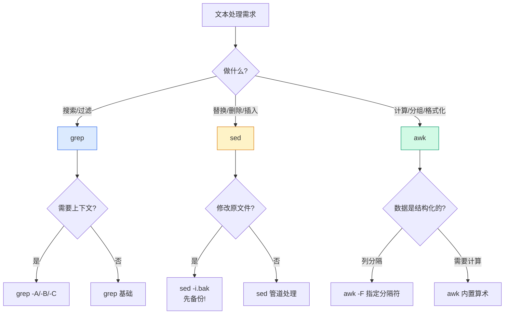

# Linux 文本处理三剑客：grep、sed、awk 实战指南

## 前言

在 Linux 运维和开发中，80% 的日常工作都围绕文本处理展开：分析日志、提取数据、批量修改配置、格式化输出。`grep`、`sed`、`awk` 这三个工具构成了文本处理的核心武器库——它们各有擅长，组合使用威力无穷。

本文不是命令手册（手册看 `man`），而是聚焦**实战场景**，帮你建立「看到问题 → 选择工具 → 写出解法」的思维链路。

!!! tip "三句话记住分工"
    -   **`grep`**：从文本中**找**出符合条件的行
    -   **`sed`**：对文本做**替换、删除、插入**操作
    -   **`awk`**：对结构化数据做**计算和格式化**

---

## grep：搜索过滤

### 基础

```bash
grep "error" app.log               # 搜索包含 error 的行
grep -i "error" app.log            # 忽略大小写
grep -v "debug" app.log            # 排除包含 debug 的行
grep -n "error" app.log            # 显示行号
grep -c "error" app.log            # 计数
grep -r "TODO" /opt/project/       # 递归搜索目录
```

### 上下文控制

```bash
grep -A 3 "error" app.log          # 显示匹配行 + 后 3 行（After）
grep -B 3 "error" app.log          # 显示匹配行 + 前 3 行（Before）
grep -C 3 "error" app.log          # 显示匹配行 + 前后各 3 行（Context）
```

### 正则表达式

```bash
grep -E "error|warning|critical" app.log    # 扩展正则（或）
grep -E "^2026-07-20" app.log              # 以日期开头
grep -E "PID: [0-9]+" app.log              # 匹配数字
grep -E "192\.168\.1\.[0-9]+" access.log   # 匹配 IP 段
grep -oE "[0-9]+\.[0-9]+\.[0-9]+\.[0-9]+" access.log | sort | uniq -c | sort -rn  # 统计 IP 访问量
```

### 高频实战

```bash
# 排除注释和空行，查看有效配置
grep -v "^#" /etc/nginx/nginx.conf | grep -v "^$"

# 查看 5xx 错误
grep -E " 50[0-9] " /var/log/nginx/access.log

# 查看最近 100 行中的错误
tail -100 /var/log/app.log | grep -i error

# 统计每个状态码的请求数
grep -oE ' [0-9]{3} ' access.log | sort | uniq -c | sort -rn
```

---

## sed：流编辑器

### 替换（最常用）

```bash
sed 's/old/new/' file.txt           # 替换每行第一个匹配
sed 's/old/new/g' file.txt          # 替换每行所有匹配
sed 's/old/new/2' file.txt          # 替换每行第二个匹配
sed 's/old/new/g' file.txt          # 打印到屏幕（不修改文件）
sed -i 's/old/new/g' file.txt       # 直接修改文件（危险！）
sed -i.bak 's/old/new/g' file.txt   # 备份后再修改（推荐）
```

### 正则替换

```bash
# 删除行首空格
sed 's/^[[:space:]]*//' file.txt

# 删除行尾空格
sed 's/[[:space:]]*$//' file.txt

# 替换 IP 地址
sed -E 's/[0-9]+\.[0-9]+\.[0-9]+\.[0-9]+/REDACTED/g' access.log

# 给行号加前缀
sed = file.txt | sed 'N;s/\n/ /'
```

### 增删改行

```bash
# 删除第 3 行
sed '3d' file.txt

# 删除 3 到 5 行
sed '3,5d' file.txt

# 删除空行
sed '/^$/d' file.txt

# 删除包含 "debug" 的行
sed '/debug/d' file.txt

# 在第 3 行后插入
sed '3a\new line' file.txt

# 在第 3 行前插入
sed '3i\new line' file.txt

# 替换第 3 行整行
sed '3c\new content' file.txt

# 打印第 5 到 10 行
sed -n '5,10p' file.txt
```

### 高频实战

```bash
# 一键修改配置文件（端口从 8080 改为 9090）
sed -i.bak 's/port=8080/port=9090/g' /etc/myapp/config.ini

# 清理 CSV 中的多余引号
sed 's/^"//;s/"$//' data.csv

# 在 Dockerfile 的 CMD 之前添加一行
sed -i '/^CMD/i RUN echo "build step"' Dockerfile

# 提取日志的第 100 到 200 行
sed -n '100,200p' /var/log/app.log
```

---

## awk：结构化数据处理

### awk 程序的三个部分

```bash
awk 'BEGIN { 初始化 } { 每行执行 } END { 结束执行 }' file.txt
```

### 字段处理

`$0` = 整行，`$1` = 第一个字段，`$2` = 第二个字段……`NF` = 字段总数，`NR` = 行号：

```bash
# 打印第 1 和第 3 列
awk '{print $1, $3}' data.txt

# 打印最后一列
awk '{print $NF}' data.txt

# 打印倒数第二列
awk '{print $(NF-1)}' data.txt

# 设置分隔符
awk -F: '{print $1, $7}' /etc/passwd          # 冒号分隔
awk -F',' '{print $2}' data.csv                # 逗号分隔
awk -F'[ ,]+' '{print $1, $2}' data.txt        # 空格或逗号分隔
```

### 条件过滤

```bash
# 第 3 列 > 100 的行
awk '$3 > 100' data.txt

# 包含 "error" 的行
awk '/error/' app.log

# 第 1 列等于 "nginx" 且第 3 列 > 5
awk '$1 == "nginx" && $3 > 5' data.txt

# 第 5 列不是空
awk '$5 != ""' data.txt
```

### 计算

```bash
# 求第 3 列的总和
awk '{sum += $3} END {print sum}' data.txt

# 求第 3 列的平均值
awk '{sum += $3; count++} END {print sum/count}' data.txt

# 找出第 3 列的最大值
awk 'max < $3 {max = $3} END {print max}' data.txt

# 按第 1 列分组求和
awk '{sum[$1] += $3} END {for (k in sum) print k, sum[k]}' data.txt
```

### 格式化输出

```bash
# 对齐打印
awk '{printf "%-20s %10s\n", $1, $2}' data.txt

# 用制表符分隔
awk -v OFS='\t' '{print $1, $2, $3}' data.txt
```

---

## 生产环境实战案例

### 案例 1：Nginx 日志分析

```bash
# 访问量 Top 10 IP
awk '{print $1}' /var/log/nginx/access.log | sort | uniq -c | sort -rn | head -10

# 状态码分布
awk '{print $9}' /var/log/nginx/access.log | sort | uniq -c | sort -rn

# 响应时间超过 1 秒的请求
awk '$NF > 1 {print $0}' /var/log/nginx/access.log

# 每个小时的请求量
awk '{print substr($4,2,14)}' access.log | cut -d: -f1 | sort | uniq -c
```

### 案例 2：从 /etc/passwd 提取信息

```bash
# 列出所有用户名
awk -F: '{print $1}' /etc/passwd

# 列出 Shell 为 /bin/bash 的用户
awk -F: '$7 == "/bin/bash" {print $1}' /etc/passwd

# UID >= 1000 的普通用户数
awk -F: '$3 >= 1000 {count++} END {print count}' /etc/passwd
```

### 案例 3：监控脚本

```bash
#!/bin/bash
# 内存使用超过 80% 告警

free -m | awk 'NR==2 {
    used=$3; total=$2;
    pct=used/total*100;
    if (pct > 80) printf "WARNING: Memory usage %.1f%%\n", pct
}'
```

### 案例 4：批量重命名

```bash
# 将所有 .JPG 改为 .jpg
ls *.JPG | sed 's/\.JPG$//' | while read name; do
    mv "${name}.JPG" "${name}.jpg"
done
```

### 案例 5：配置漂移检查

```bash
# 对比两台服务器的 nginx 配置差异（排除注释和空行）
diff <(ssh srv1 "grep -v '^#' /etc/nginx/nginx.conf | grep -v '^$'") \
     <(ssh srv2 "grep -v '^#' /etc/nginx/nginx.conf | grep -v '^$'")
```

---

## 工具选择决策树



---

## 正则表达式速查

| 模式 | 含义 | 示例 |
| --- | --- | --- |
| `^` | 行首 | `^#` 以 # 开头 |
| `$` | 行尾 | `;$` 以 ; 结尾 |
| `.` | 任意单个字符 | `h.t` 匹配 hat, hot, hit |
| `*` | 前一个字符重复 0 次或多次 | `ab*c` 匹配 ac, abc, abbc |
| `+` | 前一个字符重复 1 次或多次（需 `-E`） | `ab+c` 匹配 abc, abbc |
| `?` | 前一个字符可选（需 `-E`） | `colou?r` 匹配 color, colour |
| `[]` | 字符集 | `[0-9]` 数字，`[a-z]` 小写字母 |
| `[^]` | 排除字符集 | `[^0-9]` 非数字 |
| `\|` | 或（需 `-E`） | `error\|warning` |
| `()` | 分组（需 `-E`） | `(ab)+` 匹配 ab, abab |
| `{n,m}` | 重复 n 到 m 次（需 `-E`） | `[0-9]{2,4}` 2~4 位数字 |
| `\b` | 单词边界 | `\bword\b` 精确匹配 word |
| `\s` | 空白字符（需 `-E` 或 `[[:space:]]`） | `\s+` 一个或多个空白 |

---

## 下一步学习

| 方向 | 教程 |
| --- | --- |
| **Shell 脚本** | [Shell 基础](../shell/index.md) — 用三剑客构建自动化脚本 |
| **常用命令** | [常用命令指南](../base-system/common-commands.md) — sort/uniq/cut 等配套工具 |
| **系统监控** | [系统监控](../base-system/system-monitoring.md) — 监控脚本实战 |
| **日志管理** | [日志管理](../base-system/log-management.md) — 日志分析与清理 |

---

## 总结

文本处理三剑客是 Linux 运维的「万能瑞士军刀」：

1. **`grep`**：快速定位，`-A/-B/-C` 查看上下文，`-oE` 提取模式
2. **`sed`**：批量替换用 `-i.bak` 先备份，`/pattern/d` 删除行，`/pattern/a` 追加行
3. **`awk`**：结构化数据用 `-F` 设分隔符，`{sum+=$N}` 做计算，`END {print}` 出结果

三个工具不是竞争关系——最强大的用法是**管道串起来**：

```bash
grep "ERROR" app.log | sed 's/.*msg=//' | awk '{print $1}' | sort | uniq -c | sort -rn
```

这就是命令行之美：每个工具只做一件事，但组合起来无所不能。 🚀
