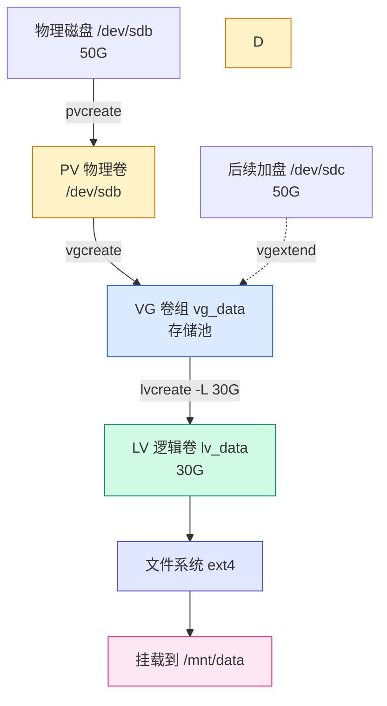

# Linux 磁盘挂载与 LVM 配置实战：从一块新硬盘到可用存储

## 前言

服务器加了一块新硬盘，或者虚拟机挂了一块数据盘——接下来怎么办？很多人的卡点在于：**能 `lsblk` 看到磁盘了，但不知道如何把它变成真正能存文件的空间。**

本文用一个贯穿始终的场景，带你走完两条路：

1. **传统方式**：分区 → 格式化 → 挂载 → 开机自动挂载
2. **LVM 方式**：物理卷（PV）→ 卷组（VG）→ 逻辑卷（LV）→ 格式化 → 挂载 → 在线扩容

读完你可以直接照抄命令，把一块裸盘变成可用存储，并且理解每一步在做什么、为什么这么做。

!!! tip "先记一条主线"
    一块磁盘要能存文件，必须依次经过四个环节：**识别 → 分区（可选）→ 创建文件系统 → 挂载**。LVM 并不是什么魔法，它只是把「分区」这一层换成了一套更灵活的抽象（PV/VG/LV）。

---

## 场景与准备

贯穿全文的场景：

| 项目 | 值 |
|------|-----|
| 新磁盘 | `/dev/sdb`（50 GiB，虚拟机数据盘） |
| 挂载点 | `/mnt/data` |
| 文件系统 | ext4（Debian 默认自带；XFS 需另装 xfsprogs） |
| 目标 | 把磁盘挂到 `/mnt/data`，并且以后能随时扩容 |

!!! warning "动手前先确认磁盘没有数据"
    下面出现的 `fdisk`、`mkfs`、`pvcreate` 都会**改写或清空磁盘数据**。操作前务必用 `lsblk` 确认 `/dev/sdb` 就是你要操作的新盘，**千万别把系统盘 `/dev/sda` 给格式化掉**。生产环境建议先在测试机或虚拟机里走一遍流程。

---

## 第一步：识别磁盘

新盘插上后，先确认内核有没有识别到它：

```bash
# 树形查看所有块设备（最推荐）
lsblk
```

```
NAME                    MAJ:MIN RM  SIZE RO TYPE MOUNTPOINTS
sda                       8:0    0   30G  0 disk
├─sda1                    8:1    0  976M  0 part /boot/efi
├─sda2                    8:2    0  977M  0 part /boot
└─sda3                    8:3    0 28.1G  0 part
  ├─k8s--nfs--vg-root   254:0    0 26.6G  0 lvm  /
  └─k8s--nfs--vg-swap_1 254:1    0  1.5G  0 lvm  [SWAP]
sdb                       8:16   0   50G  0 disk   ← 新盘：没有任何分区、没挂载
sr0                      11:0    1 1024M  0 rom
```

对比 `/dev/sda`（系统盘，下面还挂着 `k8s--nfs--vg-root`、`k8s--nfs--vg-swap_1` 两个 LVM 逻辑卷），`/dev/sdb` 没有任何子项，说明它是一块**完全空白的新盘**。顺带注意：这台机器的系统盘已经用上了 LVM——这正是本文后半段「方式二」要讲的内容。

再看分区表详情：

```bash
sudo fdisk -l /dev/sdb
```

```
Disk /dev/sdb: 50 GiB, 53687091200 bytes, 104857600 sectors
Disk model: Virtual disk
Units: sectors of 1 * 512 = 512 bytes
Sector size (logical/physical): 512 bytes / 512 bytes
I/O size (minimum/optimal): 512 bytes / 512 bytes
```

!!! note "设备命名规则速记"
    - SATA/SCSI/虚拟机硬盘：`/dev/sda`、`/dev/sdb`、`/dev/sdc`…
    - NVMe SSD：`/dev/nvme0n1`，其分区是 `/dev/nvme0n1p1`
    - 虚拟机 virtio 盘：`/dev/vda`、`/dev/vdb`…
    如果你的环境里盘符不同，把下文的 `/dev/sdb` 替换成实际盘符即可。

---

## 方式一：传统挂载（分区 → 文件系统 → 挂载）

这是最经典、最简单的方式，适合「这块盘就当个固定大小的数据盘用」的场景。

### Step 1：用 fdisk 分区

```bash
sudo fdisk /dev/sdb
```

在 util-linux 2.41（Debian 13 自带版本）下，对一块**没有分区表的新盘**运行 fdisk，它会先自动创建一张 DOS（MBR）分区表：

```
Welcome to fdisk (util-linux 2.41).
Changes will remain in memory only, until you decide to write them.
Be careful before using the write command.

Device does not contain a recognized partition table.
Created a new DOS (MBR) disklabel with disk identifier 0xa91ddc1e.

Command (m for help):
```

然后按提示依次输入，新建一个用满整块盘的主分区：

```text
Command (m for help): n          ← n = new，新建分区
Partition type
   p   primary (0 primary, 0 extended, 4 free)
   e   extended
Select (default p): p            ← 主分区
Partition number (1-4, default 1): 1   ← 分区号 1
First sector (2048-104857599, default 2048): 直接回车  ← 用默认起始扇区
Last sector, +/-sectors or +/-size{K,M,G,T,P} (2048-104857599, default 104857599): 直接回车  ← 用满整块盘
Created a new partition 1 of type 'Linux' and of size 50 GiB.

Command (m for help): w          ← w = write，写入分区表并退出
The partition table has been altered.
```

几个关键点：

- `n` 新建分区，`p` 选主分区，`w` 是「写入并退出」。中途想放弃，输入 `q` 不保存退出（退出时会问 `All unwritten changes will be lost, do you really want to quit?`，回答 `y` 放弃）。
- 两次「直接回车」表示接受默认值——起始扇区自动对齐，结束扇区用满整块盘。
- 分区后得到设备文件 `/dev/sdb1`。

!!! note "超过 2 TB 的磁盘要用 GPT"
    MBR 分区表（fdisk 默认）最多支持 2 TB。更大的盘在 fdisk 里先输入 `g` 创建 GPT 分区表，或者直接用下方的 parted 一步到位（本次实验实际走的就是 parted + GPT）。

确认分区已生效：

```bash
lsblk /dev/sdb
```

```
NAME   MAJ:MIN RM  SIZE RO TYPE MOUNTPOINT
sdb      8:16   0   50G  0 disk
└─sdb1   8:17   0   50G  0 part        ← 分区出现
```

> 如果内核没有立即识别新分区，执行 `sudo partprobe /dev/sdb` 刷新一下。

### 备选：用 parted 分区（非交互、支持 GPT 大盘）

!!! note "Debian 13 默认没装 parted"
    本次实验第一次跑 `parted` 时直接报 `command not found`，需要先装：

    ```bash
    sudo apt install -y parted
    ```

    会一并装上依赖 `libparted2t64`，装完即可用。

除了 fdisk，Linux 还有另一个常用分区工具 **parted**。它和 fdisk 的区别：

| 对比 | fdisk | parted |
| --- | --- | --- |
| 分区表 | MBR 为主（`g` 切 GPT） | 默认即支持 GPT，MBR/GPT 都行 |
| 交互方式 | 纯交互问答 | 交互 + `-s` 非交互一行命令 |
| 大磁盘（>2TB） | 需手动 `g` 建 GPT | `mklabel gpt` 一步到位 |
| 脚本化 | 较麻烦 | 友好，适合自动化 |

**方式一：非交互一行命令**（推荐，适合写脚本）：

```bash
# 创建 GPT 分区表
sudo parted -s /dev/sdb mklabel gpt

# 用满整块盘建一个 primary 分区
sudo parted -s /dev/sdb mkpart primary 0% 100%

# 查看结果
sudo parted /dev/sdb print
```

```
Model: VMware Virtual disk (scsi)
Disk /dev/sdb: 53.7GB
Sector size (logical/physical): 512B/512B
Partition Table: gpt
Disk Flags:

Number  Start   End     Size    File system  Name     Flags
 1      1049kB  53.7GB  53.7GB               primary
```

**方式二：交互模式**：

```bash
sudo parted /dev/sdb
```

```
GNU Parted 3.6
Using /dev/sdb
Welcome to GNU Parted! Type 'help' to view a list of commands.
(parted) mklabel gpt                       ← 建 GPT 分区表
(parted) mkpart primary 0% 100%            ← 用满整块盘
(parted) print                             ← 查看
(parted) quit                              ← 退出并保存
Information: You may need to update /etc/fstab.
```

几个关键点：

- `mklabel` 决定分区表类型：`mklabel gpt`（GPT）或 `mklabel msdos`（MBR）。
- `mkpart` 的起止位置支持 `0%`、`100%`、`1MiB`、`50GiB` 等多种写法；parted 会自动做 I/O 对齐。
- 输出里的 `Disk /dev/sdb: 53.7GB` 是 50 GiB 按十进制（GB）的另一种表示，和 `lsblk` 里的 50G 是同一块盘。
- `-s` 表示非交互（script），命令失败会直接报错退出，不会卡在问答里，特别适合 CI/自动化脚本。
- 分区完成后同样用 `lsblk /dev/sdb` 或 `partprobe /dev/sdb` 确认内核已识别。

!!! tip "fdisk 和 parted 选哪个"
    日常手动操作两个都能用：习惯交互问答就 fdisk，要处理 **2TB 以上的大盘**、或要在脚本里**非交互地分区**，直接 parted。

### Step 2：创建文件系统（格式化）

分区只是把磁盘切出一块区域，**这块区域里还没有任何数据结构**，所以还存不了文件。创建文件系统：

```bash
# ext4：最通用，Debian 默认自带
sudo mkfs.ext4 /dev/sdb1
```

!!! note "想用 XFS？先装 xfsprogs"
    本次实验第一次跑 `mkfs.xfs` 时报 `command not found`——Debian 13 默认没装 XFS 工具链。需要的话先执行：

    ```bash
    sudo apt install -y xfsprogs
    sudo mkfs.xfs /dev/sdb1
    ```

    本文示例统一用 ext4，避免额外安装依赖。

```
mke2fs 1.47.2 (1-Jan-2025)
Creating filesystem with 13106688 4k blocks and 3276800 inodes
Filesystem UUID: 66080918-98ef-4b14-bf22-2c067f6d0c40
Superblock backups stored on blocks:
        32768, 98304, 163840, 229376, 294912, 819200, 884736, 1605632, 2654208,
        4096000, 7962624, 11239424

Allocating group tables: done
Writing inode tables: done
Creating journal (65536 blocks): done
Writing superblocks and filesystem accounting information: done
```

看到 `Writing superblocks ... done` 就说明格式化成功。记住这里输出的 `UUID`（`66080918-...`），Step 4 写 fstab 要用。

### Step 3：挂载

挂载 = 把这个文件系统「挂」到目录树的某个目录（挂载点）上，之后读写该目录就等于读写这块盘：

```bash
# 1. 创建挂载点（一个空目录）
sudo mkdir -p /mnt/data

# 2. 挂载
sudo mount /dev/sdb1 /mnt/data

# 3. 验证
df -h /mnt/data
```

```
Filesystem      Size  Used Avail Use% Mounted on
/dev/sdb1        49G   24K   47G   1% /mnt/data
```

现在往 `/mnt/data` 里写文件，数据就落在 `/dev/sdb1` 上了。

### Step 4：写入 fstab 实现开机自动挂载

上面的 `mount` 是**临时**的——重启后就没了。要开机自动挂载，需要写入 `/etc/fstab`。

先用 `blkid` 拿到分区的 UUID（推荐用 UUID 而不是设备路径，因为盘符可能因插拔顺序变化而漂移）：

```bash
sudo blkid /dev/sdb1
```

```
/dev/sdb1: UUID="66080918-98ef-4b14-bf22-2c067f6d0c40" TYPE="ext4" PARTUUID="..."
```

把这一行追加到 `/etc/fstab`：

```bash
echo 'UUID=66080918-98ef-4b14-bf22-2c067f6d0c40 /mnt/data ext4 defaults 0 2' | sudo tee -a /etc/fstab
```

fstab 每行 6 个字段，含义如下：

| 字段 | 含义 | 本例取值 |
| :---: | --- | --- |
| 1 | 设备（路径或 UUID） | `UUID=66080918-...` |
| 2 | 挂载点 | `/mnt/data` |
| 3 | 文件系统类型 | `ext4` |
| 4 | 挂载选项 | `defaults` |
| 5 | 是否 dump 备份（几乎不用） | `0` |
| 6 | 开机 fsck 检查顺序 | `2`（根分区是 1，数据盘 2，swap 是 0） |

!!! warning "改完 fstab 一定要先测试再重启"
    如果 fstab 写错了，机器可能**无法正常启动**（卡在 emergency mode）。所以改完先执行下面这条验证，能通过再放心重启：
    ```bash
    sudo mount -a
    df -h /mnt/data
    ```
    如果 `mount -a` 没报错，说明 fstab 配置正确。

### Step 5：验证与卸载

```bash
# 卸载（注意是 umount，不是 unmount）
sudo umount /mnt/data

# 卸载后目录重新变回普通空目录
df -h /mnt/data        # 不再显示 /dev/sdb1

# 测试 fstab 是否真的能自动挂载
sudo mount -a
df -h /mnt/data        # 又回来了
```

---

## 方式二：LVM（PV → VG → LV）

传统分区有一个死穴：**大小定死了**。分区划了 50G，以后想扩就非常麻烦。LVM 通过加一层抽象解决这个问题——先建「存储池」，再从池子里随时切出、随时扩容。

### LVM 是什么

LVM 把磁盘管理抽象成三个概念：

| 概念 | 全称 | 比喻 | 命令 |
|------|------|------|------|
| **PV** | Physical Volume 物理卷 | 一块砖 | `pvcreate` |
| **VG** | Volume Group 卷组 | 一堆砖垒成的砖堆（存储池） | `vgcreate` |
| **LV** | Logical Volume 逻辑卷 | 从砖堆里切出的一块空间 | `lvcreate` |

三者关系一张图看明白：



关键好处：LV 不够用时，只要 VG 池里还有空间，一条命令就能**在线扩容**，不用停机、不用搬数据。

### Step 1：创建 PV

把整块磁盘标记为 LVM 物理卷（**不需要先分区**，LVM 可以直接用整块盘）：

```bash
sudo pvcreate /dev/sdb
```

```
  Physical volume "/dev/sdb" successfully created.
```

查看：

```bash
sudo pvs
```

```
  PV         VG     Fmt  Attr PSize   PFree
  /dev/sdb          lvm2 ---  50.00g 50.00g
```

### Step 2：创建 VG

把 PV 装进一个卷组（存储池）：

```bash
sudo vgcreate vg_data /dev/sdb
```

```
  Volume group "vg_data" successfully created
```

```bash
sudo vgs
```

```
  VG      #PV #LV #SN Attr   VSize   VFree
  vg_data   1   0   0 wz--n- 50.00g 50.00g
```

### Step 3：创建 LV

从 VG 里切出 30G 逻辑卷（**故意只切 30G，留下 20G 待会儿演示扩容**）：

```bash
sudo lvcreate -L 30G -n lv_data vg_data
```

```
  Logical volume "lv_data" created.
```

```bash
sudo lvs
```

```
  LV      VG      Attr       LSize  Pool Origin Data%  Meta%
  lv_data vg_data -wi-a----- 30.00g
```

逻辑卷的设备路径有两种写法，完全等价：

- `/dev/vg_data/lv_data`（`卷组名/逻辑卷名`，直观）
- `/dev/mapper/vg_data-lv_data`（内核映射路径）

### Step 4：格式化并挂载 LV

```bash
# 创建文件系统（ext4，Debian 默认自带；XFS 需另装 xfsprogs）
sudo mkfs.ext4 /dev/vg_data/lv_data

# 建挂载点并挂载
sudo mkdir -p /mnt/data
sudo mount /dev/vg_data/lv_data /mnt/data

df -h /mnt/data
```

```
Filesystem                 Size  Used Avail Use% Mounted on
/dev/mapper/vg_data-lv_data   30G  390M   30G   1% /mnt/data
```

### Step 5：写入 fstab 持久化

和传统方式一样，写入 `/etc/fstab` 实现开机自动挂载。LVM 场景下直接用设备路径更直观：

```bash
echo '/dev/vg_data/lv_data /mnt/data ext4 defaults 0 2' | sudo tee -a /etc/fstab

# 测试 fstab 是否正确
sudo mount -a
df -h /mnt/data
```

### Step 6：在线扩容（LVM 的核心价值）

场景：`lv_data`（30G）快满了，而 `vg_data` 池里还有 20G 空闲。

```bash
# 1. LV 扩容 20G（在线执行，无需卸载）
sudo lvextend -L +20G /dev/vg_data/lv_data

# 2. 文件系统同步扩大（ext4 用 resize2fs，在线执行）
sudo resize2fs /dev/vg_data/lv_data
# 如果是 XFS，则用（需要已挂载，传挂载点即可）：
# sudo xfs_growfs /mnt/data

df -h /mnt/data
```

```
Filesystem                 Size  Used Avail Use% Mounted on
/dev/mapper/vg_data-lv_data   50G  390M   50G   1% /mnt/data
```

30G → 50G，全程在线、数据无损。

**如果 VG 池里也没空间了怎么办？** 加一块新盘，把它并入卷组即可：

```bash
# 假设又插了一块 /dev/sdc
sudo pvcreate /dev/sdc
sudo vgextend vg_data /dev/sdc

# 现在池子变大了，继续扩 LV
sudo lvextend -L +50G /dev/vg_data/lv_data
sudo resize2fs /dev/vg_data/lv_data
```

!!! tip "LVM 公式速记"
    ```
    PV（砖块）：pvcreate /dev/sdX
    VG（砖堆）：vgcreate vg_name /dev/sdX
    LV（切一块）：lvcreate -L 10G -n lv_name vg_name
    扩容：lvextend + resize2fs（ext4）/ xfs_growfs（xfs）
    加盘：pvcreate + vgextend
    ```

---

## 两种方式对比

| 维度 | 传统分区挂载 | LVM |
|------|------------|-----|
| 灵活扩容 | ❌ 困难，基本要重做分区 | ✅ 一条命令在线扩容 |
| 跨多块磁盘合并 | ❌ 不支持 | ✅ 多个 PV 并入一个 VG |
| 快照 | ❌ 不支持 | ✅ 支持 |
| 学习成本 | 低 | 略高 |
| 适用场景 | 固定大小数据盘、系统盘 | 需要弹性扩容的数据盘、数据库盘 |

一句话总结：**一次性、固定大小的盘用传统分区就够了；会持续增长、需要弹性的数据盘，直接上 LVM。**

---

## 常见问题排查

### 1. `mount: wrong fs type, bad option, bad superblock...`

**原因**：忘了格式化（`mkfs`），或者文件系统类型和实际不符。

**排查**：

```bash
sudo blkid /dev/sdb1        # 看 TYPE 是什么
sudo mkfs.ext4 /dev/sdb1    # 没格式化就补上
sudo mount -t ext4 /dev/sdb1 /mnt/data   # 类型不符时显式指定
```

### 2. 改完 fstab 后重启进不了系统（emergency mode）

**原因**：fstab 写错（UUID 抄错、路径不存在、格式不对）。

**解决**：进入 emergency mode 后，编辑 `/etc/fstab` 删掉/修正那一行，或给它加上 `nofail` 选项：

```
UUID=xxx /mnt/data ext4 defaults,nofail 0 2
```

`nofail` 表示「这块盘挂载失败也不阻止系统启动」。**预防手段**永远是：改完先 `sudo mount -a` 验证。

### 3. `umount: target is busy`

**原因**：有进程正在占用挂载点（比如你的 shell 正好 `cd` 在里面）。

```bash
# 看谁在占用
sudo lsof /mnt/data
# 或强制踢掉占用进程后卸载
sudo fuser -km /mnt/data && sudo umount /mnt/data
```

### 4. 2 TB 以上的盘，fdisk 只识别到 2 TB

**原因**：MBR 分区表上限 2 TB。用 GPT：

```bash
sudo fdisk /dev/sdb    # 进去后输入 g，再按正常流程 n → w
# 或
sudo parted /dev/sdb mklabel gpt mkpart primary 0% 100%
```

### 5. XFS 无法缩容

XFS 只支持扩容、**不支持缩容**。需要缩容的 LV，请用 ext4，或提前规划好大小。缩容是危险操作，务必先备份。

---

## 相关阅读

- [Linux 存储管理](storage.md) — 分区表详解、swap 交换空间、磁盘配额
- [LVM 进阶实战](lvm-practice.md) — LVM 快照、缩容、磁盘替换与灾难恢复
- [Linux 文件系统原理](filesystem-internals.md) — inode、ext4 与 XFS 内部机制
- [NFS 服务安装（Debian 13）](nfs-server-debian13.md) — 把本地目录导出成网络文件系统，跨主机共享存储
