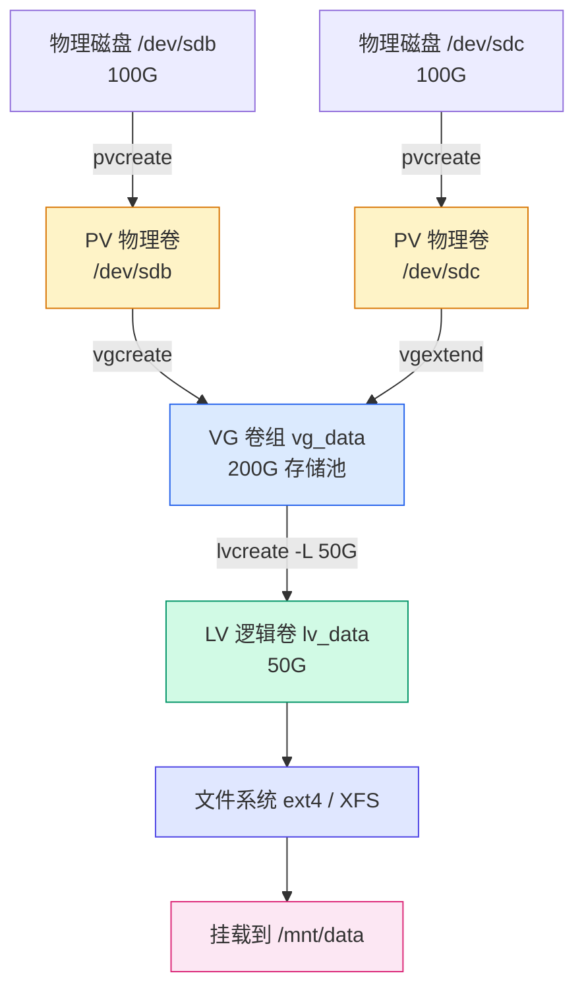

# Linux 磁盘挂载与 LVM 配置实战：从一块新硬盘到可用存储

## 前言

服务器加了一块新硬盘，或者虚拟机挂了一块数据盘——接下来怎么办？很多人的卡点在于：**能 `lsblk` 看到磁盘了，但不知道如何把它变成真正能存文件的空间。**

本文用一个贯穿始终的场景，带你走完两条路：

1. **传统方式**：分区 → 格式化 → 挂载 → 开机自动挂载
2. **LVM 方式**：物理卷（PV）→ 卷组（VG）→ 逻辑卷（LV）→ 格式化 → 挂载 → 在线扩容

读完你可以直接照抄命令，把一块裸盘变成可用存储，并且理解每一步在做什么、为什么这么做。

!!! tip "先记一条主线"
    一块磁盘要能存文件，必须依次经过四个环节：**识别 → 分区（可选）→ 创建文件系统 → 挂载**。LVM 并不是什么魔法，它只是把「分区」这一层换成了一套更灵活的抽象（PV/VG/LV）。

---

## 场景与准备

贯穿全文的场景：

| 项目 | 值 |
|------|-----|
| 新磁盘 | `/dev/sdb`（100 GB，虚拟机数据盘） |
| 挂载点 | `/mnt/data` |
| 文件系统 | 传统方式用 ext4，LVM 方式用 XFS |
| 目标 | 把磁盘挂到 `/mnt/data`，并且以后能随时扩容 |

!!! warning "动手前先确认磁盘没有数据"
    下面出现的 `fdisk`、`mkfs`、`pvcreate` 都会**改写或清空磁盘数据**。操作前务必用 `lsblk` 确认 `/dev/sdb` 就是你要操作的新盘，**千万别把系统盘 `/dev/sda` 给格式化掉**。生产环境建议先在测试机或虚拟机里走一遍流程。

---

## 第一步：识别磁盘

新盘插上后，先确认内核有没有识别到它：

```bash
# 树形查看所有块设备（最推荐）
lsblk
```

```
NAME        MAJ:MIN RM   SIZE RO TYPE MOUNTPOINT
sda           8:0    0   100G  0 disk
├─sda1        8:1    0     1G  0 part /boot
├─sda2        8:2    0    50G  0 part /
└─sda3        8:3    0    49G  0 part /home
sdb           8:16   0   100G  0 disk          ← 新盘：没有任何分区、没挂载
```

对比 `/dev/sda`（系统盘，下面挂着 sda1/sda2/sda3 三个分区），`/dev/sdb` 没有任何子项，说明它是一块**完全空白的新盘**。

再看分区表详情：

```bash
sudo fdisk -l /dev/sdb
```

```
Disk /dev/sdb: 100 GiB, 107374182400 bytes, 209715200 sectors
Units: sectors of 1 * 512 = 512 bytes
Disklabel type: dos            ← 空盘还没有分区表（或显示 dos/gpt）
```

!!! note "设备命名规则速记"
    - SATA/SCSI/虚拟机硬盘：`/dev/sda`、`/dev/sdb`、`/dev/sdc`…
    - NVMe SSD：`/dev/nvme0n1`，其分区是 `/dev/nvme0n1p1`
    - 虚拟机 virtio 盘：`/dev/vda`、`/dev/vdb`…
    如果你的环境里盘符不同，把下文的 `/dev/sdb` 替换成实际盘符即可。

---

## 方式一：传统挂载（分区 → 文件系统 → 挂载）

这是最经典、最简单的方式，适合「这块盘就当个固定大小的数据盘用」的场景。

### Step 1：用 fdisk 分区

```text
sudo fdisk /dev/sdb
```

fdisk 是交互式的，依次输入：

```text
Command (m for help): n          ← n = new，新建分区
Partition type
   p   primary (0 primary, 0 extended, 4 free)
   e   extended
Select (default p): p            ← 主分区
Partition number (1-4, default 1): 1   ← 分区号 1
First sector (2048-209715199, default 2048): 直接回车  ← 用默认起始扇区
Last sector, +/-sectors or +/-size{K,M,G,T,P} (2048-209715199, default 209715199): 直接回车  ← 用满整块盘
Created a new partition 1 of type 'Linux' and of size 100 GiB.

Command (m for help): w          ← w = write，写入分区表并退出
The partition table has been altered.
```

几个关键点：

- `n` 新建分区，`p` 选主分区，`w` 是「写入并退出」。中途想放弃，输入 `q` 不保存退出。
- 两次「直接回车」表示接受默认值——起始扇区自动对齐，结束扇区用满整块盘。
- 分区后得到设备文件 `/dev/sdb1`。

!!! note "超过 2 TB 的磁盘要用 GPT"
    MBR 分区表（fdisk 默认）最多支持 2 TB。更大的盘在 fdisk 里先输入 `g` 创建 GPT 分区表，或者直接用 parted 一步到位：
    ```bash
    sudo parted /dev/sdb mklabel gpt mkpart primary 0% 100%
    ```

确认分区已生效：

```bash
lsblk /dev/sdb
```

```
NAME   MAJ:MIN RM  SIZE RO TYPE MOUNTPOINT
sdb      8:16   0  100G  0 disk
└─sdb1   8:17   0  100G  0 part        ← 分区出现
```

> 如果内核没有立即识别新分区，执行 `sudo partprobe /dev/sdb` 刷新一下。

### Step 2：创建文件系统（格式化）

分区只是把磁盘切出一块区域，**这块区域里还没有任何数据结构**，所以还存不了文件。创建文件系统：

```bash
# ext4：最通用，兼容性最好
sudo mkfs.ext4 /dev/sdb1

# 或 XFS：大文件、大容量场景表现更好（下面 LVM 部分会用它）
sudo mkfs.xfs /dev/sdb1
```

```
mke2fs 1.47.0 (5-Feb-2023)
Creating filesystem with 26214400 4k blocks and 6553600 inodes
...
Writing superblocks and filesystem accounting information: done
```

看到 `Writing superblocks ... done` 就说明格式化成功。

### Step 3：挂载

挂载 = 把这个文件系统「挂」到目录树的某个目录（挂载点）上，之后读写该目录就等于读写这块盘：

```bash
# 1. 创建挂载点（一个空目录）
sudo mkdir -p /mnt/data

# 2. 挂载
sudo mount /dev/sdb1 /mnt/data

# 3. 验证
df -h /mnt/data
```

```
Filesystem      Size  Used Avail Use% Mounted on
/dev/sdb1        98G   24K   93G   1% /mnt/data
```

现在往 `/mnt/data` 里写文件，数据就落在 `/dev/sdb1` 上了。

### Step 4：写入 fstab 实现开机自动挂载

上面的 `mount` 是**临时**的——重启后就没了。要开机自动挂载，需要写入 `/etc/fstab`。

先用 `blkid` 拿到分区的 UUID（推荐用 UUID 而不是设备路径，因为盘符可能因插拔顺序变化而漂移）：

```bash
sudo blkid /dev/sdb1
```

```
/dev/sdb1: UUID="a1b2c3d4-5678-4e9f-8b1a-2c3d4e5f6a7b" TYPE="ext4" PARTUUID="..."
```

把这一行追加到 `/etc/fstab`：

```bash
echo 'UUID=a1b2c3d4-5678-4e9f-8b1a-2c3d4e5f6a7b /mnt/data ext4 defaults 0 2' | sudo tee -a /etc/fstab
```

fstab 每行 6 个字段，含义如下：

| 字段 | 含义 | 本例取值 |
| :---: | --- | --- |
| 1 | 设备（路径或 UUID） | `UUID=a1b2c3d4-...` |
| 2 | 挂载点 | `/mnt/data` |
| 3 | 文件系统类型 | `ext4` |
| 4 | 挂载选项 | `defaults` |
| 5 | 是否 dump 备份（几乎不用） | `0` |
| 6 | 开机 fsck 检查顺序 | `2`（根分区是 1，数据盘 2，swap 是 0） |

!!! warning "改完 fstab 一定要先测试再重启"
    如果 fstab 写错了，机器可能**无法正常启动**（卡在 emergency mode）。所以改完先执行下面这条验证，能通过再放心重启：
    ```bash
    sudo mount -a
    df -h /mnt/data
    ```
    如果 `mount -a` 没报错，说明 fstab 配置正确。

### Step 5：验证与卸载

```bash
# 卸载（注意是 umount，不是 unmount）
sudo umount /mnt/data

# 卸载后目录重新变回普通空目录
df -h /mnt/data        # 不再显示 /dev/sdb1

# 测试 fstab 是否真的能自动挂载
sudo mount -a
df -h /mnt/data        # 又回来了
```

---

## 方式二：LVM（PV → VG → LV）

传统分区有一个死穴：**大小定死了**。分区划了 100G，以后想扩到 200G 就非常麻烦。LVM 通过加一层抽象解决这个问题——先建「存储池」，再从池子里随时切出、随时扩容。

### LVM 是什么

LVM 把磁盘管理抽象成三个概念：

| 概念 | 全称 | 比喻 | 命令 |
|------|------|------|------|
| **PV** | Physical Volume 物理卷 | 一块砖 | `pvcreate` |
| **VG** | Volume Group 卷组 | 一堆砖垒成的砖堆（存储池） | `vgcreate` |
| **LV** | Logical Volume 逻辑卷 | 从砖堆里切出的一块空间 | `lvcreate` |

三者关系一张图看明白：



关键好处：LV 不够用时，只要 VG 池里还有空间，一条命令就能**在线扩容**，不用停机、不用搬数据。

### Step 1：创建 PV

把整块磁盘标记为 LVM 物理卷（**不需要先分区**，LVM 可以直接用整块盘）：

```bash
sudo pvcreate /dev/sdb
```

```
  Physical volume "/dev/sdb" successfully created.
```

查看：

```bash
sudo pvs
```

```
  PV         VG     Fmt  Attr PSize   PFree
  /dev/sdb          lvm2 ---  100.00g 100.00g
```

### Step 2：创建 VG

把 PV 装进一个卷组（存储池）：

```bash
sudo vgcreate vg_data /dev/sdb
```

```
  Volume group "vg_data" successfully created
```

```bash
sudo vgs
```

```
  VG      #PV #LV #SN Attr   VSize   VFree
  vg_data   1   0   0 wz--n- 100.00g 100.00g
```

### Step 3：创建 LV

从 VG 里切出 50G 逻辑卷（**故意只切 50G，留下 50G 待会儿演示扩容**）：

```bash
sudo lvcreate -L 50G -n lv_data vg_data
```

```
  Logical volume "lv_data" created.
```

```bash
sudo lvs
```

```
  LV      VG      Attr       LSize  Pool Origin Data%  Meta%
  lv_data vg_data -wi-a----- 50.00g
```

逻辑卷的设备路径有两种写法，完全等价：

- `/dev/vg_data/lv_data`（`卷组名/逻辑卷名`，直观）
- `/dev/mapper/vg_data-lv_data`（内核映射路径）

### Step 4：格式化并挂载 LV

```bash
# 创建文件系统（这次用 XFS）
sudo mkfs.xfs /dev/vg_data/lv_data

# 建挂载点并挂载
sudo mkdir -p /mnt/data
sudo mount /dev/vg_data/lv_data /mnt/data

df -h /mnt/data
```

```
Filesystem                 Size  Used Avail Use% Mounted on
/dev/mapper/vg_data-lv_data   50G  390M   50G   1% /mnt/data
```

### Step 5：写入 fstab 持久化

和传统方式一样，写入 `/etc/fstab` 实现开机自动挂载。LVM 场景下直接用设备路径更直观：

```bash
echo '/dev/vg_data/lv_data /mnt/data xfs defaults 0 2' | sudo tee -a /etc/fstab

# 测试 fstab 是否正确
sudo mount -a
df -h /mnt/data
```

### Step 6：在线扩容（LVM 的核心价值）

场景：`lv_data`（50G）快满了，而 `vg_data` 池里还有 50G 空闲。

```bash
# 1. LV 扩容 20G（在线执行，无需卸载）
sudo lvextend -L +20G /dev/vg_data/lv_data

# 2. 文件系统同步扩大
# XFS 用 xfs_growfs（需要已挂载，传挂载点即可）
sudo xfs_growfs /mnt/data
# ext4 则用 resize2fs（在线执行）：
# sudo resize2fs /dev/vg_data/lv_data

df -h /mnt/data
```

```
Filesystem                 Size  Used Avail Use% Mounted on
/dev/mapper/vg_data-lv_data   70G  390M   70G   1% /mnt/data
```

50G → 70G，全程在线、数据无损。

**如果 VG 池里也没空间了怎么办？** 加一块新盘，把它并入卷组即可：

```bash
# 假设又插了一块 /dev/sdc
sudo pvcreate /dev/sdc
sudo vgextend vg_data /dev/sdc

# 现在池子变大了，继续扩 LV
sudo lvextend -L +50G /dev/vg_data/lv_data
sudo xfs_growfs /mnt/data
```

!!! tip "LVM 公式速记"
    ```
    PV（砖块）：pvcreate /dev/sdX
    VG（砖堆）：vgcreate vg_name /dev/sdX
    LV（切一块）：lvcreate -L 10G -n lv_name vg_name
    扩容：lvextend + resize2fs（ext4）/ xfs_growfs（xfs）
    加盘：pvcreate + vgextend
    ```

---

## 两种方式对比

| 维度 | 传统分区挂载 | LVM |
|------|------------|-----|
| 灵活扩容 | ❌ 困难，基本要重做分区 | ✅ 一条命令在线扩容 |
| 跨多块磁盘合并 | ❌ 不支持 | ✅ 多个 PV 并入一个 VG |
| 快照 | ❌ 不支持 | ✅ 支持 |
| 学习成本 | 低 | 略高 |
| 适用场景 | 固定大小数据盘、系统盘 | 需要弹性扩容的数据盘、数据库盘 |

一句话总结：**一次性、固定大小的盘用传统分区就够了；会持续增长、需要弹性的数据盘，直接上 LVM。**

---

## 常见问题排查

### 1. `mount: wrong fs type, bad option, bad superblock...`

**原因**：忘了格式化（`mkfs`），或者文件系统类型和实际不符。

**排查**：

```bash
sudo blkid /dev/sdb1        # 看 TYPE 是什么
sudo mkfs.ext4 /dev/sdb1    # 没格式化就补上
sudo mount -t ext4 /dev/sdb1 /mnt/data   # 类型不符时显式指定
```

### 2. 改完 fstab 后重启进不了系统（emergency mode）

**原因**：fstab 写错（UUID 抄错、路径不存在、格式不对）。

**解决**：进入 emergency mode 后，编辑 `/etc/fstab` 删掉/修正那一行，或给它加上 `nofail` 选项：

```
UUID=xxx /mnt/data ext4 defaults,nofail 0 2
```

`nofail` 表示「这块盘挂载失败也不阻止系统启动」。**预防手段**永远是：改完先 `sudo mount -a` 验证。

### 3. `umount: target is busy`

**原因**：有进程正在占用挂载点（比如你的 shell 正好 `cd` 在里面）。

```bash
# 看谁在占用
sudo lsof /mnt/data
# 或强制踢掉占用进程后卸载
sudo fuser -km /mnt/data && sudo umount /mnt/data
```

### 4. 2 TB 以上的盘，fdisk 只识别到 2 TB

**原因**：MBR 分区表上限 2 TB。用 GPT：

```bash
sudo fdisk /dev/sdb    # 进去后输入 g，再按正常流程 n → w
# 或
sudo parted /dev/sdb mklabel gpt mkpart primary 0% 100%
```

### 5. XFS 无法缩容

XFS 只支持扩容、**不支持缩容**。需要缩容的 LV，请用 ext4，或提前规划好大小。缩容是危险操作，务必先备份。

---

## 相关阅读

- [Linux 存储管理](storage.md) — 分区表详解、swap 交换空间、磁盘配额
- [LVM 进阶实战](lvm-practice.md) — LVM 快照、缩容、磁盘替换与灾难恢复
- [Linux 文件系统原理](filesystem-internals.md) — inode、ext4 与 XFS 内部机制
