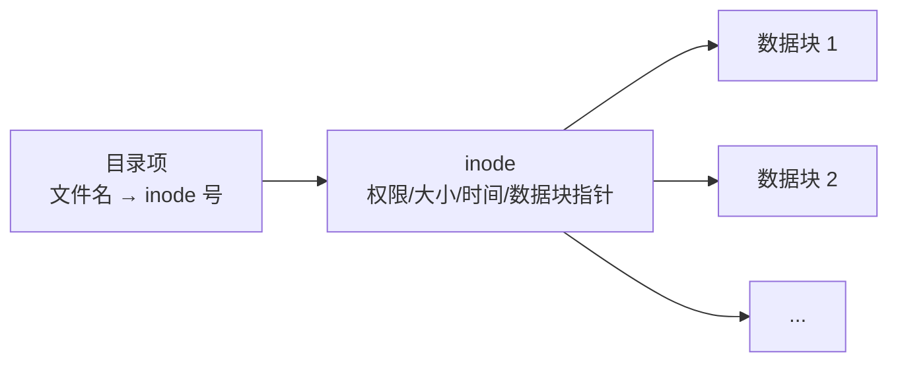
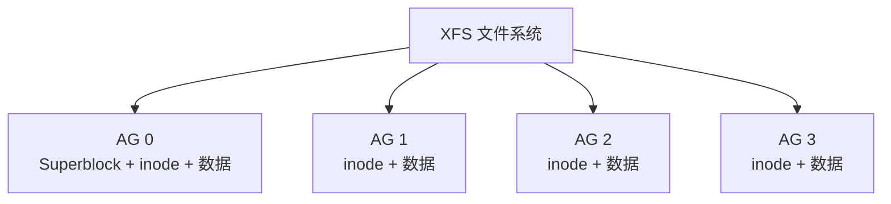

# Linux 文件系统原理：inode、ext4 与 XFS 深入解析

## 前言

很多人知道 `df -i` 可以看 inode 使用率，但 inode 到底是什么？ext4 和 XFS 都是日志文件系统，它们有什么本质不同？本文从 inode 讲起，拆解 ext4 和 XFS 的内部架构，帮你理解文件系统到底在磁盘上做了什么。

---

## inode：文件系统的基石

### inode 是什么？

在 Linux 中，**文件名不是文件的唯一标识**——inode 才是。inode 存储了文件的所有元数据：



| inode 存储的信息 | 不在 inode 中的 |
| --- | --- |
| 文件类型和权限 | 文件名（在目录项中） |
| 所有者 UID / GID | |
| 文件大小 | |
| 时间戳（atime/mtime/ctime） | |
| 链接计数 | |
| 数据块指针 | |

```bash
# 查看文件的 inode 信息
stat file.txt
#   File: file.txt
#   Size: 4096       Blocks: 8          IO Block: 4096
# Device: 8,2    Inode: 123456     Links: 1
# Access: 2026-07-20 14:30:00
# Modify: 2026-07-20 14:00:00
# Change: 2026-07-20 14:00:00

# 查看 inode 号
ls -i file.txt
# 123456 file.txt
```

### inode 耗尽问题

```bash
df -i
# Filesystem  Inodes  IUsed  IFree  IUse%
# /dev/sda1   655360  654000  1360   99.8%   ← inode 用完了！
```

inode 在格式化时就已经分配好，用完就**无法创建新文件**——哪怕磁盘还有很多空闲空间。常见原因：大量小文件（邮件服务器、缓存目录）。

---

## ext4：稳定可靠的第四代扩展文件系统

### 架构概览

ext4 将一个分区划分为多个**块组（Block Group）**，每个块组包含：

| 结构 | 作用 |
| --- | --- |
| **Superblock** | 文件系统全局元数据（大小、块大小、inode 数量等） |
| **Group Descriptors** | 每个块组的描述信息 |
| **Block Bitmap** | 记录哪些数据块空闲 |
| **Inode Bitmap** | 记录哪些 inode 空闲 |
| **Inode Table** | 该块组的 inode 列表 |
| **Data Blocks** | 实际文件数据 |

### 日志机制

ext4 使用**日志（Journal）**保证一致性。写入操作先记入日志（Journal），确认后再写入实际位置：


如果中途断电，重启后重放 Journal 中的未完成事务，保证文件系统一致性，**避免 fsck**。

### 关键特性

| 特性 | 说明 |
| --- | --- |
| **Extent** | 连续数据块用一段范围描述，代替间接块指针 |
| **延迟分配（Delayed Allocation）** | 写入时先不分配物理块，攒够了一起分配，减少碎片 |
| **多块分配（Multi-Block Allocation）** | 一次分配多个连续块，减少碎片 |
| **在线扩容** | `resize2fs` 在线扩展 |
| **在线缩容** | 需要先 `umount`（XFS 不支持缩容） |

---

## XFS：高性能 64 位日志文件系统

### 架构概览

XFS 采用**分配组（Allocation Group, AG）** 的架构，每个 AG 独立管理自己的 inode 和空间：



多 AG 设计使得 XFS 在**多核并发写入**时性能远超 ext4——每个 AG 可以独立处理 I/O 请求。

### 关键特性

| 特性 | 说明 |
| --- | --- |
| **分配组（AG）** | 核心优势，独立管理，高并发 |
| **B+ 树索引** | 所有空间管理用 B+ 树，查找快 |
| **延迟分配** | 与 ext4 类似 |
| **在线扩容** | `xfs_growfs` 在线扩大 |
| **无法缩容** | 设计哲学：XFS 不缩小，如需缩小重建 |

### 日志类型

XFS 的日志可以选择放在：

-   **内部**：与数据在同一个设备（默认）
-   **外部**：放在更快的 SSD 上，加速写入

---

## ext4 vs XFS

| | ext4 | XFS |
| --- | :---: | :---: |
| **定位** | 通用，稳定 | 高性能，大数据 |
| **最大卷** | 1 EB | 8 EB |
| **最大文件** | 16 TB | 8 EB |
| **缩容** | 支持（需 umount） | **不支持** |
| **并发性能** | 一般 | **优秀（AG 设计）** |
| **碎片** | 长时间使用后可能产生 | 很少（预分配 + 延迟分配） |
| **适用场景** | 系统盘、通用服务器 | 数据库、大文件、高并发 |
| **RHEL 默认** | RHEL 5/6 | **RHEL 7+** |

---

## 写时复制（CoW）与 btrfs/ZFS

ext4 和 XFS 都是**传统日志文件系统**。新一代文件系统（btrfs、ZFS）采用**写时复制（Copy-on-Write）**：

| 传统文件系统 | 写时复制文件系统 |
| --- | --- |
| 直接覆盖原数据块 | 写新块 → 更新元数据指针 → 释放旧块 |
| 日志保护元数据一致性 | 始终不覆盖，天然原子化 |
| 无快照 | **支持快照** |
| 无压缩 | **支持透明压缩** |
| 无校验 | **支持数据完整性校验** |

!!! info "btrfs 适合你吗？"
    如果你需要快照、回滚、透明压缩，btrfs 是最好的选择。但 btrfs 在极端负载下的稳定性仍不如 ext4/XFS——选它需要权衡。

---

## 文件系统选型指南

| 场景 | 推荐 | 原因 |
| --- | :---: | --- |
| 系统盘 `/` | **ext4** | 最成熟稳定，支持缩容 |
| 数据库存储 | **XFS** | 高并发，大文件 |
| 文件服务器 / NAS | **btrfs** 或 **ZFS** | 快照、压缩、数据校验 |
| 日志/小文件 | **ext4** | inode 管理灵活 |
| 容器存储 | **XFS** 或 **btrfs** | XFS 稳，btrfs 有快照 |
| 虚拟机镜像存储 | **XFS** | 大文件顺序写性能优秀 |

---

## 总结

理解文件系统内部机制对性能优化至关重要：

1. **inode 是元数据的核心**：`df -i` 耗尽比盘满更隐蔽
2. **ext4**：通用稳定，块组设计，支持缩容
3. **XFS**：AG 设计带来极致并发，但不可缩容
4. **日志**：保证掉电后一致性，避免 fsck 噩梦
5. **CoW**：btrfs/ZFS 带来快照和数据校验，是现代存储的方向

选 ext4 不会错，选 XFS 性能更优，选 btrfs 拥抱未来。根据实际场景权衡，而不是盲目跟风。 🚀
