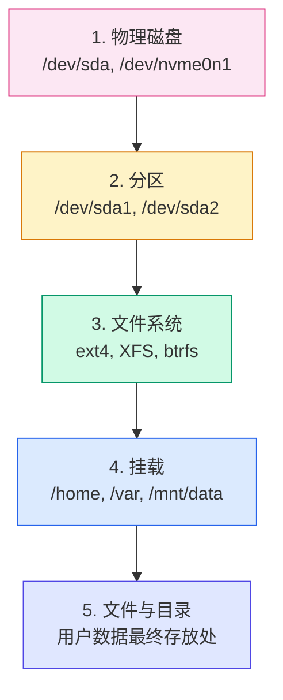
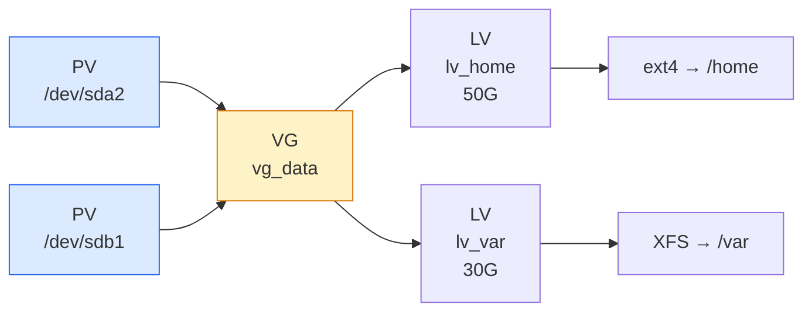

# Linux 存储基础概览：磁盘、分区、文件系统与 LVM

## 前言

存储管理是 Linux 运维中的「地基」技能。加一块新硬盘、调整分区大小、解决磁盘写满的故障——这些问题几乎每周都会遇到。不理解存储体系，就像盖楼不知道地基在哪。

本文作为存储系列的总览，帮你理清 Linux 存储的**五层架构**和核心概念。读完你会清楚地知道：一块磁盘从插入服务器到能存文件，中间经历了哪些环节，以及每个环节涉及的工具和概念。

!!! tip "配套实战文章"
    本文侧重**概念梳理和架构理解**。具体的命令操作（fdisk 分区、mkfs 格式化、mount 挂载、LVM 配置等）请参考 [Linux 存储管理](storage.md)，那里有从零开始的完整实战。

---

## Linux 存储五层体系

在 Linux 中，一块新磁盘要变成能用的存储空间，需要经过五个层次：



| 层次 | 做什么 | 核心概念 | 关键命令 |
| :---: | --- | --- | --- |
| **1. 物理磁盘** | 识别硬件设备 | 设备命名规则、块设备 | `lsblk`、`lsscsi` |
| **2. 分区** | 将磁盘划分为独立区域 | MBR vs GPT、主分区/扩展分区 | `fdisk`、`gdisk`、`parted` |
| **3. 文件系统** | 组织结构化存储 | ext4、XFS、btrfs、ZFS | `mkfs.*`、`tune2fs` |
| **4. 挂载** | 挂到目录树上 | 挂载点、`/etc/fstab`、UUID | `mount`、`umount` |
| **5. 文件与目录** | 用户实际使用 | 权限、inode、目录层级 | `ls`、`chmod`、`df` |

!!! warning "每一步都不能少"
    新手常见错误：以为分区完就能用了——忘了创建文件系统和挂载。或者 `mount` 了但忘了写入 `/etc/fstab`，重启后挂载就丢了。

---

## 设备命名规则

Linux 中一切皆文件，磁盘也不例外：

| 设备类型 | 命名规则 | 示例 |
| --- | --- | --- |
| **SATA / SAS / SCSI** | `/dev/sd[a-z]` | `/dev/sda`（第一块）、`/dev/sdb`（第二块） |
| **NVMe SSD** | `/dev/nvme[0-9]n[0-9]` | `/dev/nvme0n1`（第一块 NVMe）、`/dev/nvme0n1p1`（第一个分区） |
| **虚拟磁盘（KVM/VMware）** | `/dev/vd[a-z]` | `/dev/vda`（virtio） |
| **Xen 虚拟磁盘** | `/dev/xvd[a-z]` | `/dev/xvda` |
| **CD/DVD** | `/dev/sr[0-9]` | `/dev/sr0` |

```bash
# 快速查看所有块设备
lsblk
# NAME   MAJ:MIN RM  SIZE RO TYPE MOUNTPOINT
# sda      8:0    0  100G  0 disk
# ├─sda1   8:1    0    1G  0 part /boot
# └─sda2   8:2    0   99G  0 part /

# 查看设备详情
lsblk -o NAME,SIZE,TYPE,MOUNTPOINT,UUID,FSTYPE
```

---

## 分区表：MBR vs GPT

分区是将一块物理磁盘划分为多个独立逻辑区域的过程。分区信息存储在磁盘开头的**分区表**中：

| 特性 | MBR（传统） | GPT（现代） |
| --- | --- | --- |
| **最大磁盘容量** | 2 TB | 9.4 ZB（无实际限制） |
| **最大分区数** | 4 个主分区 | 128 个（默认） |
| **启动方式** | Legacy BIOS | UEFI |
| **冗余** | 无（坏了就丢） | 磁盘末尾有备份表 |
| **分区标识** | 设备号 | UUID + PARTUUID |
| **推荐场景** | 老旧系统、2TB 以下传统磁盘 | 所有新系统、大容量磁盘、UEFI 启动 |

!!! tip "现在都选 GPT"
    除非你有一台 15 年前的旧电脑必须用 Legacy BIOS 启动，否则**一律选 GPT**。GPT 支持更大磁盘、更多分区、有备份容错，是现代 Linux 的默认选择。

```bash
# 查看分区表类型
sudo fdisk -l /dev/sda | grep "Disklabel type"
# Disklabel type: gpt

# 或
sudo parted -l | grep "Partition Table"
# Partition Table: gpt
```

---

## 文件系统对比

文件系统决定了数据在磁盘上的组织方式。选对文件系统，性能和可靠性差很多：

| 文件系统 | 最大卷 | 最大文件 | 特点 | 推荐场景 |
| --- | :---: | :---: | --- | --- |
| **ext4** | 1 EB | 16 TB | 最成熟稳定，日志可靠 | 通用、系统盘、兼容性要求高 |
| **XFS** | 8 EB | 8 EB | 高性能、并发好、无法缩容 | 大文件、数据库、高并发 |
| **btrfs** | 16 EB | 16 EB | 写时复制、快照、压缩 | 需要快照和卷管理的高级用户 |
| **ZFS** | 256 ZB | 16 EB | 数据完整性校验、去重、快照 | 存储服务器、数据安全 |
| **NTFS** | — | — | Windows 互传文件 | 双系统 U 盘、移动硬盘 |
| **exFAT** | — | — | 跨平台大文件 | U 盘、移动硬盘（>4GB 文件） |

```bash
# 查看分区文件系统
lsblk -f
df -T
```

!!! info "XFS 不能缩容"
    XFS 是 RHEL 7+ 的默认文件系统，性能非常优秀。但它有一个著名的限制：**只支持扩容（xfs_growfs），不支持缩容**。如果你的分区可能将来需要缩小，选 ext4。

---

## 挂载与 /etc/fstab

### 挂载的本质

Linux 只有一个根目录树（`/`）。挂载就是把一个文件系统「嫁接」到这个树的某个节点上：

```text
/                          ← 根文件系统（/dev/sda2, ext4）
├── boot/                  ← 启动分区（/dev/sda1, ext4）
├── home/                  ← 用户数据（/dev/sdb1, XFS）
└── mnt/
    └── backup/            ← 备份盘（/dev/sdc1, ext4）
```

### 临时挂载 vs 永久挂载

| 方式 | 命令 | 特点 |
| --- | --- | --- |
| **临时** | `mount /dev/sdb1 /mnt/data` | 重启即失效 |
| **永久** | 写入 `/etc/fstab` | 开机自动挂载 |

### fstab 字段解读

```text
# <设备>           <挂载点>  <文件系统>  <选项>     <dump> <fsck>
UUID=abc123...     /         ext4        defaults   0      1
UUID=def456...     /boot     ext4        defaults   0      2
UUID=ghi789...     /home     xfs         defaults   0      2
```

| 字段 | 说明 |
| :---: | --- |
| **设备** | 推荐用 `UUID=` 而非 `/dev/sd*`（设备名可能漂移） |
| **挂载点** | 目录路径，必须已存在 |
| **文件系统** | `ext4`、`xfs`、`btrfs` 等 |
| **选项** | `defaults`、`noatime`（减少写操作）、`noexec`（禁止执行） |
| **dump** | `0` = 不备份（大多数情况） |
| **fsck** | `1` = 根分区优先检查，`2` = 其他分区，`0` = 不检查 |

---

## LVM 逻辑卷管理

### 为什么需要 LVM？

传统分区有一个致命缺陷：**分好后很难调整大小**。例如你给 `/home` 分了 50GB，一年后满了，而 `/var` 还空着 80GB——传统方式只能备份数据、删除分区、重新划分。

LVM 在物理磁盘和文件系统之间加了一层**抽象层**，让存储变得灵活：



### LVM 三层概念

| 层 | 全称 | 含义 | 类比 |
| --- | --- | --- | --- |
| **PV** | Physical Volume | 物理卷——磁盘或分区，LVM 的「砖块」 | 一块硬盘 |
| **VG** | Volume Group | 卷组——多个 PV 组成的存储池 | 一个硬盘柜 |
| **LV** | Logical Volume | 逻辑卷——从 VG 划分出的「虚拟分区」 | 柜子里的一个抽屉 |

### LVM 的核心优势

| 能力 | 说明 |
| --- | --- |
| **在线扩容** | `/home` 满了？从 VG 剩余空间分给它，不停机 |
| **跨磁盘** | 一个 LV 可以跨越多个物理磁盘 |
| **快照** | 创建某个时间点的卷快照，用于备份和恢复 |
| **精简置备** | 按需分配空间，而不是预先占满 |

!!! tip "LVM 是运维标配"
    在生产环境中，几乎所有服务器都应该使用 LVM。它带来的灵活性远超那一点点性能开销。RHEL/CentOS/Rocky Linux 安装程序默认就使用 LVM 布局。

---

## 常用工具速查

| 场景 | 工具 | 典型命令 |
| --- | --- | --- |
| 查看块设备 | `lsblk` | `lsblk -f` |
| 磁盘空间 | `df` | `df -h`、`df -i` |
| 目录空间 | `du` | `du -sh /var/log` |
| 分区操作 | `fdisk` / `gdisk` / `parted` | `sudo fdisk /dev/sdb` |
| 文件系统创建 | `mkfs.*` | `sudo mkfs.ext4 /dev/sdb1` |
| 挂载 | `mount` | `sudo mount /dev/sdb1 /mnt/data` |
| fstab 验证 | `findmnt` | `findmnt --verify` |
| LVM 总览 | `pvdisplay`/`vgdisplay`/`lvdisplay` | `sudo pvs; sudo vgs; sudo lvs` |
| 磁盘健康 | `smartctl` | `sudo smartctl -a /dev/sda` |
| I/O 监控 | `iostat` | `iostat -x 1` |

---

## 常见场景速查

| 场景 | 大致步骤 |
| --- | --- |
| **加新硬盘** | `lsblk` 确认 → `fdisk` 分区 → `mkfs` 格式化 → `mount` 挂载 → 写入 `/etc/fstab` |
| **根分区扩容** | 扩磁盘 → 扩分区（`growpart`） → 扩文件系统（`resize2fs`/`xfs_growfs`） |
| **创建交换空间** | `dd` 创建文件 → `mkswap` → `swapon` → 写入 `/etc/fstab` |
| **磁盘空间告警** | `df -h` 定位 → `du -sh /*` 逐级排查 → `lsof \| grep deleted` 检查已删除未释放文件 |
| **更换故障磁盘** | 备份 → 移除 → 插入新盘 → 分区/格式化 → 恢复数据 |

---

## 下一步学习

| 方向 | 教程 |
| --- | --- |
| **实战操作** | [Linux 存储管理](storage.md) — 分区、格式化、挂载、LVM、配额完整命令详解 |
| **网络共享** | [NFS 服务安装（Debian 13）](nfs-server-debian13.md) — 跨主机共享存储 |
| **性能优化** | [Linux 性能优化](../performance/index.md) — 磁盘 I/O 调优 |
| **数据安全** | [数据安全擦除](../security/data-deletion-and-secure-erasure.md) — 安全删除与擦除 |
| **系统基础** | [Linux 基础主页](../base-system/index.md) — 目录结构、常用命令 |

---

## 总结

Linux 存储管理的核心在于理解**五层架构**和**LVM 的抽象价值**：

1. **五层不可跳过**：磁盘 → 分区 → 文件系统 → 挂载 → 文件，每一步有每一步的工具
2. **GPT 取代 MBR**：新系统一律选 GPT，除非你有迫不得已的理由
3. **XFS 性能好但不可缩容**：系统盘用 ext4 保守稳妥，数据盘用 XFS 性能更佳
4. **LVM 是标配**：在生产环境中，LVM 不是「可选」，而是「应该有」
5. **UUID 优于设备名**：`/etc/fstab` 中用 `UUID=` 挂载，避免设备名漂移导致启动失败

存储不复杂，但每一步都不能省。把这五层理顺了，加盘扩盘再也不会慌。 🚀
