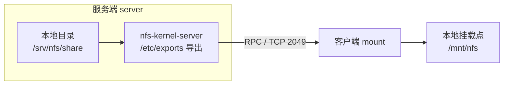
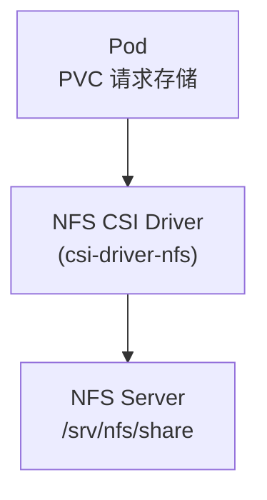

# Linux NFS 服务安装与配置实战：Debian 13 从零搭建

## 文章摘要

NFS（Network File System）是最古老的网络文件系统之一，也是目前最简单、最通用的跨主机共享存储方案。它让一台服务器把本地目录「导出」给其他机器，客户端像挂本地盘一样挂载使用。

这篇文章以 Debian 13（trixie）为例，从安装 `nfs-kernel-server` 开始，逐步拆解共享目录创建、`/etc/exports` 配置、权限选项、客户端挂载、防火墙放行与故障排查。

后续的 Kubernetes 存储系列会用到这台 NFS 服务器作为 **NFS CSI** 的后端存储——所以本文最后会专门说明为 CSI 准备共享目录时需要注意的选项。

!!! tip "前置阅读"
    如果你还不熟悉 Linux 的挂载、文件系统这些基础概念，建议先读 [Linux 存储基础概览](index.md) 或 [Linux 存储管理](storage.md)。挂载、`/etc/fstab`、LVM 的动手实操见 [Linux 磁盘挂载与 LVM 配置实战](disk-mount-lvm.md)——本文客户端的挂载操作与它高度衔接。

---

## 一、什么是 NFS，为什么需要它

本地磁盘只能被本机访问。当多台服务器（或 Kubernetes 集群里的多个节点）需要共享同一份数据时，就需要网络文件系统。

NFS 的工作方式很简单：



- **服务端**：把某个本地目录通过 `/etc/exports` 声明为「可被谁访问」。
- **客户端**：用 `mount -t nfs` 把这个远端目录挂到本地，之后读写就像操作本地文件。

NFS 的几个典型用途：

| 场景 | 说明 |
| --- | --- |
| 多机共享数据 | 多台 Web 服务器共享同一份静态文件、上传目录 |
| 集中备份 | 各机器把备份写到同一个 NFS 共享 |
| 无状态应用的持久化 | 容器/虚机挂 NFS 保存状态，宿主机坏了数据还在 |
| Kubernetes 后端存储 | NFS CSI 把 NFS 共享作为 PVC 的后端存储（本文的最终用途） |

---

## 二、环境准备

本文用两台 Debian 13 机器做演示：

| 角色 | 主机名 | IP | 系统 |
| --- | --- | --- | --- |
| NFS 服务端 | nfs-server | 192.168.114.200 | Debian 13（trixie） |
| NFS 客户端 | nfs-client | 192.168.114.201 | Debian 13（trixie） |

```bash
# 确认系统版本
cat /etc/os-release | grep PRETTY_NAME
# PRETTY_NAME="Debian GNU/Linux 13 (trixie)"

# 确认主机名与 IP
hostname && hostname -I
```

!!! note "Debian 13 的软件版本"
    Debian 13 里 `nfs-kernel-server` 的内核态 NFS 服务默认走 **NFSv4**。NFSv4 相比老旧的 NFSv3 有两个明显好处：只用 TCP 2049 一个端口（对防火墙友好）、支持状态与锁。下文会分别说明 v4 和 v3 的差异。

---

## 三、安装 NFS 服务端

服务端只需要一个包：`nfs-kernel-server`。

```bash
# 更新索引并安装
sudo apt update
sudo apt install -y nfs-kernel-server
```

安装完成后，systemd 里会多出几个相关单元：

```bash
systemctl list-unit-files | grep nfs
```

```
nfs-blkmap.service             disabled  enabled
nfs-convert.service            enabled   enabled
nfs-idmapd.service             static    enabled
nfs-mountd.service             static    enabled
nfs-server.service             enabled   enabled
nfsdcld.service                static    enabled
```

关键单元说明：

| 单元 | 作用 |
| --- | --- |
| `nfs-server.service` | 主服务，拉起整个 NFS 导出流程 |
| `nfs-mountd.service` | 处理客户端挂载请求（NFSv3 必需，v4 也参与） |
| `nfs-idmapd.service` | 用户/组 ID 与名称的映射（NFSv4） |
| `nfsdcld.service` | 跟踪 NFSv4 客户端的锁状态 |

---

## 四、创建共享目录

选一个目录作为共享根，比如 `/srv/nfs/share`：

```bash
sudo mkdir -p /srv/nfs/share
# 先让本地用户可写，后面再用 export 选项控制远端权限
sudo chown -R nobody:nogroup /srv/nfs/share
sudo chmod 777 /srv/nfs/share
```

!!! note "为什么 chown 成 nobody"
    NFS 默认的 `root_squash` 会把远端 root 映射成 `nobody:nogroup`。如果共享目录属主是 root，客户端以普通用户身份写就会权限不足。先改成 `nobody` 便于默认场景直接使用；如果你明确需要远端 root 保留 root 权限，用 `no_root_squash`（见第五节）。

---

## 五、配置 /etc/exports

NFS 的导出规则全部写在 `/etc/exports`，每行一个共享：

```text
# <要导出的目录>  <允许访问的客户端>(选项)
/srv/nfs/share   192.168.114.0/24(rw,sync,no_subtree_check)
```

### 5.1 常用选项速查

| 选项 | 含义 |
| --- | --- |
| `rw` / `ro` | 读写 / 只读 |
| `sync` / `async` | 同步写（数据落盘才应答）/ 异步写（快但不安全） |
| `no_subtree_check` | 不检查子目录，避免文件重命名报错，推荐必加 |
| `root_squash` | **默认**。客户端 root 被映射为 nobody（安全） |
| `no_root_squash` | 客户端 root 保留 root 身份（权限大，CSI 常用） |
| `all_squash` | 所有用户都映射为匿名用户 |
| `anonuid` / `anongid` | 指定匿名用户映射成的 UID/GID |

### 5.2 一个典型的 exports 配置

```bash
sudo tee /etc/exports <<'EOF'
# 内网普通共享：root 被 squash，适合多机共享文件
/srv/nfs/share   192.168.114.0/24(rw,sync,no_subtree_check)
EOF
```

写完后让配置生效：

```bash
# -r 重新读取所有 exports，-a 导出所有条目
sudo exportfs -ra
# 查看当前实际导出的内容
sudo exportfs -v
```

```
/srv/nfs/share  192.168.114.0/24(sync,wdelay,hide,no_subtree_check,sec=sys,rw,secure,no_root_squash,no_all_squash)
```

### 5.3 为 Kubernetes NFS CSI 准备的共享

后面 CSI 文章会用 `csi-driver-nfs` 把 NFS 共享挂进 Pod。CSI 驱动的挂载动作由 root 执行，且容器内进程常以 root 写数据，所以通常需要 **`no_root_squash`**：

```bash
sudo tee /etc/exports <<'EOF'
/srv/nfs/share   192.168.114.0/24(rw,sync,no_subtree_check,no_root_squash)
EOF
sudo exportfs -ra
```

!!! warning "no_root_squash 的安全代价"
    `no_root_squash` 意味着客户端 root 可以以 root 身份写入，权限等同于服务端 root。只在受信内网（比如你的实验集群）里用；生产环境应结合具体 CSI 驱动的权限要求评估。

---

## 六、启动服务并验证

```bash
# 开机自启 + 立即启动
sudo systemctl enable --now nfs-server

# 查看状态
systemctl status nfs-server --no-pager
```

```
● nfs-server.service - NFS server and services
     Loaded: loaded (/lib/systemd/system/nfs-server.service; enabled; preset: enabled)
     Active: active (exited) since ...
```

在服务端本机验证导出：

```bash
# 查看本机导出了哪些共享
showmount -e localhost
```

```
Export list for localhost:
/srv/nfs/share 192.168.114.0/24
```

!!! note "showmount 走的是 NFSv3 的 mountd 协议"
    如果只做 NFSv4，`showmount` 仍然可用（Debian 保留了 mountd 兼容）。更现代的查看方式是直接读内核导出表：`cat /proc/fs/nfsd/exports`。

---

## 七、客户端挂载验证

回到客户端机器，先装客户端工具：

```bash
sudo apt update
sudo apt install -y nfs-common
```

### 7.1 临时挂载

```bash
sudo mkdir -p /mnt/nfs
sudo mount -t nfs 192.168.114.200:/srv/nfs/share /mnt/nfs

df -h /mnt/nfs
```

```
Filesystem                        Size  Used Avail Use% Mounted on
192.168.114.200:/srv/nfs/share    91G   13G   74G  15% /mnt/nfs
```

写个文件验证双向读写：

```bash
echo "hello from client" | sudo tee /mnt/nfs/test.txt
cat /mnt/nfs/test.txt
# hello from client
```

回到服务端确认文件真实落到了共享目录：

```bash
cat /srv/nfs/share/test.txt
# hello from client
```

### 7.2 开机自动挂载（fstab）

```bash
sudo tee -a /etc/fstab <<'EOF'
192.168.114.200:/srv/nfs/share  /mnt/nfs  nfs  defaults,nofail,_netdev  0  0
EOF

# 先验证 fstab 写对了再重启，避免机器起不来
sudo mount -a
df -h /mnt/nfs
```

fstab 里两个关键选项：

| 选项 | 作用 |
| --- | --- |
| `nofail` | NFS 服务不可用时**不阻塞开机**（网络存储必备） |
| `_netdev` | 等网络就绪后再挂载（网络文件系统必备） |

---

## 八、防火墙放行

Debian 13 默认用 nftables。NFS 要放行的端口取决于版本：

| 版本 | 需要放行的端口 | 说明 |
| --- | --- | --- |
| **NFSv4（推荐）** | TCP 2049 | 只一个端口，最省事 |
| NFSv3 | TCP/UDP 111（rpcbind）+ 2049 + mountd/statd 随机端口 | 需要额外固定端口 |

如果客户端和服务器都在同一内网且你不想折腾，可以直接先临时关掉防火墙验证连通性，再决定放行规则：

```bash
# 临时验证（生产别这么做）
sudo systemctl stop nftables
```

正式放行 NFSv4（推荐）：

```bash
sudo nft add rule inet filter input tcp dport 2049 accept
```

需要 NFSv3 时，建议先固定 mountd/statd 端口，再放行固定端口：

```bash
# 固定 mountd 端口
echo 'RPCMOUNTDOPTS="--port 20048"' | sudo tee /etc/default/nfs-kernel-server
# 固定 statd 端口
echo 'STATDOPTS="--port 32765 --outgoing-port 32766"' | sudo tee /etc/default/nfs-common

sudo systemctl restart nfs-server nfs-common

# 放行 rpcbind + nfs + 固定端口
sudo nft add rule inet filter input tcp dport 111 accept
sudo nft add rule inet filter input udp dport 111 accept
sudo nft add rule inet filter input tcp dport 2049 accept
sudo nft add rule inet filter input tcp dport 20048 accept
sudo nft add rule inet filter input tcp dport 32765-32766 accept
```

---

## 九、常见问题排查

### 9.1 客户端 mount 报 `mount.nfs: Connection refused`

按顺序检查：

```bash
# 1. 服务端进程是否在跑
sudo systemctl status nfs-server

# 2. 网络是否通（从客户端）
ping 192.168.114.200
nc -zv 192.168.114.200 2049

# 3. RPC 服务是否注册
rpcinfo -p 192.168.114.200
```

`rpcinfo -p` 输出里应能看到 `nfs`（2049）和 `mountd` 条目；如果看不到，多半是 rpcbind 没起或被防火墙挡了。

### 9.2 客户端能挂载但写文件报 `Permission denied`

最常见的原因是 `root_squash` 把客户端 root 映射成了 nobody，而共享目录不给 nobody 写权限：

```bash
# 方案 A：共享目录改成 nobody 可写（保持 root_squash）
sudo chown nobody:nogroup /srv/nfs/share
sudo chmod 777 /srv/nfs/share

# 方案 B：明确需要 root 身份写入（如 CSI）
# /etc/exports 加 no_root_squash 后 exportfs -ra
```

### 9.3 卸载时报 `device is busy`

```bash
# 找出谁在占用
sudo fuser -m /mnt/nfs
sudo lsof | grep /mnt/nfs

# 强制卸载（慎用）
sudo umount -l /mnt/nfs
```

### 9.4 挂载后读写很慢

先确认是否误用了 `async` 而数据没落盘；再看网络与磁盘：

```bash
# 看是网络瓶颈还是磁盘瓶颈
iostat -x 1
iperf3 -c 192.168.114.200
```

---

## 十、作为 Kubernetes NFS CSI 的后端存储

这台 NFS 服务器就是下一步 Kubernetes 存储系列里 **NFS CSI** 实验的后端。简单说：



NFS CSI 的思路是：CSI 驱动把 NFS 共享挂载到节点，再把这个挂载点以子目录的形式提供给 Pod 使用。相比 Ceph、云盘，它**最简单**——不需要块设备、不需要 attach/detach，非常适合实验环境先跑通「PV/PVC → 后端存储」的完整链路。

为 CSI 准备的要点回顾：

1. **共享目录**：`/srv/nfs/share`，给足够大的空间。
2. **export 选项**：加 `no_root_squash`，否则 Pod 内 root 写不进去。
3. **网络**：确保所有 K8s 节点都能访问服务端 TCP 2049。
4. **客户端工具**：每个节点都要装 `nfs-common`（CSI 驱动挂载时依赖它）。

!!! info "下一篇"
    Kubernetes 存储系列的 [CSI 原理](../../kubernetes/architecture/storage/csi.md) 会基于这台 NFS 服务端，拆解 external-provisioner / external-attacher / node-driver 如何把 NFS 共享变成 Pod 里的 PVC。本文就是它的环境准备篇。
