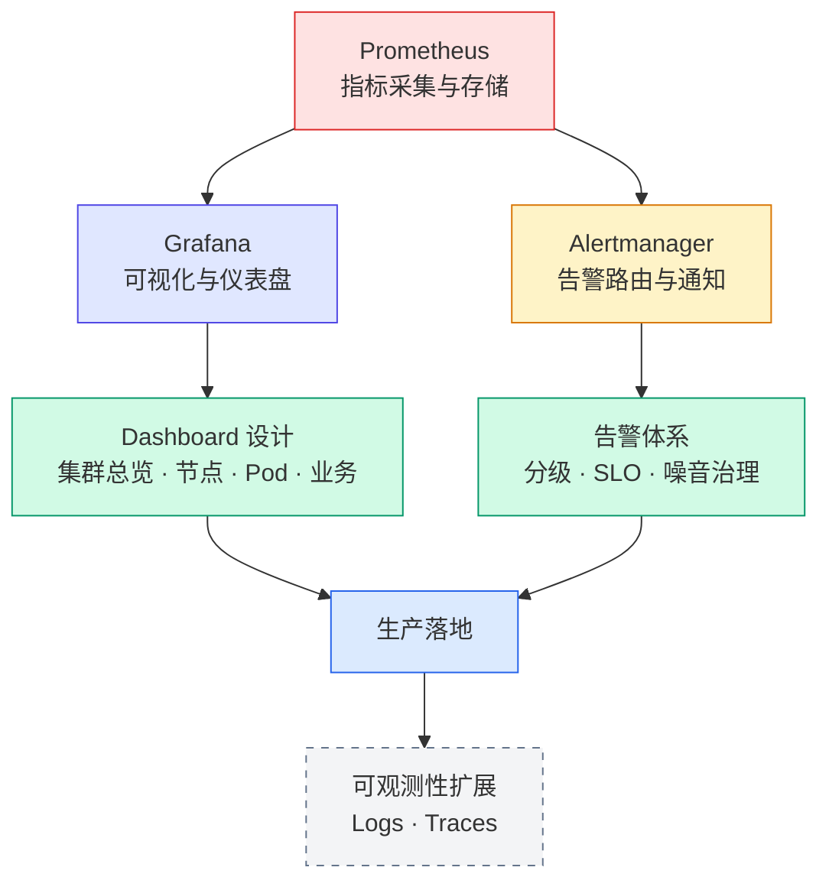

# Monitoring

没有监控的系统，等于在黑暗中驾驶汽车。

监控体系是现代运维和平台工程不可或缺的一部分。本专题记录从零搭建监控平台到生产环境落地的全过程——基于 Prometheus + Grafana + Alertmanager 技术栈，围绕 Kubernetes 集群和基础设施监控展开。

---

## 内容索引

### 核心组件

| 文章 | 说明 | 状态 |
|---|---|---|
| [Prometheus 搭建与实践](prometheus/) | 部署、配置、ServiceDiscovery、PromQL 基础 | 🔨 建设中 |
| [Grafana Dashboard 设计](grafana/) | 数据源配置、面板设计、变量与仪表盘组织 | 🔨 建设中 |
| [Alertmanager 告警体系](alertmanager/) | 告警规则、路由、通知渠道、抑制与静默 | 🔨 建设中 |

### 实战指南

| 文章 | 说明 | 状态 |
|---|---|---|
| [Kubernetes 集群健康检查指标指南](k8s-cluster-health-check/) | 从几百个指标中筛出真正值得关注的核心指标，按控制平面 / 节点 / Pod 三层分层讲解 | ✅ 已发布 |

---

## 内容计划

Monitoring 是可观测性体系的一个支柱。后续内容将沿以下方向展开：

| 方向 | 规划内容 |
|---|---|
| 基础组件 | Prometheus 部署、Grafana 配置、Alertmanager 告警规则 |
| 指标采集 | Node Exporter、kube-state-metrics、自定义 Exporter |
| 告警设计 | 告警分级、SLO 告警、告警噪音治理 |
| Dashboard | 集群总览、节点监控、Pod 监控、业务监控面板设计 |
| K8s 监控 | 控制平面指标、ETCD 健康检查、Pod 资源监控 |
| 进阶 | Thanos 长期存储、Recording Rules、性能优化 |

---

## 监控体系建设路径

先跑通 Prometheus → Grafana → Alertmanager 三件套，再逐步完善 Dashboard 和告警规则，最后向可观测性（Logs / Traces）扩展。

---

## 关于可观测性

Prometheus + Grafana 解决的是 **Metrics（指标）** 问题，这是可观测性三支柱之一：

| 支柱 | 解决什么 | 工具 | 本专栏状态 |
|---|---|---|---|
| **Metrics** | 系统当前状态如何？是否异常？ | Prometheus + Grafana | ✅ 建设中 |
| **Logs** | 发生了什么？为什么？ | Loki + Promtail | 📋 规划中 |
| **Traces** | 请求在哪里卡住了？ | Tempo / Jaeger | 📋 规划中 |

当三支柱内容齐备时，本专栏将升级为 **Observability（可观测性）**，覆盖完整的可观测性体系。
