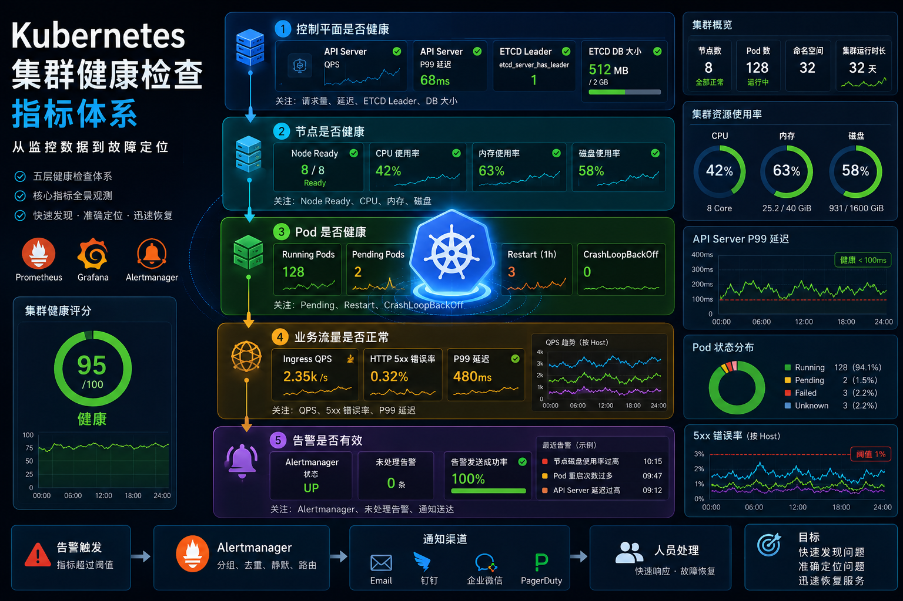

# Prometheus 搭好了，然后看什么？Kubernetes 集群健康检查指标指南



在之前的文章中，完成了 Kubernetes 高可用集群以及监控体系的搭建：

- Prometheus
- Grafana
- Alertmanager

监控平台已经跑起来了。
但是新的问题也来了：

> Dashboard 上几百个指标，到底应该关注哪些？
> 怎么判断 Kubernetes 集群到底健不健康？
> 如果哪天业务真出问题了，应该先看哪个图？

很多人搭完 Prometheus 就觉得“监控已经有了”。
但是我的观点是：**建立一套观察集群健康状态的思路**。

今天结合我自己的环境，把 Kubernetes 集群最值得关注的核心指标梳理一遍。
照着这篇看，你也能很快判断集群到底出了什么问题。

---

## 为什么需要健康检查指标？

传统服务器时代，运维主要看：

- CPU
- 内存
- 磁盘

但在 Kubernetes 里，它是一个**分布式平台**。
即使每个节点资源都正常，依然可能出现：

- Pod 无法调度
- Service 访问不通
- ETCD 异常
- API Server 卡顿

所以我们需要从多个维度观察集群状态。
下面按**重要程度分层**来讲。

---

## 第一层：控制平面是否健康

控制平面决定了整个集群能不能正常工作。

### 1. API Server 请求量

核心指标：

```promql
sum(rate(apiserver_request_total[5m]))
```

观察 QPS 和请求量的变化趋势。
如果出现**请求量突然暴涨**、**响应明显变慢**，往往意味着：

- 大量资源变更（比如批量删除 Pod）
- 某个 Controller 异常循环调谐
- 集群整体压力过大

### 2. API Server 延迟

不要看平均值，重点看：

```promql
histogram_quantile(0.99, sum(rate(apiserver_request_duration_seconds_bucket[5m])) by (le, verb))
```

经验阈值：

| P99 延迟    | 状态     |
| ------------- | ---------- |
| < 100 ms    | 健康     |
| 100–500 ms | 需要关注 |
| > 500 ms    | 存在风险 |

> ⚠️ 注意：`list` 和 `watch` 请求的延迟天然偏高，建议按 `verb` 分开观察。

### 3. ETCD 集群状态

ETCD 是 K8s 的数据库，最关键的一个指标：

```promql
etcd_server_has_leader
```

**这个值必须为 1**，否则说明集群丢失了 Leader，控制平面基本不可用。

同时关注：

```promql
etcd_mvcc_db_total_size_in_bytes / 1024 / 1024
```

DB 大小如果持续增长且接近 2GB（默认配额），说明历史版本堆积或资源对象过多，需要做压缩或清理。

---

## 第二层：节点是否健康

节点是 Pod 运行的物理／虚拟底座。

### 1. Node Ready 状态

```promql
kube_node_status_condition{condition="Ready", status="true"}
```

理想情况：所有节点 `Ready=True`。
如果有节点 NotReady，优先排查 kubelet 和网络。

### 2. CPU / 内存使用率

建议长期保持：

- CPU 使用率 < 70%
- 内存使用率 < 80%

当内存超过 **90%**  时，Kubelet 可能触发 Pod 驱逐或 OOM Kill。

一个实用的 CPU 告警阈值（5 分钟平均值）：

```promql
(1 - avg(rate(node_cpu_seconds_total{mode="idle"}[5m])) by (instance)) > 0.8
```

### 3. 磁盘空间

重点关注容器存储目录（通常是 `/var/lib/docker` 或 `/var/lib/containerd`）：

```promql
(1 - node_filesystem_avail_bytes{mountpoint="/var/lib/containerd"} / node_filesystem_size_bytes{mountpoint="/var/lib/containerd"}) > 0.8
```

建议  **< 80%** ，超过 **90%**  时应立即清理镜像或日志。

---

## 第三层：Pod 是否健康

业务最直接的体现就是 Pod。

### 1. Pod 运行数量

按状态查看：

```promql
sum(kube_pod_status_phase{phase=~"Running|Pending|Failed"}) by (phase)
```

如果 Pending 持续增加，说明：

- 资源不足（CPU / 内存 / 存储卷）
- 节点亲和性或污点导致无法调度

### 2. Pod 重启次数

```promql
rate(kube_pod_container_status_restarts_total[1h]) > 0
```

每小时有重启 → 需要关注
每 5 分钟多次重启 → 严重异常（CrashLoopBackOff）

### 3. CrashLoopBackOff

这是生产环境最常见的告警之一。
标志：Pod 启动 → 崩溃 → 重启 → 再崩溃。

**第一步永远是**：`kubectl logs <pod-name> --previous`
不要只看当前日志，要看上一次退出的日志。

---

## 第四层：业务流量是否正常

资源健康不代表业务健康。
即使所有 Pod 都在 Running，也可能返回 500 错误。

### 1. 入口请求量（以 Ingress Nginx 为例）

```promql
sum(rate(nginx_ingress_controller_requests[2m])) by (host)
```

观察 QPS 趋势：突降可能表示上游不健康，突增可能是攻击或流量异常。

### 2. HTTP 错误率

重点关注 5xx：

```promql
sum(rate(nginx_ingress_controller_requests{status=~"5.."}[2m])) / sum(rate(nginx_ingress_controller_requests[2m]))
```

错误率 > 1% 就应该立即排查。

### 3. 响应时间（P95 / P99）

不要看平均值。配置一个典型告警：

```promql
histogram_quantile(0.99, sum(rate(nginx_ingress_controller_request_duration_seconds_bucket[2m])) by (le, host)) > 1
```

P99 > 1 秒 → 业务可能已经有明显卡顿。

---

## 第五层：告警是否有效

监控系统最怕一种情况：

> 指标在采集，仪表盘在画图，但**没有人收到告警**。

建议每天检查：

- Alertmanager 是否 alive
- 最近的告警是否触发（有 firing 状态的告警吗？）
- 告警是否真正送达（钉钉／邮件／企微／PagerDuty）

否则监控平台只是一个漂亮的摆设。

---

## 我的每日健康检查清单

每天打开 Grafana，我通常会按这个顺序扫一眼：

| 顺序 | 层次     | 关键指标                             | 期望                  |
| ------ | ---------- | -------------------------------------- | ----------------------- |
| ①   | 控制平面 | API Server P99 延迟、ETCD Leader     | < 100 ms, Leader = 1  |
| ②   | 节点     | CPU / 内存 / 磁盘                    | < 70% / 80% / 80%     |
| ③   | Pod      | Pending / Restart / CrashLoopBackOff | 尽量为 0              |
| ④   | 业务     | QPS / 5xx 错误率 / P99 延迟          | 错误率 < 1%, P99 平稳 |
| ⑤   | 告警     | Alertmanager 未处理告警              | 0 条未处理            |

如果以上都正常，集群基本是健康的。

---

## 下一步计划：故障注入验证

理论看完了，更重要的验证。
接下来我准备在环境里**主动注入故障**：

- CPU 打满
- Pod OOM
- ETCD 写入延迟
- 节点标记为 NotReady
- Service 后端全部不可达

通过真实故障，去看 Prometheus 和 Grafana 里指标如何变化，告警是否触发。
这也是监控体系从“搭起来”到“用得上”的关键一步。

[开始阅读](../lab/cpu-stress-test.md){ .md-button .md-button--primary }

!!! tip "监控的意义"
    监控不是为了收集数据，而是为了在故障发生时，能**快速发现、定位、恢复服务**。