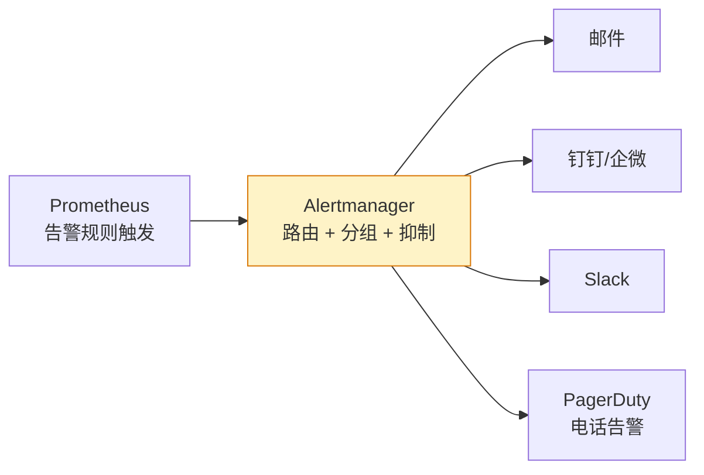

# Alertmanager 告警体系：路由、分组与噪音治理

## 前言

Prometheus 负责发现异常，Alertmanager 负责**把异常告诉对的人**。但「把异常告诉人」这件事比想象中复杂——同一个告警不要发给太多人（分组）、不需要的告警不要发（抑制）、凌晨 3 点只有致命告警才打电话（分级）。

---

## 架构



---

## 告警路由树

路由树决定「什么告警发给谁、用什么渠道」：

```yaml
route:
  receiver: 'default-email'            # 默认接收者
  group_by: ['alertname', 'severity']  # 分组键
  group_wait: 30s                      # 首次等待（收集同组告警）
  group_interval: 5m                   # 同组新告警间隔
  repeat_interval: 4h                  # 重复发送间隔

  routes:
    - match:
        severity: critical
      receiver: 'pagerduty-critical'
      continue: true                   # 继续匹配下级路由

    - match:
        severity: warning
      receiver: 'slack-warning'

    - match_re:
        alertname: 'NodeDisk.*'
      receiver: 'ops-team'
```

### 路由设计原则

| 原则 | 说明 |
| --- | --- |
| **按 severity 第一级路由** | critical → 电话，warning → 聊天群 |
| **按 team 第二级路由** | 数据库告警 → DBA，Pod 告警 → 平台团队 |
| **默认 receiver 兜底** | 未匹配任何规则的告警不丢失 |

---

## 分组与抑制

### 分组（Grouping）

同一组的告警合并成一条通知，避免告警风暴：

```yaml
group_by: ['alertname', 'severity']
```

效果：5 个节点同时 CPU 高 → 收到 1 封邮件，内容列出 5 个节点，而不是 5 封独立邮件。

### 抑制（Inhibition）

当某个告警触发时，抑制低优先级的关联告警：

```yaml
inhibit_rules:
  - source_match:
      alertname: 'NodeDown'
    target_match_re:
      alertname: 'Node.*'
    equal: ['instance']
```

效果：节点宕机 → 只发「节点宕机」告警，不发该节点上「CPU 高」「内存高」等衍生告警。

---

## 通知渠道

### 邮件

```yaml
receivers:
  - name: 'ops-email'
    email_configs:
      - to: 'ops@company.com'
        from: 'alertmanager@company.com'
        smarthost: 'smtp.company.com:587'
        auth_username: 'alertmanager'
        auth_password: '<password>'
```

### 钉钉机器人

```yaml
receivers:
  - name: 'dingtalk'
    webhook_configs:
      - url: 'https://oapi.dingtalk.com/robot/send?access_token=xxx'
        send_resolved: true
```

### PagerDuty（电话告警）

```yaml
receivers:
  - name: 'pagerduty'
    pagerduty_configs:
      - routing_key: '<PD_ROUTING_KEY>'
        severity: '{{ .CommonLabels.severity }}'
```

---

## 告警分级体系

| 级别 | 标签值 | 通知方式 | 响应要求 | 示例 |
| --- | :---: | --- | :---: | --- |
| **critical** | `severity: critical` | 电话 + 聊天群 | 5 分钟内响应 | 节点宕机、磁盘满 |
| **warning** | `severity: warning` | 聊天群 | 30 分钟内处理 | CPU > 80%、内存 > 85% |
| **info** | `severity: info` | 仅 Dashboard | 工作时间处理 | 磁盘使用 > 70% |

---

## SLO 告警

基于 SLO（Service Level Objective）的告警比固定阈值告警更智能：

```yaml
# 错误预算消耗过快告警
- alert: ErrorBudgetBurn
  expr: |
    (
      sum(rate(http_requests_total{status=~"5.."}[1h]))
      /
      sum(rate(http_requests_total[1h]))
    ) > 0.01 * 14.4  # 1 小时内消耗了 1% 月度错误预算的 14.4 倍
  for: 1h
  labels:
    severity: critical
  annotations:
    summary: "错误预算消耗过快"
```

---

## 噪音治理

| 问题 | 解决方案 |
| --- | --- |
| 告警抖动（短暂触发又恢复） | `for: 5m`——持续 5 分钟才发 |
| 告警风暴（大批量同时触发） | `group_by` + `group_wait` |
| 告警重复（每 5 分钟发一次） | `repeat_interval: 4h` |
| 无关告警太多 | 审查规则，提高阈值或合并 |
| 半夜被低优先级告警吵醒 | critical 才电话，warning 只发群 |

---

## 总结

Alertmanager 的核心是**把人从信息噪音中解放出来**：

1. **路由树**：什么人收什么告警，按 severity + team 分层
2. **分组**：100 个节点宕机 → 1 封邮件，不是 100 封
3. **抑制**：根因告警触发后，衍生告警自动静音
4. **分级**：critical = 电话，warning = 群，info = 看看就行
5. **SLO 告警**：比固定阈值更贴合业务真实体验

好的告警体系不是「什么异常都通知」，而是「通知对了，人就信；通知多了，人就麻木」。 🚀
