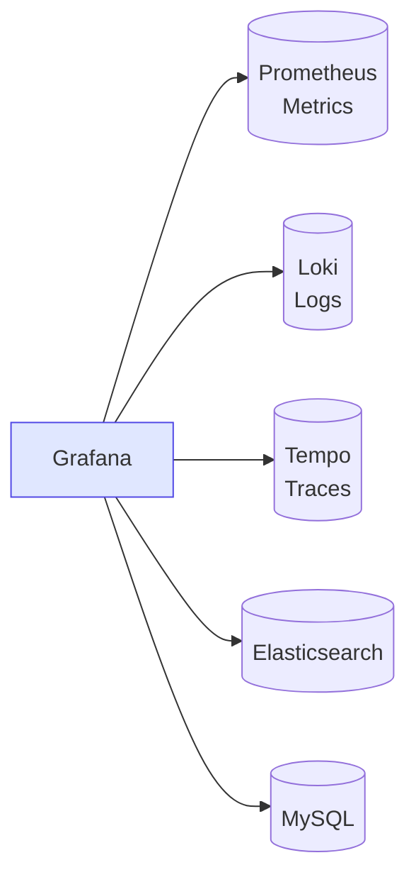
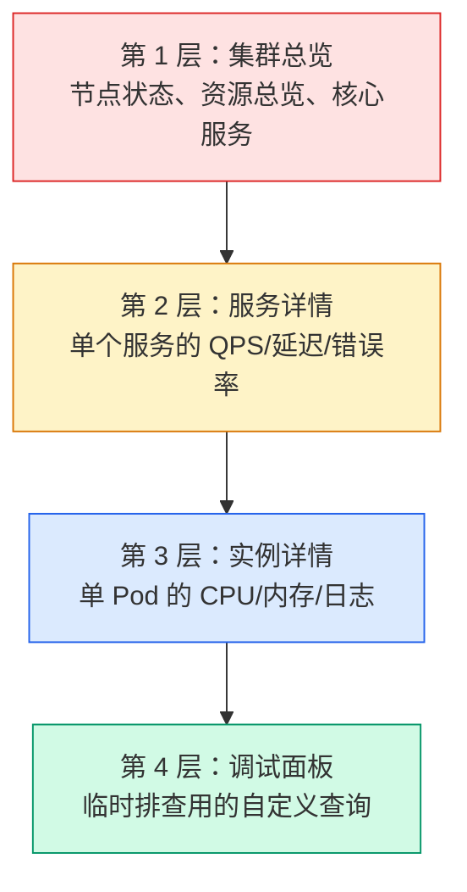

# Grafana 可视化：Dashboard 设计与数据源配置

## 前言

Grafana 是世界上最流行的开源可视化平台。它不存储数据——它连接你的数据源（Prometheus、Loki、Elasticsearch……），让你在一个统一的界面中创建指标、日志和追踪的仪表盘。

一个好 Dashboard 的标准：**30 秒内让任何人看懂系统当前是否健康**。

---

## 架构



---

## 数据源配置

### Prometheus

```yaml
# 基本配置
Name: Prometheus
URL: http://prometheus:9090
Access: Server (default)

# 自定义 HTTP Header（认证）
Header: X-Scope-OrgID
Value: tenant-1
```

### Loki（日志）

```yaml
Name: Loki
URL: http://loki:3100
```

配置完成后，在 Explore 中可通过 Label 筛选查看日志，并可从日志行直接跳转到 Tempo Trace（通过 `traceID` 关联）。

### 多数据源混合查询

Grafana 支持在同一个面板中混合多个数据源，例如：Metrics 曲线（Prometheus）上叠加 Annotation（Loki 日志事件标记）。

---

## Dashboard 设计原则

### 分层设计法



### 黄金信号原则

每个 Dashboard 至少覆盖这四类指标：

| 信号 | 含义 | PromQL 示例 |
| --- | --- | --- |
| **延迟（Latency）** | 请求花费多长时间？ | `histogram_quantile(0.99, ...)` |
| **流量（Traffic）** | 有多少请求？ | `rate(http_requests_total[5m])` |
| **错误（Errors）** | 有多少失败？ | `rate(http_requests_total{status=~"5.."}[5m])` |
| **饱和度（Saturation）** | 资源有多满？ | `node_cpu_utilization` |

---

## 变量（Variables）

变量让 Dashboard 具有交互性和可复用性：

```text
# 查询型变量——从 Prometheus 动态获取
Name: namespace
Type: Query
Query: label_values(kube_namespace_created, namespace)

# 自定义变量
Name: environment
Type: Custom
Values: prod, staging, dev

# 使用变量
rate(http_requests_total{namespace="$namespace"}[5m])
```

---

## 核心面板类型

| 面板 | 适用场景 | 关键配置 |
| --- | --- | --- |
| **Time Series** | 趋势图（CPU/内存/QPS） | 推荐替代旧 Graph 面板 |
| **Stat** | 单一数值（当前 Pod 数） | 设定阈值颜色 |
| **Gauge** | 百分比显示（磁盘使用率） | 绿色/黄色/红色阈值 |
| **Table** | 结构化数据（Top 10 列表） | 排序、分页 |
| **Bar Gauge** | 横向条形图（各节点资源） | 同 Stat |
| **Pie Chart** | 占比分布 | 状态码分布 |
| **Logs** | 日志查看（Loki 数据源） | 关联 Trace |

---

## Provisioning：基础设施即代码

将 Dashboard 和数据源定义为 JSON/YAML 文件，纳入 Git 版本管理：

```yaml
# /etc/grafana/provisioning/datasources/prometheus.yaml
apiVersion: 1
datasources:
  - name: Prometheus
    type: prometheus
    url: http://prometheus:9090
    access: proxy
    isDefault: true
```

```yaml
# /etc/grafana/provisioning/dashboards/all.yaml
apiVersion: 1
providers:
  - name: 'default'
    folder: ''
    type: file
    options:
      path: /var/lib/grafana/dashboards
```

所有 Dashboard JSON 放在 `/var/lib/grafana/dashboards/` 下即可自动加载。

---

## Grafana 告警

Grafana 8+ 内置告警引擎，可直接在 Dashboard 上配置告警：

```yaml
# 告警规则要素
- Condition：查询结果满足什么条件（如 > 80）
- Evaluation：多久评估一次
- No Data / Error：数据缺失时如何处理
- Notification：发送到哪些联系点（钉钉/Slack/PagerDuty）
```

比 Alertmanager 更适合「非 Prometheus 数据源」的告警场景（如 MySQL、Elasticsearch 直接告警）。

---

## 总结

1. **分层 Dashboard**：总览 → 服务 → 实例 → 调试
2. **黄金信号**：延迟、流量、错误、饱和度
3. **变量**：让 Dashboard 可交互、可复用
4. **Provisioning**：GitOps 管理，拒绝手动导入 JSON

好 Dashboard 的标准：凌晨 3 点被电话叫醒，打开 Dashboard 30 秒内定位问题所在。 🚀
