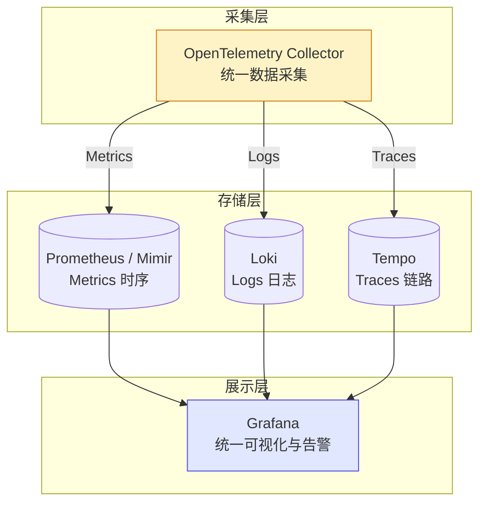
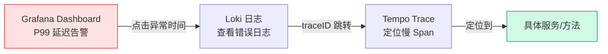

# 可观测性：Metrics · Logs · Traces

## 前言

没有可观测性的系统，等于在黑暗中驾驶。

传统「监控」告诉你 CPU 高了、内存满了。但**可观测性**回答更高阶的问题：**用户正在经历什么？是什么导致了这个异常？如何在不看代码的情况下定位根因？**

本栏目基于 Grafana LGTM 技术栈（Loki + Grafana + Tempo + Mimir/Prometheus），结合 OpenTelemetry 统一采集标准，覆盖从 Metrics 到 Logs 到 Traces 的完整可观测性体系。

---

## 三支柱架构

| 支柱 | 解决的问题 | 核心工具 | 本栏目 |
| :---: | --- | --- | :---: |
| **Metrics** | 系统现在状态如何？是否异常？ | Prometheus + Grafana | ✅ |
| **Logs** | 发生了什么事件？为什么出错？ | Loki + Promtail | ✅ |
| **Traces** | 请求在哪一步卡住了？ | Tempo / Jaeger | ✅ |

---

## 栏目导航

### Metrics 支柱

| 文章 | 说明 |
| --- | --- |
| [Prometheus 监控体系](prometheus.md) | 架构、PromQL、Service Discovery、Recording Rules |
| [Grafana 可视化](grafana.md) | Dashboard 设计、多数据源、Provisioning |
| [Alertmanager 告警](alertmanager.md) | 路由树、分组抑制、告警分级、噪音治理 |
| [K8s 集群健康检查](k8s-cluster-health-check.md) | 控制平面 → 节点 → Pod 三层核心指标指南 |

### Logs 支柱

| 文章 | 说明 |
| --- | --- |
| [Loki 日志聚合](loki.md) | 架构、Promtail 采集、LogQL 查询、Grafana 集成 |

### Traces 支柱

| 文章 | 说明 |
| --- | --- |
| [分布式追踪](tracing.md) | Span/Trace/Context Propagation、Tempo、Jaeger |

### 统一可观测性

| 文章 | 说明 |
| --- | --- |
| [OpenTelemetry](opentelemetry.md) | 统一采集标准、Collector、自动埋点 |
| [SLO / SLI / Error Budget](slo-sli.md) | 可靠性工程、错误预算、发布决策 |

---

## Grafana LGTM 技术栈

LGTM 是 Grafana Labs 提出的全套可观测性方案：

| 组件 | 角色 | 类比 |
| --- | --- | --- |
| **L**oki | 日志聚合 | 轻量版 Elasticsearch |
| **G**rafana | 统一可视化 | — |
| **T**empo | 分布式追踪 | 轻量版 Jaeger |
| **M**imir / Prometheus | Metrics 存储 | 水平扩展的 Prometheus |

四者共享 Grafana 作为统一前端，通过 `traceID` 等关联字段实现 Metrics → Logs → Traces 一键跳转。

---

## 排障联动流程

---

## 小结

| 问题 | 看什么 |
| --- | :---: |
| 系统健康吗？ | Metrics（Prometheus） |
| 为什么 500？ | Logs（Loki） |
| 为什么慢？ | Traces（Tempo） |
| 怎么采集？ | OpenTelemetry |
| 多可靠够用？ | SLO / Error Budget |

> 监控告诉你「有病」，可观测性告诉你「病在哪、多严重、怎么治」。
> —— 1HairLabs

