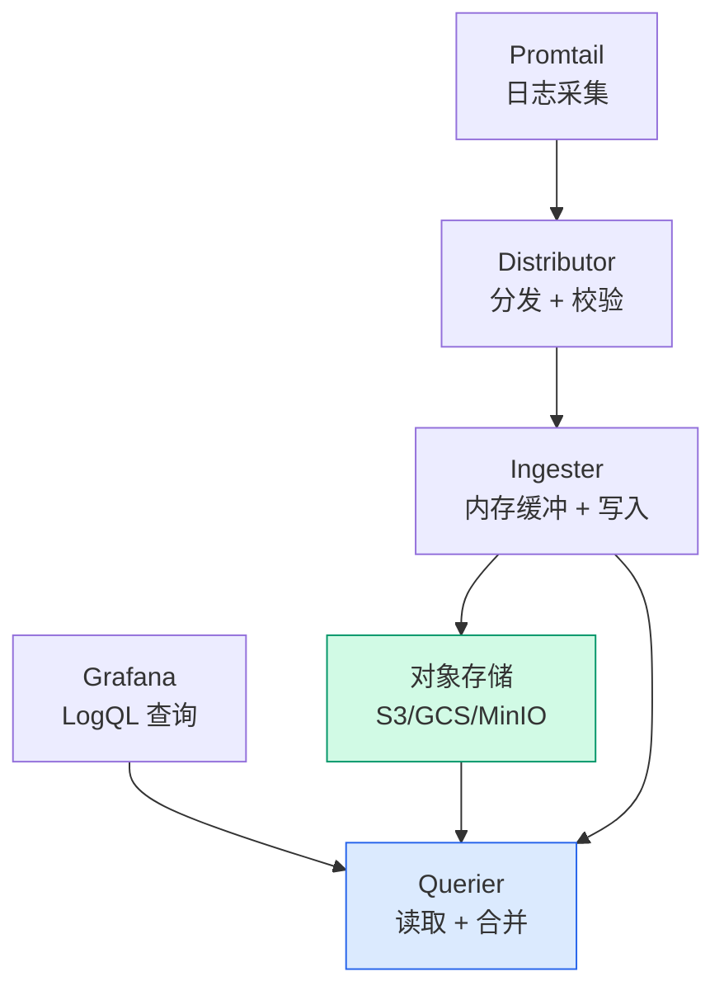

# Loki 日志聚合：架构、LogQL 与 Grafana 集成

## 前言

Prometheus 解决了 Metrics，但日志呢？传统方案（ELK）笨重且成本高——Loki 的设计哲学是「像 Prometheus 一样处理日志」：**只索引元数据（Labels），不索引日志正文**，因此极其轻量，与 Grafana 深度集成。

---

## Loki 架构



| 组件 | 角色 |
| --- | --- |
| **Promtail** | 日志采集代理，发现日志文件、打标签、推送到 Loki |
| **Distributor** | 接收日志流，校验后转发给 Ingester |
| **Ingester** | 内存缓冲日志，定期刷到对象存储 |
| **Querier** | 处理 LogQL 查询，合并 Ingester + 存储结果 |
| **对象存储** | S3/GCS/MinIO，持久化日志（低成本） |

---

## Promtail 配置

```yaml
server:
  http_listen_port: 9080

clients:
  - url: http://loki:3100/loki/api/v1/push

scrape_configs:
  - job_name: system
    static_configs:
      - targets: [localhost]
        labels:
          job: varlogs
          __path__: /var/log/*.log

  - job_name: docker
    docker_sd_configs:
      - host: unix:///var/run/docker.sock
    relabel_configs:
      - source_labels: [__meta_docker_container_name]
        target_label: container
```

### Kubernetes 日志采集

```yaml
scrape_configs:
  - job_name: kubernetes-pods
    kubernetes_sd_configs:
      - role: pod
    pipeline_stages:
      - cri: {}       # 解析 CRI 格式日志
    relabel_configs:
      - source_labels: [__meta_kubernetes_namespace]
        target_label: namespace
      - source_labels: [__meta_kubernetes_pod_name]
        target_label: pod
```

---

## LogQL 查询语言

LogQL 语法类似 PromQL，按 Label 筛选日志：

```logql
# 基本查询
{job="varlogs"} |= "error"

# 排除关键字
{namespace="production"} != "debug"

# 正则
{app="nginx"} |~ `status=[4-5]\d{2}`

# 管道：解析 → 过滤 → 格式化
{app="nginx"}
  | json
  | status >= 400
  | line_format "{{.method}} {{.path}} → {{.status}}"

# 聚合（类似 PromQL）
sum(count_over_time({job="varlogs"} |= "error" [5m])) by (host)
rate({job="varlogs"} |= "error" [5m])
```

---

## Grafana 集成

### Explore 中的日志面板

-   输入 LogQL → 实时查看日志
-   点击日志行中的时间戳 → 跳转到该时刻的 Metrics Dashboard
-   如果日志包含 `traceID`，自动生成 Tempo 链接

### Dashboard 中的日志面板

在 Dashboard 中嵌入日志面板，与 Metrics 图表并列显示——定位到异常时间点后，下方直接显示对应日志。

---

## 与 ELK 对比

| | Loki | ELK（Elasticsearch） |
| --- | :---: | :---: |
| **索引方式** | 只索引 Labels | **全文索引** |
| **存储成本** | 低（对象存储） | 高（ES 集群） |
| **查询速度** | 中等（按 Label 过滤快，全文扫描慢） | 快（全文索引） |
| **运维复杂度** | 低（单二进制） | 高（ES 集群） |
| **适合场景** | K8s 日志、与 Prometheus 配合 | 需要复杂全文搜索 |

---

## 总结

1. **Loki = 日志版 Prometheus**：只索引标签，不索引正文，轻量
2. **Promtail**：自动打 Kubernetes 标签（namespace/pod/container）
3. **LogQL**：`{} |= "keyword"` 基础查询 + 管道解析 JSON
4. **Grafana 一站式**：Metrics + Logs + Traces 在同一个 Dashboard

Loki 让日志从「昂贵的全文搜索引擎」变成了「Prometheus 风格的标签查询」——成本低一个数量级。 🚀
