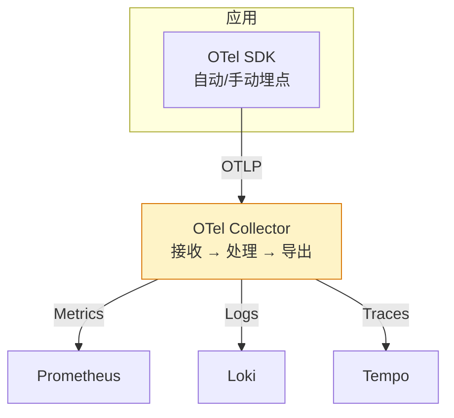

# OpenTelemetry：统一可观测性数据采集标准

## 前言

可观测性最痛苦的不是「没有数据」，而是「数据格式不统一」——Prometheus 用 Exposition Format、Jaeger 用 Thrift、Zipkin 用 JSON。OpenTelemetry（OTel）解决的就是这个问题：**一套 SDK、一种协议（OTLP）、采集 Metrics + Logs + Traces，导出到任意后端**。

---

## 架构



---

## Collector 组件

| 组件 | 职责 |
| --- | --- |
| **Receiver** | 接收数据（OTLP / Jaeger / Zipkin / Prometheus） |
| **Processor** | 处理数据（批处理、内存限制、属性过滤、采样） |
| **Exporter** | 导出数据（Prometheus / Loki / Tempo / Kafka） |
| **Pipeline** | Receiver → Processor → Exporter 的组合 |

### 示例配置

```yaml
receivers:
  otlp:
    protocols:
      grpc:
        endpoint: 0.0.0.0:4317
      http:
        endpoint: 0.0.0.0:4318

processors:
  batch:
    timeout: 1s
    send_batch_size: 1024
  memory_limiter:
    limit_mib: 512

exporters:
  otlp/tempo:
    endpoint: tempo:4317
    tls:
      insecure: true
  prometheusremotewrite:
    endpoint: "http://prometheus:9090/api/v1/write"

service:
  pipelines:
    traces:
      receivers: [otlp]
      processors: [memory_limiter, batch]
      exporters: [otlp/tempo]
    metrics:
      receivers: [otlp]
      processors: [memory_limiter, batch]
      exporters: [prometheusremotewrite]
```

---

## 自动埋点

最小侵入方式——不改代码，Sidecar 或 DaemonSet 注入：

### Kubernetes Operator

```bash
kubectl apply -f https://github.com/open-telemetry/opentelemetry-operator/releases/latest/download/opentelemetry-operator.yaml
```

Pod 加注解即可自动注入：

```yaml
annotations:
  instrumentation.opentelemetry.io/inject-java: "true"
  instrumentation.opentelemetry.io/inject-python: "true"
```

支持的自动埋点语言：Java、Python、Node.js、.NET、Go（有限）。

---

## 手动埋点示例

```python
from opentelemetry import trace
from opentelemetry.sdk.trace import TracerProvider
from opentelemetry.exporter.otlp.proto.grpc.trace_exporter import OTLPSpanExporter

# 创建 Span
tracer = trace.get_tracer(__name__)

with tracer.start_as_current_span("process-order") as span:
    span.set_attribute("order.id", "12345")
    span.set_attribute("customer.id", "67890")
    # ... 业务逻辑
    span.add_event("payment-processed", {"method": "credit_card"})
```

---

## OTel vs 传统方案

| | 传统（直接对接） | OpenTelemetry |
| --- | :---: | :---: |
| **Metrics** | 应用直接暴露 `/metrics` | Collector 统一接收 → 导出 Prometheus |
| **Traces** | 应用直接连 Jaeger Agent | Collector 接收 → 导出 Tempo/Jaeger |
| **Logs** | Filebeat/Fluentd 采集 | Collector 接收 + 处理 → 导出 Loki |
| **后端切换** | 改代码 | 改 Collector 配置（不改应用） |
| **数据关联** | 困难 | 同一 Collector 关联三条数据 |

---

## 总结

1. **OTel Collector** = 可观测数据的「瑞士中转站」
2. **OTLP** = 统一的传输协议（取代 Prometheus Exposition / Jaeger Thrift）
3. **自动埋点** = Kubernetes Operator + Pod 注解，不改代码
4. **后端无关** = 换 Tempo 还是 Jaeger，只改 Collector 配置

OpenTelemetry 是 CNCF 中活跃度第二的项目——它正在成为可观测性数据采集的「TCP/IP」。 🚀
