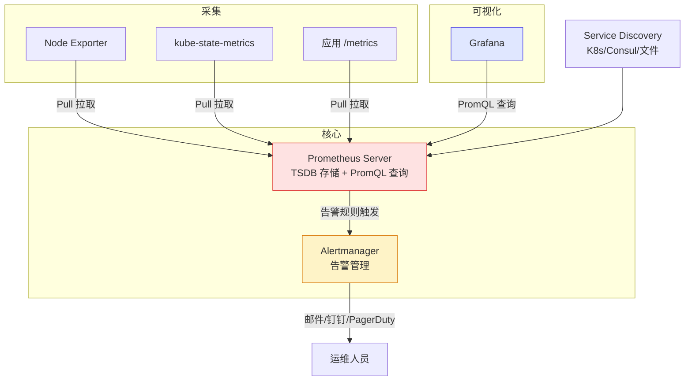

# Prometheus 监控体系：架构、PromQL 与服务发现

## 前言

Prometheus 是 CNCF 的第二个毕业项目（仅次于 Kubernetes），已成为云原生监控的事实标准。它以**拉取（Pull）模型**、**多维数据模型**和强大的 **PromQL 查询语言**为核心，特别适合动态的容器和微服务环境。

---

## 架构概览



---

## 核心概念

### 数据模型

```text
<metric_name>{<labels>} <value> <timestamp>
http_requests_total{method="GET",status="200"} 12345 1753000000
```

### 四种指标类型

| 类型 | 说明 | 示例 |
| --- | --- | --- |
| **Counter** | 只增不减 | `http_requests_total` |
| **Gauge** | 可增可减 | `node_memory_usage_bytes` |
| **Histogram** | 分桶分布统计 | `http_request_duration_seconds` |
| **Summary** | 分位数统计 | `http_request_duration_quantile` |

---

## PromQL 常用查询

```promql
# CPU 使用率
100 - (avg(rate(node_cpu_seconds_total{mode="idle"}[5m])) by (instance) * 100)

# 内存使用百分比
(1 - node_memory_MemAvailable_bytes / node_memory_MemTotal_bytes) * 100

# Top 10 CPU 消耗 Pod
topk(10, sum(rate(container_cpu_usage_seconds_total[5m])) by (pod))

# 错误率
sum(rate(http_requests_total{status=~"5.."}[5m])) / sum(rate(http_requests_total[5m])) * 100

# 预测 4 小时后磁盘满
predict_linear(node_filesystem_free_bytes[1h], 4*3600) < 0
```

---

## Service Discovery

Prometheus 支持多种自动发现机制：

```yaml
scrape_configs:
  - job_name: 'kubernetes-pods'
    kubernetes_sd_configs:
      - role: pod
    relabel_configs:
      - source_labels: [__meta_kubernetes_pod_annotation_prometheus_io_scrape]
        action: keep
        regex: true
```

通过 Pod 注解自动发现：

```yaml
annotations:
  prometheus.io/scrape: "true"
  prometheus.io/path: "/metrics"
  prometheus.io/port: "8080"
```

| SD 方式 | 适用场景 |
| --- | --- |
| `kubernetes_sd_configs` | K8s Pod/Service/Node |
| `consul_sd_configs` | Consul 注册中心 |
| `file_sd_configs` | 静态文件（最简单） |
| `ec2_sd_configs` | AWS EC2 |

---

## Recording Rules

预计算复杂 PromQL，加速 Dashboard 和告警：

```yaml
groups:
  - name: cpu_node
    rules:
      - record: instance:node_cpu_utilization:rate5m
        expr: 100 - (avg(rate(node_cpu_seconds_total{mode="idle"}[5m])) by (instance) * 100)
```

---

## 存储与高可用

Prometheus 使用自研 TSDB。容量规划：活跃 Series 数 × 采样间隔 × ~3 字节/样本 × 保留天数。

| 方案 | 说明 |
| --- | --- |
| **双 Prometheus** | 两个相同实例，互为冗余 |
| **Thanos** | Block 上传 S3，全局查询 |
| **VictoriaMetrics** | Prometheus 兼容高性能替代 |
| **Mimir** | Grafana 出品，水平扩展 |

---

## 告警规则

```yaml
groups:
  - name: node
    rules:
      - alert: NodeHighCPU
        expr: 100 - (avg(rate(node_cpu_seconds_total{mode="idle"}[5m])) by (instance) * 100) > 80
        for: 5m
        labels:
          severity: warning
        annotations:
          summary: "节点 {{ $labels.instance }} CPU > 80%"
          description: "当前值: {{ $value | humanize }}%"
```

---

## 总结

1. **Pull + SD**：自动发现，零配置
2. **PromQL**：表达式简洁而强大
3. **Recording Rules**：预计算加速
4. **多维 Labels**：灵活聚合

Prometheus 是 Metrics 支柱的核心——先搭好它，Grafana 和 Alertmanager 才有数据。 🚀
