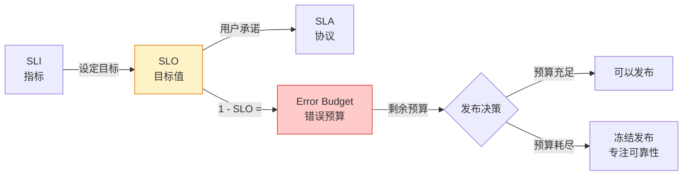

# SLO/SLI/Error Budget：可观测性驱动的可靠性

## 前言

「我们的服务可用性目标是 99.9%」——很多团队立了这个目标，但既不知道怎么测量，也不知道没达到时怎么办。SLO/SLI/Error Budget 是 Google SRE 的核心实践，它将可靠性从「感觉」变成「可测量的工程决策」。

---

## 核心概念

| 概念 | 全称 | 一句话 | 示例 |
| --- | --- | --- | --- |
| **SLI** | Service Level Indicator | 服务好不好，用什么衡量 | 请求成功率 |
| **SLO** | Service Level Objective | SLI 的目标值 | 成功率 ≥ 99.9% |
| **SLA** | Service Level Agreement | 对客户的承诺（违约有赔款） | 成功率 < 99.5% 退款 |
| **Error Budget** | 错误预算 | 允许失败的次数 | 100% - 99.9% = 0.1% |



---

## SLI 选型：测什么？

### 以用户为中心的四类 SLI

| 类别 | 示例 SLI | PromQL |
| --- | --- | --- |
| **可用性** | 请求成功率 | `sum(rate(requests{status!~"5.."}[5m])) / sum(rate(requests[5m]))` |
| **延迟** | P99 响应时间 | `histogram_quantile(0.99, rate(request_duration_bucket[5m]))` |
| **吞吐** | 每秒请求数 | `sum(rate(requests[5m]))` |
| **持久性** | 数据写入成功率 | `rate(write_success[5m]) / rate(write_total[5m])` |

### 好 SLI 的标准

-   **代表用户体验**：不是 CPU 使用率，而是用户感受到的延迟
-   **可测量**：能从监控系统获取
-   **不随流量变化**：成功率是比率，不是绝对值

---

## SLO 目标设定

### 常见 SLO 目标

| 服务等级 | 可用性目标 | 月度停机预算 |
| :---: | :---: | --- |
| 关键业务 | 99.99% | 4.3 分钟 |
| 核心服务 | 99.95% | 21.6 分钟 |
| 一般服务 | 99.9% | 43.2 分钟 |
| 后台服务 | 99.5% | 3.6 小时 |

### 不要设 100%

100% 意味着：
-   零错误预算 → 任何变更都可能违规
-   过度设计 → 成本指数增长
-   无法区分「真的出问题」和「正常波动」

---

## Error Budget 决策

错误预算的核心价值不是「告诉我们出问题了」，而是**指导发布决策**：

### 预算消耗告警

```yaml
- alert: ErrorBudgetBurn
  expr: |
    (1 - avg_over_time(slo:success_rate[1h])) > (1 - 0.999) * 14.4
    # 1 小时内消耗了 1% 月度错误预算的 14.4 倍
  labels:
    severity: critical
```

| 消耗率 | 含义 | 响应 |
| :---: | --- | --- |
| < 1x | 正常 | — |
| 1x ~ 2x | 高于预期 | 关注 |
| 2x ~ 10x | 快速消耗 | 发告警 |
| > 10x | 严重事件 | 全员响应 |

### 发布决策

-   **有剩余错误预算** → 可以发布新版本、做变更
-   **错误预算耗尽** → 冻结发布，专注提高可靠性

这样「开发想要快」和「运维想要稳」之间的矛盾有了客观的仲裁标准——错误预算就是双方的「谈判筹码」。

---

## 实现清单

```bash
1. 选择 2~4 个 SLI（成功率 + P99 延迟 是最小集合）
2. 在 Prometheus 中实现 SLI 查询
3. 设定 SLO 目标（从当前实际值出发，逐步收紧）
4. 配置 Error Budget 烧钱告警
5. 将 SLO Dashboard 作为团队周会必看面板
```

---

## 总结

1. **SLI** = 测什么（成功率、延迟）
2. **SLO** = 目标是多少（99.9%）
3. **Error Budget** = 还有多少犯错额度
4. **预算耗尽 → 冻结发布** = 可靠性优先
5. **预算充足 → 可以冒险** = 速度优先

SLO 不是又一个运维指标——它是整个团队对「可靠性」的共识语言。 🚀
