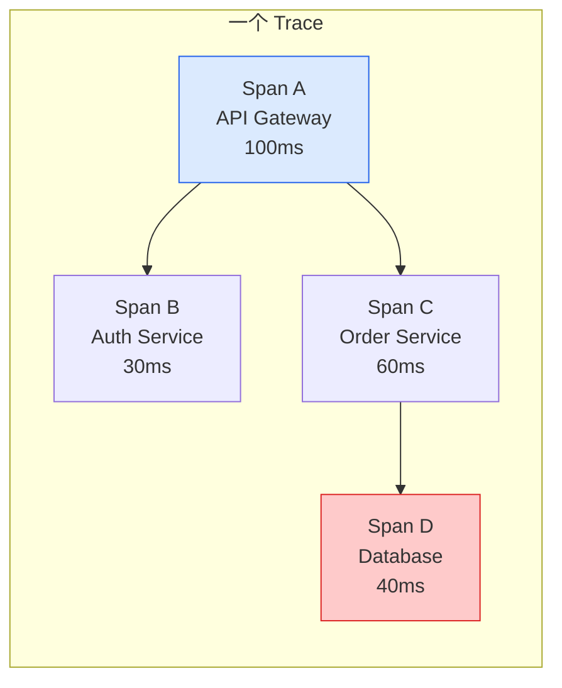
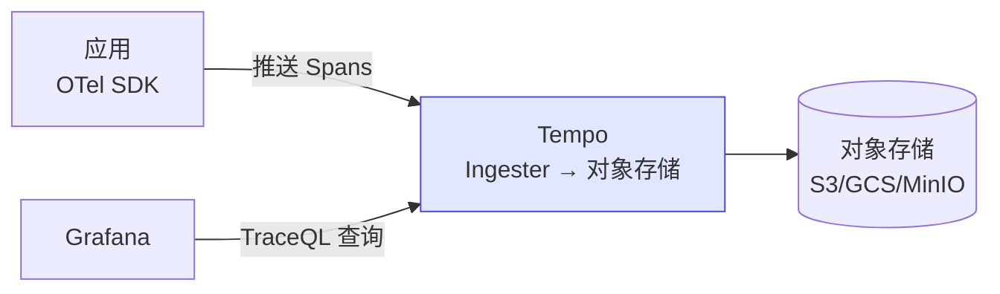
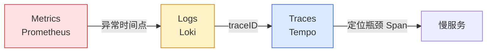

# 分布式追踪：Tempo、Jaeger 与 OpenTelemetry

## 前言

Metrics 告诉你「系统慢了」，Logs 告诉你「发生了什么」，但**Tracing 告诉你「请求在哪里卡住了」**。在微服务架构中，一个用户请求可能经过 10 个服务——Tracing 是唯一能还原完整调用链的工具。

---

## 核心概念



| 概念 | 说明 |
| --- | --- |
| **Trace** | 一次完整请求的调用链（由多个 Span 组成） |
| **Span** | 调用链中的一个操作（有开始时间、结束时间、父 Span） |
| **Context Propagation** | 将 Trace ID 在服务间传递（通过 HTTP Header `traceparent`） |
| **Root Span** | Trace 的起点，没有父 Span |

---

## Grafana Tempo

Tempo 是 Grafana 出品的分布式追踪后端，设计理念与 Loki 一致——低成本、只索引元数据：



### Tempo 优势

| 特性 | 说明 |
| --- | --- |
| **零索引** | 不索引 Span 内容，只按 Trace ID 检索 |
| **对象存储** | S3/GCS 存储，成本极低 |
| **Grafana 原生** | 从 Loki 日志中的 `traceID` 一键跳转到 Trace |
| **TraceQL** | 类似 PromQL 的 Trace 查询语言 |

---

## Jaeger

Jaeger 是 CNCF 毕业项目，是 Tempo 之前最流行的开源 Tracing 方案：

| 组件 | 说明 |
| --- | --- |
| **Jaeger Agent** | 在每个节点上监听 UDP，接收 Spans |
| **Jaeger Collector** | 验证、处理并存储 Spans |
| **Jaeger Query** | UI + API 查询 |
| **存储后端** | Elasticsearch / Cassandra / Badger |

### Tempo vs Jaeger

| | Tempo | Jaeger |
| --- | :---: | :---: |
| **存储** | 对象存储（便宜） | ES/Cassandra（贵） |
| **Grafana 集成** | 原生（Loki → Tempo 跳转） | 需配置 |
| **依赖分析** | 有限 | 完整服务依赖图 |
| **运维复杂度** | 低 | 中-高 |

---

## Context Propagation

让 Trace ID 在服务间传递的标准方式——W3C Trace Context：

```http
traceparent: 00-0af7651916cd43dd8448eb211c80319c-b7ad6b7169203331-01
              │  │                                │                │
              │  │                                │                └─ 采样标志
              │  │                                └────────────────── Parent Span ID
              │  └────────────────────────────────── Trace ID
              └──────────────────────────────────── 版本号
```

所有 OpenTelemetry SDK 自动处理这个 Header，你不需要手写。

---

## Grafana 三支柱联动



排障流程：
1. Grafana Dashboard 上看到 P99 延迟飙升（Metrics）
2. 点击异常时间点 → 跳转到 Loki 查看日志（Logs）
3. 日志中的 `traceID` → 跳转到 Tempo 查看完整 Trace
4. 定位到具体慢的 Span → 找到问题服务

---

## 总结

1. **Metrics + Logs + Traces** = 完整的可观测性
2. **Tempo**：轻量、低成本、Grafana 原生
3. **Jaeger**：成熟稳定、依赖图分析、但运维成本高
4. **W3C Trace Context**：标准化的 Trace 传递方式
5. **三支柱联动**：从 Dashboard → 异常时间点 → 日志 → Trace → 定位根因

Tracing 是微服务架构中「最后一公里」的排障利器——没有它，你永远无法回答「为什么这次请求花了 5 秒」。 🚀
