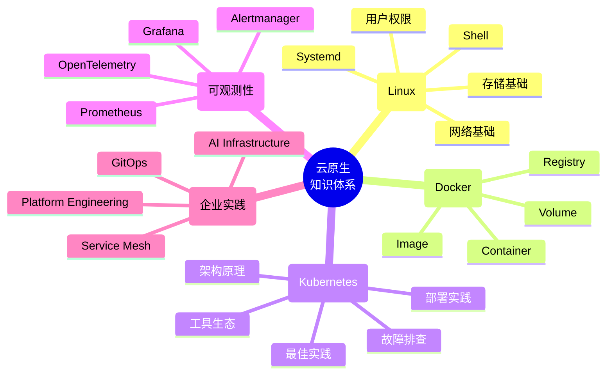
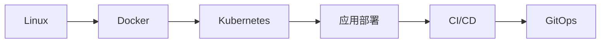
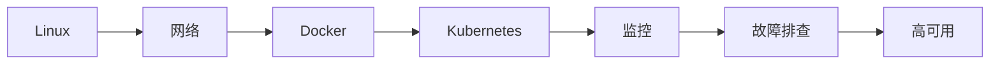
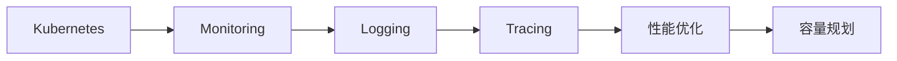
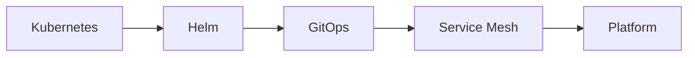
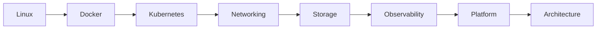
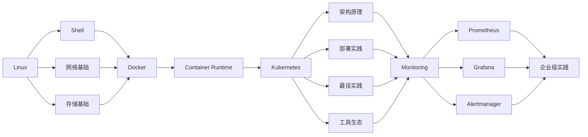
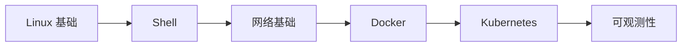
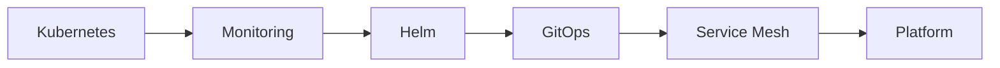

# 云原生学习路线（2026）

> **从 Linux，到 Kubernetes，再到企业级云原生架构。**
>
> 这不仅是一份学习路线，更是一张完整的知识地图（Knowledge Map），帮助你建立系统化的技术体系，而不是零散地学习命令和工具。

## 🧭 全景知识地图

---

## 🎯 如何选择你的学习路径？

不同角色 → 不同路线，但底层体系一致。

### 👨‍💻 开发工程师路线

#### 🎯 学习目标
- 应用容器化（Dockerfile / 镜像构建）
- Kubernetes 部署与发布
- 理解 Deployment / Service / Ingress
- 使用 Helm / GitOps
- 构建持续交付流程

### 👨‍🔧 运维工程师路线

#### 🎯 学习目标
- Linux 服务器管理与排障
- Kubernetes 集群部署与维护
- 网络 / 存储基础
- Prometheus + Grafana 监控体系
- 生产故障定位与处理
- 高可用架构设计

### 📊 SRE 学习路线

#### 🎯 学习目标
- 构建完整可观测性体系
- SLA / SLO / SLI 设计
- 日志 / 指标 / 链路追踪
- 性能调优与容量规划
- 故障响应与复盘机制

### 🏗 平台工程师路线

#### 🎯 学习目标
- 构建企业级 Kubernetes 平台
- 标准化应用交付体系
- 多集群与多租户管理
- 服务治理（Service Mesh）
- 平台工程体系建设

### 🚀 云原生架构师路线

#### 🎯 学习目标
- 企业级云原生架构设计
- 高可用 / 高可靠系统设计
- 网络 / 存储 / 安全体系规划
- 多集群架构设计
- 平台级能力建设

---

## 📌 学习核心原则

**1️⃣ 不要只学工具，要理解原理**
|技术	|核心本质|
|---|---|
|Linux	|进程 / 文件系统 / 网络|
|Docker	|Namespace / Cgroups|
|Kubernetes	|控制器 / 调度 / 声明式|

**2️⃣ 必须做实验**

建议结合本站的文章

**3️⃣ 学习路径优先于知识本身**

推荐顺序：

---

### 🎯 学完后你应该具备的能力
- 能独立部署 Kubernetes 集群
- 能排查生产环境问题
- 能设计基础云原生架构
- 能理解系统底层运行机制

### 📚 推荐入口
- [Linux 基础](../linux/index.md)
- [Kubernetes](/kubernetes/)
- [可观测性](/monitoring/)
- [故障实验室](/lab/)

## 🚀 写在最后

技术的核心不是工具，而是系统能力。

理解系统如何运行，比记住命令更重要。

## 为什么会有这份路线？

很多人在学习技术时都会遇到这些问题：

- 学了很多命令，却不知道背后的原理；
- Docker 会用了，但不知道 Kubernetes 为什么这样设计；
- 会部署 Prometheus，却不知道应该监控哪些指标；
- 学了很多工具，却始终无法串联成完整知识体系。

事实上，企业需要的不是“会某个工具的人”，而是能够理解整个技术栈设计思想的工程师。

因此，1HairLabs 希望通过这份路线，把 Linux、容器、Kubernetes、可观测性和企业级实践串联起来，帮助你建立完整的知识体系。

---

## 推荐学习顺序

---

---

## 第一阶段：Linux 基础

> 一切云原生技术都运行在 Linux 之上。

建议学习：

- Linux 安装
- 文件系统
- 用户与权限
- systemd
- 软件包管理
- 日志管理
- Shell
- 性能分析

学习完成后，你应该能够：

✅ 独立维护 Linux 服务器

✅ 理解系统资源管理

✅ 排查基础系统故障

---

📚 推荐阅读

- [Linux 专题](../linux/index.md)

---

## 第二阶段：网络基础

很多 Kubernetes 问题，本质都是网络问题。

建议掌握：

- TCP/IP
- DNS
- HTTP
- HTTPS
- NAT
- VLAN
- VXLAN
- 路由

学习目标：

能够理解 Pod 为什么可以跨节点通信。

---

## 第三阶段：Docker

重点不是 Docker 命令。

而是理解：

- Namespace
- Cgroups
- OverlayFS
- Image Layer
- Container Runtime

真正理解：

> 为什么 Docker 能做到"一次构建，到处运行"。

---

## 第四阶段：Kubernetes

这是整个学习路线中最重要的一部分。

建议按照下面顺序学习：

1. Kubernetes 架构
2. API Server
3. Scheduler
4. Controller
5. Kubelet
6. Workload
7. Service
8. Ingress
9. Storage
10. Network
11. Security

完成之后，再学习：

- 集群部署
- 集群升级
- 高可用
- 企业实践

---

## 第五阶段：可观测性

企业环境中：

部署只是开始。

真正重要的是：

> 如何知道集群是否健康？

建议学习：

- Prometheus
- Grafana
- Alertmanager
- Metrics
- Logs
- Traces（OpenTelemetry）

---

## 第六阶段：企业级实践

这一阶段开始接近真实生产环境。

包括：

- Requests 与 Limits
- Resource Optimization
- HPA
- VPA
- Cluster Autoscaler
- Backup
- Disaster Recovery

---

## 第七阶段：现代云原生

继续深入：

- GitOps
- ArgoCD
- Helm
- Service Mesh
- Gateway API
- Platform Engineering
- AI Infrastructure

---

## 故障实验室

理论只是第一步。

真正的成长来自于不断实验。

建议配合：

- Pod OOM
- CPU Throttling
- CrashLoopBackOff
- Node NotReady
- etcd 故障

理解每一种故障背后的工作机制。

---

## 学习建议

如果你是：

### 零基础

#### 🎯 学习目标

完成本路线后，你应该能够：

- 熟练使用 Linux 进行日常管理与开发；
- 理解 Docker 容器的基本原理及镜像构建；
- 独立部署一套 Kubernetes 测试环境；
- 掌握 Kubernetes 核心资源对象（Pod、Deployment、Service 等）；
- 使用 Prometheus 和 Grafana 对集群进行基础监控。

---

### 👨‍💻 开发工程师学习路线

#### 🎯 学习目标

完成本路线后，你应该能够：

- 将应用程序容器化；
- 编写 Dockerfile 并构建镜像；
- 使用 Kubernetes 部署、升级和回滚应用；
- 理解 Deployment、Service、Ingress、ConfigMap 等核心资源；
- 使用 Helm、GitOps 构建现代化持续交付流程。

---

### 👨‍🔧 运维工程师学习路线

#### 🎯 学习目标

完成本路线后，你应该能够：

- 独立部署和维护 Linux 服务器；
- 理解 Kubernetes 网络、存储及集群架构；
- 独立搭建 Kubernetes 集群；
- 建立完整的 Prometheus + Grafana 监控体系；
- 能够定位并处理生产环境中的常见故障；
- 掌握高可用集群部署与升级流程。

---

### 📈 SRE 学习路线

#### 🎯 学习目标

完成本路线后，你应该能够：

- 建立完整的可观测性体系；
- 使用 Prometheus、Grafana、Alertmanager 实现监控与告警；
- 收集和分析日志、指标及链路追踪数据；
- 优化 Kubernetes 集群资源利用率；
- 根据 SLA、SLI、SLO 设计可靠性保障方案。

---

### 🏗 Platform Engineering 学习路线

#### 🎯 学习目标

完成本路线后，你应该能够：

- 构建企业级 Kubernetes 平台；
- 使用 Helm 管理应用生命周期；
- 使用 GitOps 实现声明式部署；
- 理解 Service Mesh 的流量治理能力；
- 为研发团队提供标准化、自助式的云原生平台。

---

### 🚀 云原生架构师学习路线

#### 🎯 学习目标

完成本路线后，你应该能够：

- 理解 Kubernetes 各核心组件的设计原理；
- 规划企业级 Kubernetes 集群架构；
- 设计高可用、高性能、高可靠性的云原生平台；
- 建立完整的网络、存储、安全与可观测性体系；
- 根据业务需求制定基础设施架构方案，并持续优化平台能力。

---

## 写在最后

| 我的目标        | 推荐学习路线                                                    |
| ----------- | --------------------------------------------------------- |
| 🎓 零基础      | Linux → Shell → Docker → Kubernetes                       |
| 👨‍💻 开发工程师 | Docker → Kubernetes → Helm → GitOps                       |
| 👨‍🔧 运维工程师 | Linux → 网络 → Kubernetes → Monitoring                      |
| 📊 SRE      | Kubernetes → Monitoring → Logging → Tracing               |
| 🏗 平台工程师    | Kubernetes → GitOps → Service Mesh → Platform Engineering |

技术学习没有真正的终点。

新的工具会不断出现，但底层原理往往变化缓慢。

希望这份学习路线能够帮助你建立系统化的知识体系，而不是停留在记忆命令和复制配置。

当你完成这条路线后，不仅能够部署 Kubernetes，更能够理解它为什么这样设计，以及如何将这些能力应用到真实的企业生产环境。

欢迎收藏本页，并跟随 1HairLabs 一起持续学习和实践。

