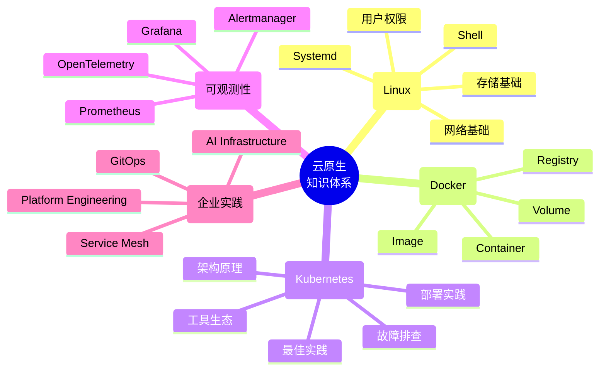
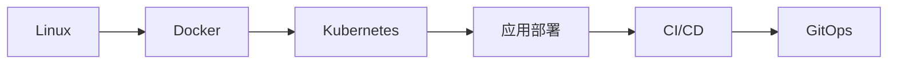
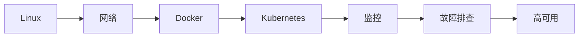
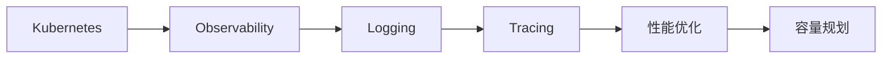
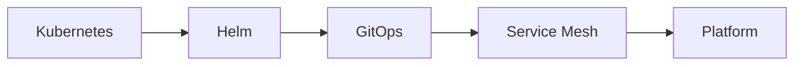
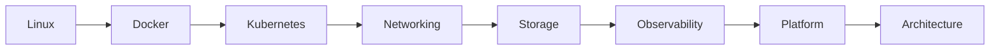

# 云原生学习路线

> **从 Linux，到 Kubernetes，再到企业级云原生架构。**

这不仅是一份学习路线，更是一张完整的知识地图（Knowledge Map），帮助你建立系统化的技术体系，而不是零散地学习命令和工具。

很多人在学习技术时都会遇到这些问题：学了很多命令却不知道背后的原理；Docker 会用了但不知道 Kubernetes 为什么这样设计；会部署 Prometheus 却不知道应该监控哪些指标。企业需要的不是"会某个工具的人"，而是能够理解整个技术栈设计思想的工程师。

这份路线把 Linux、容器、Kubernetes、可观测性和企业级实践串联起来，帮助你建立完整的知识体系。

## 🧭 全景知识地图

---

## 七阶段详解

### 第一阶段：Linux 基础

一切云原生技术都运行在 Linux 之上。

**学习内容：**

- Linux 安装部署
- 文件系统与目录结构
- 用户与权限管理
- systemd 服务管理
- 软件包管理
- 系统日志管理
- Shell 脚本基础
- 性能分析与故障排除

**推荐阅读：**

| 文章 | 说明 |
|---|---|
| [Linux 目录结构说明](../linux/base-system/linux-directory-structure) | 理解 FHS 标准和每个目录的用途 |
| [Linux 常用命令](../linux/base-system/common-commands/) | 日常运维高频命令速查 |
| [Linux 完整命令](../linux/base-system/all-commands/) | 按功能分类的完整命令参考 |
| [Linux 软件包管理](../linux/base-system/package-management/) | apt / yum / dnf / dpkg / rpm |
| [Linux 系统监控](../linux/base-system/system-monitoring/) | top / htop / iostat / vmstat |
| [Linux 系统日志管理](../linux/base-system/log-management/) | journald / rsyslog / 日志轮转 |
| [Linux 系统故障排除](../linux/base-system/troubleshooting/) | 常见系统故障的定位方法 |
| [用户和权限管理](../linux/security/user-and-permission/) | 用户/组/ACL/SELinux 基础 |
| [性能优化](../linux/performance/performance-optimization/) | CPU / 内存 / IO / 网络调优 |
| [Shell 脚本](../linux/shell/shell/) | Shell 基础语法和常用脚本 |

**学完后你应该能够：**

- ✅ 独立维护 Linux 服务器
- ✅ 理解系统资源管理机制
- ✅ 排查基础系统故障

---

### 第二阶段：网络基础

很多 Kubernetes 问题，本质都是网络问题。

**学习内容：**

- TCP/IP 协议栈
- DNS / HTTP / HTTPS
- NAT / VLAN / VXLAN
- 路由与iptables
- Bridge / Overlay 网络

**推荐阅读：**

| 文章 | 说明 |
|---|---|
| [Linux 网络基础](../linux/network/network/) | 网络配置、接口管理、路由基础 |

> 网络专题目前文章较少，后续会持续补充 TCP/IP、DNS、VXLAN 等专题。

**学完后你应该能够：**

- ✅ 理解 Pod 为什么可以跨节点通信
- ✅ 排查常见的网络连通性问题
- ✅ 理解 Kubernetes 网络模型的基础

---

### 第三阶段：Docker 与容器技术

重点不是 Docker 命令，而是理解容器本质。

**学习内容：**

- Namespace（进程隔离）
- Cgroups（资源限制）
- OverlayFS（联合文件系统）
- Image Layer（镜像分层）
- Container Runtime（容器运行时）

**推荐阅读：**

| 文章 | 说明 |
|---|---|
| [裸金属、虚拟机与容器的区别](../deployment/basics/baremetal-vm-container/) | 从底层理解容器和虚拟化的差异 |
| [Docker 部署教程](../deployment/docker&k8s/docker/) | Docker 安装与基础操作 |
| [Docker 实践](../kubernetes/practice/docker/) | 镜像构建、容器管理实践 |

**学完后你应该能够：**

- ✅ 理解 Docker"一次构建，到处运行"的底层原理
- ✅ 编写规范的 Dockerfile
- ✅ 区分容器和虚拟机的适用场景

---

### 第四阶段：Kubernetes

这是整个学习路线中最重要的一部分。

#### 架构原理

先理解 Kubernetes 各核心组件的设计，再学部署和运维。

| 文章 | 说明 |
|---|---|
| [Kubernetes 架构总览](../kubernetes/architecture/) | 控制平面 / 数据平面 / 组件协作 |
| [API Server](../kubernetes/architecture/api-server/) | 集群入口与认证授权 |
| [Scheduler](../kubernetes/architecture/scheduler/) | 调度算法与节点选择 |
| [Controller Manager](../kubernetes/architecture/controller-manager/) | 控制循环与声明式模型 |
| [Kubelet](../kubernetes/architecture/kubelet/) | 节点代理与 Pod 生命周期 |
| [Kube-Proxy](../kubernetes/architecture/kube-proxy/) | Service 转发与负载均衡 |
| [etcd](../kubernetes/architecture/etcd/) | 集群状态存储与一致性 |
| [CNI](../kubernetes/architecture/cni/) | 容器网络接口与插件 |
| [Ingress](../kubernetes/architecture/ingress/) | 七层路由与流量管理 |
| [CRI](../kubernetes/architecture/cri/) | 容器运行时接口 |
| [CSI](../kubernetes/architecture/csi/) | 容器存储接口 |
| [API Resources](../kubernetes/architecture/api-resources/) | 资源对象总览 |
| [Workloads](../kubernetes/architecture/workloads/) | Pod / Deployment / StatefulSet / DaemonSet |
| [Server Resources](../kubernetes/architecture/server-resources/) | Node / Namespace / ResourceQuota |
| [Storage](../kubernetes/architecture/storage/) | PV / PVC / StorageClass |
| [Network](../kubernetes/architecture/network/) | Service / DNS / NetworkPolicy |
| [Security](../kubernetes/architecture/security/) | RBAC / ServiceAccount / PodSecurity |
| [Other Resources](../kubernetes/architecture/other-resources/) | ConfigMap / Secret / HPAs |

#### 部署实践

| 文章 | 说明 |
|---|---|
| [K8s 从入门到生产](../kubernetes/K8s-beginner-to-production/) | 完整学习路径概览 |
| [单 Master 集群部署](../kubernetes/practice/single-master-deployment/) | 从零搭建单节点集群 |
| [单 Master 到 HA 迁移](../kubernetes/practice/single-master-to-ha/) | 从单节点升级到高可用 |
| [HA 集群部署](../kubernetes/practice/ha-cluster/) | 多 Master 高可用集群 |
| [集群升级](../kubernetes/practice/cluster-upgrade/) | 滚动升级策略与实践 |
| [kubectl drain 详解](../kubernetes/practice/kubectl-drain/) | 节点维护与驱逐 |

#### 最佳实践

| 文章 | 说明 |
|---|---|
| [10 个要点](../kubernetes/practice/10-takeaways/) | K8s 生产环境关键经验 |
| [Requests vs Limits](../kubernetes/practice/requests-vs-limits/) | 资源请求与限制的正确姿势 |
| [资源优化](../kubernetes/practice/resource-optimization/) | 集群资源调优方法 |

#### 工具生态

| 文章 | 说明 |
|---|---|
| [K9s](../kubernetes/tools/k9s/) | 终端 K8s 管理 TUI |
| [Headlamp](../kubernetes/tools/headlamp/) | 现代 K8s Web 仪表盘 |

**学完后你应该能够：**

- ✅ 理解 Kubernetes 各核心组件的设计原理
- ✅ 独立部署和维护 Kubernetes 集群
- ✅ 排查常见的集群问题
- ✅ 进行生产环境资源管理和优化

---

### 第五阶段：可观测性

企业环境中，部署只是开始。真正重要的是：如何知道集群是否健康？

**学习内容：**

- Prometheus（指标采集）
- Grafana（可视化）
- Alertmanager（告警管理）
- OpenTelemetry（链路追踪）
- Metrics / Logs / Traces 三支柱

**推荐阅读：**

| 文章 | 说明 |
|---|---|
| [Prometheus](../observability/prometheus/) | 架构、配置、PromQL、服务发现 |
| [Grafana](../observability/grafana/) | 仪表盘设计、数据源配置 |
| [Alertmanager](../observability/alertmanager/) | 告警规则与通知路由 |
| [K8s 集群健康检查](../observability/k8s-cluster-health-check/) | 集群健康度巡检方法 |

**学完后你应该能够：**

- ✅ 构建完整的 Prometheus + Grafana 监控体系
- ✅ 设计有意义的告警规则
- ✅ 通过指标定位性能瓶颈

---

### 第六阶段：企业级实践

这一阶段开始接近真实生产环境。

**学习内容：**

- Requests 与 Limits 资源管理
- HPA / VPA / Cluster Autoscaler
- 集群高可用与容灾
- 备份与恢复策略
- 安全合规与 RBAC 治理

**推荐阅读：**

| 文章 | 说明 |
|---|---|
| [Requests vs Limits](../kubernetes/practice/requests-vs-limits/) | 资源管理的核心概念 |
| [资源优化](../kubernetes/practice/resource-optimization/) | 生产环境资源调优 |
| [HA 集群部署](../kubernetes/practice/ha-cluster/) | 高可用架构实践 |
| [集群升级](../kubernetes/practice/cluster-upgrade/) | 生产环境滚动升级 |
| [10 个要点](../kubernetes/practice/10-takeaways/) | 生产环境关键经验总结 |

**学完后你应该能够：**

- ✅ 设计高可用的 Kubernetes 集群架构
- ✅ 制定资源管理和自动伸缩策略
- ✅ 建立集群备份与灾备方案

---

### 第七阶段：现代云原生

继续深入云原生生态的高级主题。

**学习内容：**

- GitOps（ArgoCD / Flux）
- Helm 包管理
- Service Mesh（Istio / Linkerd）
- Gateway API
- Platform Engineering
- AI Infrastructure on K8s

> 解决方案专题持续建设中，后续会补充更多企业级实践内容。

---

## 🎯 分角色学习路径

不同角色 → 不同路线，但底层体系一致。

### 👨‍💻 开发工程师路线

**🎯 学习目标**

- 应用容器化（Dockerfile / 镜像构建）
- Kubernetes 部署与发布
- 理解 Deployment / Service / Ingress
- 使用 Helm / GitOps
- 构建持续交付流程

### 👨‍🔧 运维工程师路线

**🎯 学习目标**

- Linux 服务器管理与排障
- Kubernetes 集群部署与维护
- 网络 / 存储基础
- Prometheus + Grafana 监控体系
- 生产故障定位与处理
- 高可用架构设计

### 📊 SRE

**🎯 学习目标**

- 构建完整可观测性体系
- SLA / SLO / SLI 设计
- 日志 / 指标 / 链路追踪
- 性能调优与容量规划
- 故障响应与复盘机制

### 🏗 平台工程师路线

**🎯 学习目标**

- 构建企业级 Kubernetes 平台
- 标准化应用交付体系
- 多集群与多租户管理
- 服务治理（Service Mesh）
- 平台工程体系建设

### 🚀 云原生架构师路线

**🎯 学习目标**

- 企业级云原生架构设计
- 高可用 / 高可靠系统设计
- 网络 / 存储 / 安全体系规划
- 多集群架构设计
- 平台级能力建设

---

## 故障实验室

理论只是第一步。真正的成长来自于不断实验。

故障实验室收录真实生产环境中的常见问题及排查过程，帮助你理解每种故障背后的工作机制。

| 实验内容 | 说明 |
|---|---|
| [Pod OOM 测试](lab/pod-oom-test/) | 内存溢出问题的复现与分析 |
| [CPU 压力测试](lab/cpu-stress-test/) | CPU 节流与资源限制验证 |
| [故障转移测试 1](lab/failover-test-1/) | 节点故障场景下的 Pod 迁移 |
| [故障转移测试 2](lab/failover-test-2/) | 控制平面故障的影响范围 |
| [故障转移测试 3](lab/failover-test-3/) | 存储故障与数据一致性 |

👉 [进入故障实验室](lab/)

---

## 📌 学习核心原则

**1️⃣ 不要只学工具，要理解原理**

|技术	|核心本质|
|---|---|
|Linux	|进程 / 文件系统 / 网络|
|Docker	|Namespace / Cgroups|
|Kubernetes	|控制器 / 调度 / 声明式|

**2️⃣ 必须做实验**

看完文章后，结合故障实验室的内容动手复现。理解一种故障的最好方式就是亲手制造它、再亲手解决它。

**3️⃣ 学习路径优先于知识本身**

先建立"学什么、先学什么后学什么"的框架，再往里填内容。不要零散地学命令和工具，要沿着知识体系递进。

---

### 🎯 学完后你应该具备的能力

- 能独立部署 Kubernetes 集群
- 能排查生产环境问题
- 能设计基础云原生架构
- 能理解系统底层运行机制

---

> 技术学习没有真正的终点。新的工具会不断出现，但底层原理往往变化缓慢。
>
> 希望这份路线能帮助你建立系统化的知识体系，而不是停留在记忆命令和复制配置。
>
> —— 1HairLabs · 一根头发丝的宽度

---

