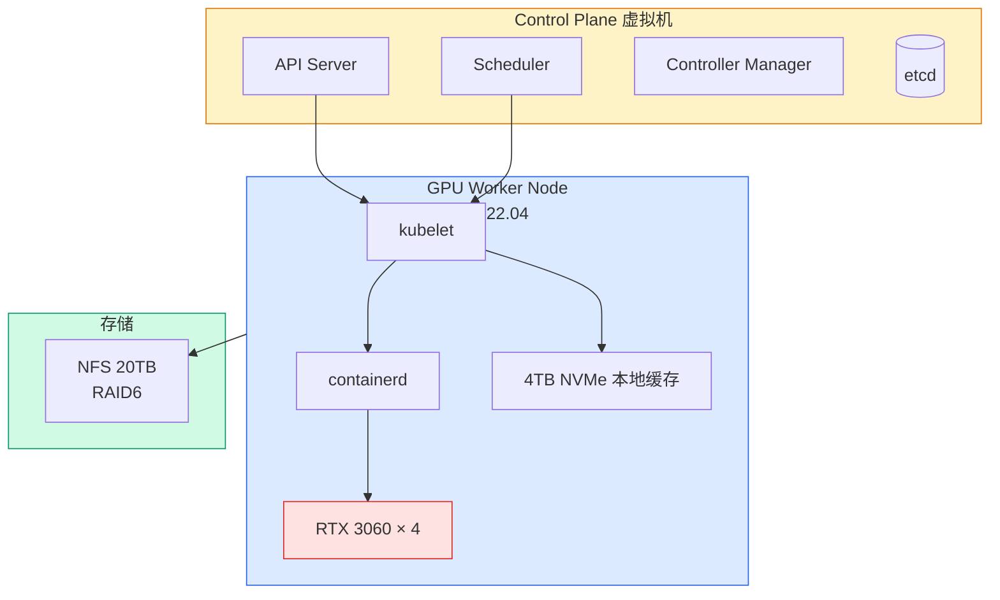
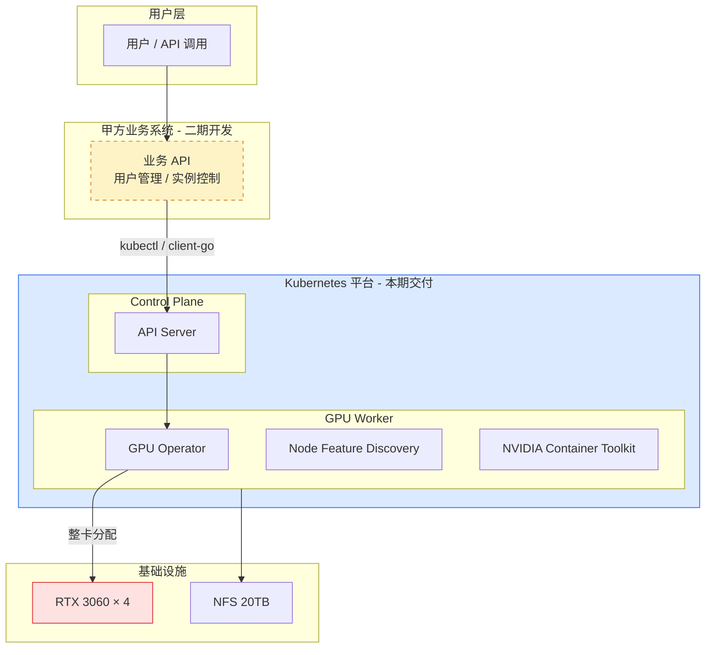
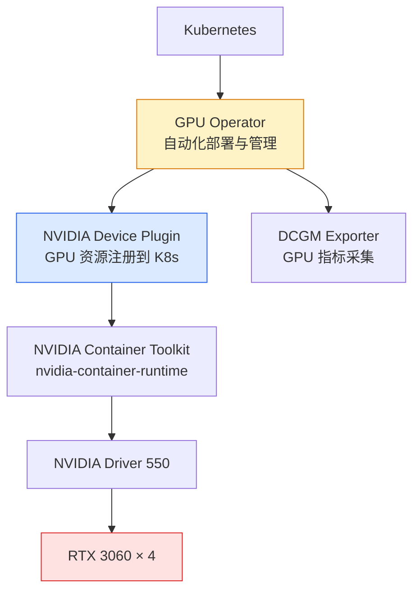
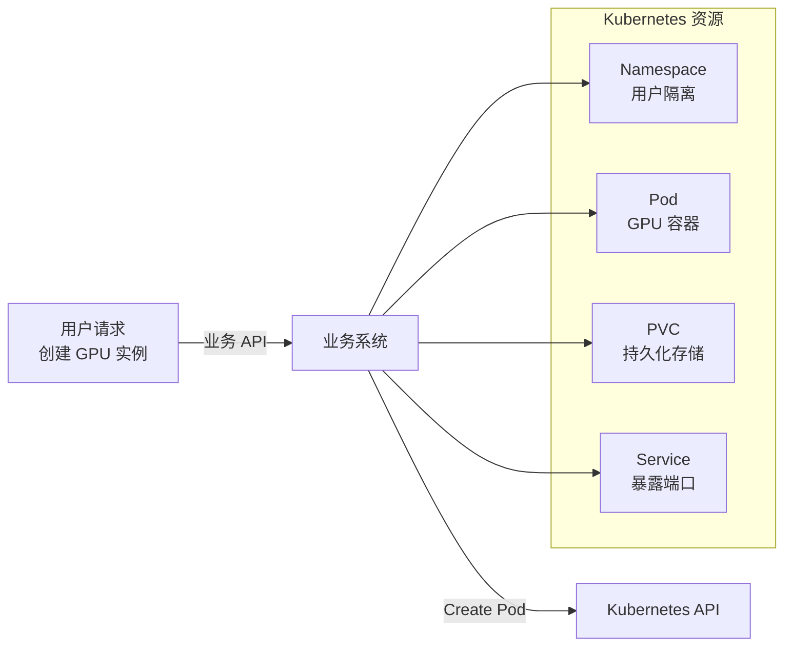
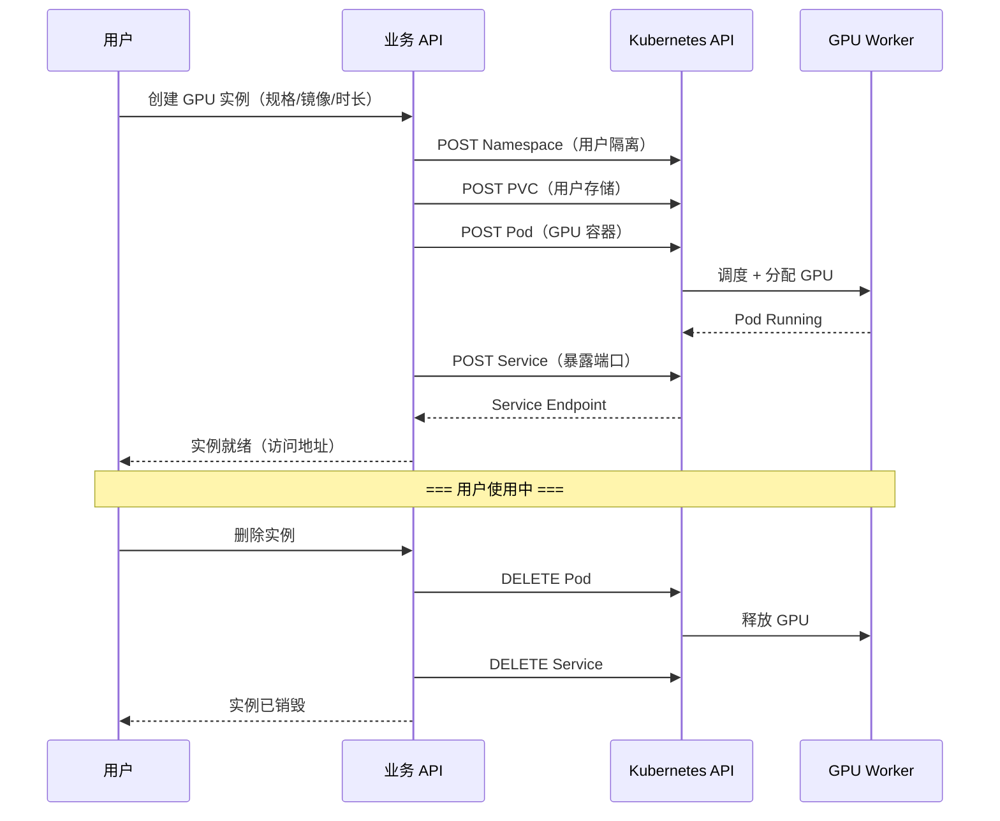

# GPU Kubernetes 算力平台一期实施方案与报价

<div style="text-align:center; padding: 20px 0; font-size: 1.1em; color: #64748b;">

**项目编号**：GKU-2026-001

**版本**：v1.0

**日期**：2026 年 7 月 30 日

**编制方**：1HairLabs

</div>

---

## 一、项目背景

甲方（客户方）正在规划建设一个 **GPU 算力租赁平台**，为用户提供 GPU 资源的在线租用服务，业务形态对标 AutoDL、仙宫云等 GPU 云平台。

甲方具备软件开发能力，后续将自行开发用户系统、业务 API 和前端界面。当前缺少的是底层基础设施能力——如何用 Kubernetes 管理 GPU 资源池、如何实现 GPU 实例的自动创建与销毁、如何设计多租户的资源隔离方案。

乙方（1HairLabs）作为 Kubernetes 与云原生基础设施技术服务提供方，负责交付 **GPU Kubernetes 算力平台的底层底座**，并为甲方开发团队提供 API 对接指导和技术转移。

---

## 二、项目目标

### 一期目标

以甲方现有硬件（4 × RTX 3060 GPU 服务器）完成 **GPU Kubernetes 平台的验证环境搭建**，实现以下核心能力：

| 目标 | 描述 |
| :---: | --- |
| **GPU 集群就绪** | Kubernetes 集群正确识别并调度 4 张 RTX 3060 GPU |
| **实例生命周期** | 通过 Kubernetes API 完成 GPU 容器的创建、运行、销毁全流程 |
| **AI 应用验证** | 在 GPU 容器中成功运行 AI 推理/训练任务（PyTorch/Jupyter） |
| **数据持久化** | 通过 NFS + PVC 实现用户数据和模型数据的持久存储 |
| **文档与转移** | 交付架构文档、部署文档，甲方可独立复现和扩展 |

### 二期方向（后续）

-   多节点 GPU 集群扩展（5090 8 卡服务器）
-   甲方业务平台对接 Kubernetes API
-   用户隔离、配额管理、GPU 显存限制
-   生产级监控与告警

---

## 三、环境规划

### 3.1 甲方现有硬件

| 节点 | CPU | 内存 | GPU | 系统盘 | 数据盘 | 网络存储 |
| --- | --- | :---: | --- | --- | --- | --- |
| **GPU Worker** | 2 × Intel Xeon E5-2680 | 128 GB+ | RTX 3060 × 4 | 480G SSD ×2 RAID1 | 4TB NVMe | NFS 20TB RAID6 |

### 3.2 规划部署拓扑



| 组件 | 配置建议 | 说明 |
| --- | --- | --- |
| **Control Plane** | 虚拟机：4~8 Core / 8~16 GB / 100 GB+ | Master 节点，运行控制面组件 |
| **GPU Worker Node** | 甲方现有物理机 | 实际运行 GPU 容器的节点 |
| **网络存储** | 甲方现有 NFS 20TB | 用户数据和模型存储 |
| **本地缓存** | NVMe 4TB | 容器镜像缓存 + 临时数据 |

### 3.3 网络规划

| 网络 | CIDR | 用途 |
| --- | --- | --- |
| **管理网络** | 甲方现有局域网 | kubelet ↔ API Server、SSH |
| **Pod 网络** | `10.244.0.0/16` | 容器间通信（Calico VXLAN） |
| **Service 网络** | `10.96.0.0/12` | ClusterIP 服务 |
| **NFS 网络** | 甲方现有 NFS IP | PVC 持久化挂载 |

---

## 四、总体架构



!!! note "二期部分"
    虚线框为甲方自行开发的业务系统，不在本期交付范围内。本期交付完整的 Kubernetes 层（实线框）。

---

## 五、Kubernetes 部署方案

### 5.1 部署方式

| 项目 | 选择 | 理由 |
| --- | :---: | --- |
| **部署工具** | kubeadm | 社区标准，甲方可复现 |
| **容器运行时** | containerd | K8s 1.24+ 默认，GPU 兼容性好 |
| **网络插件** | Calico | VXLAN 覆盖网络，稳定成熟 |
| **K8s 版本** | v1.31.x | 当前最新稳定版 |

### 5.2 Control Plane

-   部署为单节点虚拟机
-   单 Master 架构（一期验证规模足够）
-   后续扩展：可升级为 HA（3 Master + 负载均衡）

### 5.3 GPU Worker Node

-   操作系统：Ubuntu 22.04（甲方已安装）
-   NVIDIA 驱动：`nvidia-driver-550`（Production Branch，RTX 3060 兼容且生产验证充分）
-   CUDA 版本：12.4+
-   GPU Operator：自动化管理 GPU 驱动、Runtime、Device Plugin、DCGM 监控

!!! note "驱动版本选择说明"
    NVIDIA 驱动分为 **Production Branch**（如 550、570）和 **New Feature Branch**（如 555、580）。Production Branch 经过大规模生产验证，是商业环境的推荐选择。
    
    -   **550（当前选择）**：最新 Production Branch，CUDA 12.4 生态成熟，PyTorch/GPU Operator 兼容性经过充分验证，RTX 3060 正常工作
    -   **570**：550 的继任 Production Branch（如部署时 570 已是 Production Branch，可评估替换）
    -   **580**：New Feature Branch，新特性好但生产验证不足，暂不推荐用于商业交付
    
    驱动版本允许在实施阶段根据 NVIDIA 官方最新 Production Branch 状态微调——**原则是始终选 Production Branch**，不追 New Feature Branch。

---

## 六、GPU 方案

### 6.1 GPU 技术栈



### 6.2 GPU 调度策略

一期采用 **整卡独占** 模式——每个用户独占一张 RTX 3060，不做 GPU 拆分（vGPU/Time-Slicing/MIG）。

| 策略 | 说明 |
| :---: | --- |
| **分配方式** | 1 Pod → `nvidia.com/gpu: 1` → 独占 1 张 GPU |
| **隔离级别** | 物理隔离——用户间互不影响 |
| **资源利用率** | 4 张 RTX 3060 同时支持 4 个用户（每用户 1 卡） |

!!! note "不做 GPU 拆分的理由"
    -   一期仅为技术验证，用户数少，整卡分配最简单可靠
    -   物理隔离避免了多租户共享 GPU 带来的显存争抢和性能干扰
    -   后续用户量增长时，可在二期评估 Time-Slicing 或 MPS 做 GPU 复用

### 6.3 GPU 实例验证

创建 GPU Pod 示例：

```yaml
apiVersion: v1
kind: Pod
metadata:
  name: gpu-test
spec:
  containers:
    - name: cuda-test
      image: nvidia/cuda:12.4.0-runtime-ubuntu22.04
      command: ["nvidia-smi"]
      resources:
        limits:
          nvidia.com/gpu: 1
```

创建 Jupyter 环境示例：

```yaml
apiVersion: v1
kind: Pod
metadata:
  name: jupyter-gpu
spec:
  containers:
    - name: jupyter
      image: pytorch/pytorch:2.5.1-cuda12.4-cudnn9-runtime
      command: ["jupyter", "lab", "--ip=0.0.0.0", "--allow-root"]
      ports:
        - containerPort: 8888
      resources:
        limits:
          nvidia.com/gpu: 1
      volumeMounts:
        - name: user-data
          mountPath: /workspace
  volumes:
    - name: user-data
      persistentVolumeClaim:
        claimName: user-data-pvc
```

---

## 七、存储方案

### 7.1 存储分层

| 层 | 后端 | 用途 |
| --- | --- | --- |
| **本地 NVMe** | 4TB NVMe | 容器镜像缓存、临时计算数据 |
| **NFS 持久化** | NFS 20TB RAID6 | 用户数据、模型文件、PVC |
| **系统 RAID1** | 480G SSD ×2 | 操作系统 |

### 7.2 NFS CSI 集成

```bash
# 安装 NFS CSI Driver
helm repo add csi-driver-nfs https://raw.githubusercontent.com/kubernetes-csi/csi-driver-nfs/master/charts
helm install csi-driver-nfs csi-driver-nfs/csi-driver-nfs \
    --namespace kube-system \
    --set kubeletDir=/var/lib/kubelet
```

```yaml
# StorageClass 定义
apiVersion: storage.k8s.io/v1
kind: StorageClass
metadata:
  name: nfs-sc
provisioner: nfs.csi.k8s.io
parameters:
  server: <NFS_SERVER_IP>
  share: /export/gpu-platform
mountOptions:
  - nfsvers=4.1
reclaimPolicy: Retain
volumeBindingMode: Immediate
```

---

## 八、监控部署

| 组件 | 用途 |
| --- | --- |
| **Prometheus** | 采集 K8s 集群和 GPU 指标 |
| **Grafana** | GPU 利用率、显存、温度、功耗 Dashboard |
| **DCGM Exporter** | NVIDIA GPU 专用指标采集（随 GPU Operator 部署） |

Grafana Dashboard 导入 NVIDIA DCGM Exporter Dashboard（ID: 12239），监控每张 GPU 的核心指标：


---

## 九、API 对接说明

> 本节为甲方开发团队提供技术方向指导，不包含代码开发。

### 9.1 Kubernetes API 访问方式

| 方式 | 说明 | 推荐 |
| :---: | --- | :---: |
| **kubectl** | CLI 工具，手动操作 | 运维调试 |
| **client-go** | Go 语言 SDK | Go 业务系统 |
| **Kubernetes API** | REST API（Bearer Token 认证） | 任意语言 |
| **Python K8s Client** | Python SDK（`kubernetes` 包） | **推荐给 Python 系统** |

### 9.2 关键 API 资源



| 资源 | API 路径 | 操作 |
| --- | --- | --- |
| 创建 Namespace | `POST /api/v1/namespaces` | 用户隔离 |
| 创建 GPU Pod | `POST /api/v1/namespaces/{ns}/pods` | 创建 GPU 实例 |
| 删除 Pod | `DELETE /api/v1/namespaces/{ns}/pods/{name}` | 释放 GPU |
| 查看 Pod 状态 | `GET /api/v1/namespaces/{ns}/pods` | 实例状态查询 |
| 创建 PVC | `POST /api/v1/namespaces/{ns}/persistentvolumeclaims` | 用户存储 |
| 创建 Service | `POST /api/v1/namespaces/{ns}/services` | 暴露 Jupyter/SSH 端口 |

### 9.3 实例生命周期 API 流程



---

## 十、交付文档清单

| 序号 | 文档名称 | 内容概要 |
| :---: | --- | --- |
| 1 | **架构说明文档** | 总体架构图、组件关系、技术选型理由 |
| 2 | **部署文档** | 从裸机到集群就绪的完整步骤（含命令） |
| 3 | **环境配置记录** | IP 规划、软件版本、配置文件清单 |
| 4 | **GPU 验证报告** | GPU 调度测试结果、`nvidia-smi` 输出、AI 任务运行验证 |
| 5 | **API 对接指南** | Kubernetes API 调用示例、资源模型说明 |
| 6 | **运维手册** | 日常巡检、常见故障排查、日志查看 |
| 7 | **节点扩展指南** | 后续新增 GPU 节点的完整操作步骤 |

---

## 十一、项目周期

| 阶段 | 内容 | 预计工时 | 交付物 |
| :---: | --- | :---: | --- |
| **1. 环境准备** | 远程接入确认、网络规划、系统检查 | 0.5 天 | 环境确认单 |
| **2. K8s 集群部署** | Control Plane + Worker 部署、Calico 网络 | 1 天 | 集群就绪 |
| **3. GPU 环境部署** | NVIDIA 驱动、GPU Operator、Device Plugin | 1 天 | GPU 可调度 |
| **4. 存储集成** | NFS CSI Driver、StorageClass、PVC 验证 | 0.5 天 | 持久化就绪 |
| **5. AI 验证** | CUDA 测试、PyTorch/Jupyter 运行、GPU 调度验证 | 1 天 | 验证报告 |
| **6. 监控部署** | Prometheus + Grafana + DCGM | 0.5 天 | GPU Dashboard |
| **7. 文档编写** | 架构文档 + 部署文档 + API 指南 + 运维手册 | 2 天 | 全套文档 |
| **8. 技术转移** | 甲方团队讲解、API 对接指导、Q&A | 0.5 天 | 知识转移 |
| **合计** | | **7 个工作日** | |

---

## 十二、项目报价

### 报价单

| 项目名称 | GPU Kubernetes 算力平台一期验证建设项目 |
| --- | :---: |
| **项目编号** | GKU-2026-001 |
| **报价有效期** | 30 天 |

| 服务项目 | 内容说明 | 金额 |
| --- | --- | :---: |
| 架构设计 | K8s + GPU 平台架构设计、网络规划、存储规划 | ¥2,000 |
| K8s 集群部署 | Control Plane + GPU Worker 部署、Calico 网络 | ¥2,500 |
| GPU 环境部署 | NVIDIA 驱动、GPU Operator、Device Plugin、DCGM | ¥2,500 |
| 存储集成 | NFS CSI Driver、StorageClass、PVC 配置 | ¥1,000 |
| AI 应用验证 | CUDA 测试、PyTorch/Jupyter 运行、GPU 调度验证 | ¥1,500 |
| 监控部署 | Prometheus + Grafana GPU Dashboard | ¥500 |
| 技术文档 | 架构文档 + 部署文档 + API 指南 + 运维手册 + 扩展指南 | ¥2,500 |
| 技术转移 | 远程讲解、API 对接指导、Q&A | ¥500 |
| **合计** | | **¥13,000** |

### 付款方式

> 当前项目仅包含一期部署任务，因此付款节点以“一期”为单位，分别对应启动、部署完成和验收三个里程碑。

| 节点 | 比例 | 金额 | 触发条件 |
| :---: | :---: | ---: | --- |
| **一期（启动）** | 50% | ¥6,500 | 方案确认，签订协议，进入一期实施 |
| **一期（部署完成）** | 30% | ¥3,900 | 一期部署完成，GPU 集群就绪 + AI 验证通过 |
| **一期（验收）** | 20% | ¥2,600 | 一期验收通过，文档交付 + 技术转移完成 |

---

## 十三、双方责任

### 甲方（客户方）

-   提供硬件环境（GPU 服务器 + NFS 存储）
-   提供远程访问权限（SSH/VPN/内网穿透）
-   配合环境信息确认（网络配置、IP 规划）
-   按时支付各阶段款项

### 乙方（1HairLabs）

-   按时完成各阶段交付物
-   保证环境可复现（甲方按文档可独立重建）
-   提供 30 天免费技术答疑（验收后起算）
-   对交付内容保密

---

## 十四、后续阶段规划

| 阶段 | 内容 | 预计节点数 | 建议启动时机 |
| :---: | --- | :---: | --- |
| **一期** | GPU K8s 平台验证（本项目） | 1 GPU Node | 当前 |
| **二期** | 多节点扩展 + 业务 API 开发 | 2~3 GPU Node | 一期验收后 |
| **三期** | 生产上线 + 5090 8 卡节点 | 5+ GPU Node | 业务平台就绪后 |

---

## 十五、确认与签署

<div style="border: 1px solid #e5e7eb; padding: 20px; border-radius: 8px;">

**甲方确认**：

□ 已阅读并理解本方案全部内容

□ 同意项目范围、周期与报价

□ 确认硬件环境就绪，可提供远程访问

签字：________________ &nbsp;&nbsp;&nbsp;&nbsp; 日期：________________

---

**乙方确认**：

□ 确认可按时完成上述交付物

□ 确认报价包含内容

签字：_1HairLabs_ &nbsp;&nbsp;&nbsp;&nbsp; 日期：_2026-07-30_

</div>

---

## 附录：技术选型依据

| 组件 | 选择 | 替代方案 | 选型理由 |
| --- | :---: | --- | --- |
| 容器运行时 | containerd | CRI-O | K8s 默认，社区最广，GPU 兼容性最佳 |
| 网络插件 | Calico | Flannel / Cilium | VXLAN 成熟，性能好，支持 NetworkPolicy |
| GPU 管理 | GPU Operator | 手动安装 | 自动化部署、升级、监控一体化 |
| GPU 共享 | 整卡独占 | Time-Slicing / MIG | 一期用户数少，物理隔离最简单可靠，无需 GPU 拆分 |
| 存储 CSI | NFS CSI Driver | Longhorn / Rook | 甲方已有 NFS 20TB，零额外成本 |
| 监控 | Prometheus + Grafana | VictoriaMetrics | 社区标准，DCGM Exporter 直接集成 |
