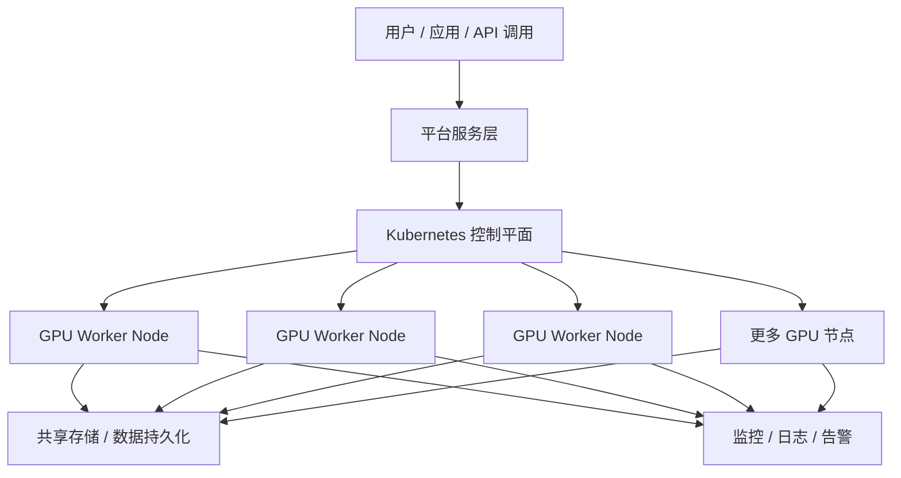

# GPU 算力平台建设方案（脱敏版）

> 本文为面向公开站点的脱敏版方案，重点展示建设思路、演进路线和关键里程碑。关于更细的架构设计、私有化配置、容量建模、实施脚本和商业报价等内容，已作为作者个人增值资产保留，不在站点中公开。

---

## 1. 建设背景

随着 AI 推理、训练和交互式 Notebook 场景的普及，单机 GPU 资源已经难以满足持续增长的算力需求。企业往往需要一套可以快速验证、稳定扩容并支持多用户使用的底层算力平台。

这类平台的核心目标，不是简单地“把 GPU 装进服务器”，而是要构建一套能够满足以下能力的基础设施：

- 支持 GPU 资源的自动发现与调度
- 支持多用户、任务隔离与资源控制
- 支持从单节点验证逐步扩展到多节点集群
- 支持容器化应用、Jupyter、推理服务和训练任务
- 支持长期运维、监控与容量管理

---

## 2. 建设目标

本方案以“从基础验证到规模扩展”的方式推进，目标分为三层：

### 2.1 基础验证目标

首先完成一次真实可运行的 GPU 平台验证，确认平台具备以下能力：

- Kubernetes 集群可正常部署
- GPU 资源可被 Kubernetes 识别并调度
- 容器可正确使用 GPU 资源运行任务
- 数据持久化与基础监控可用
- 具备后续扩展的基础能力

### 2.2 扩展目标

在验证成功后，继续把平台从单机/少量节点逐步扩展为可支撑多用户、多任务的中型 GPU 集群，重点解决：

- 集群节点扩容
- 资源池统一管理
- 网络与存储能力增强
- 监控与告警体系完善
- 对外服务能力提升

### 2.3 最终目标

最终演进到一个可覆盖大规模 AI 负载的 GPU 计算平台，目标是建设一套可支撑“20 台 8 卡 GPU 节点”的算力集群，形成具备稳定生产能力的底层基础设施。

---

## 3. 建设路线

整个方案可分为四个阶段推进：

| 阶段 | 目标 | 关键成果 |
| --- | --- | --- |
| 阶段 1：基础项目测试 | 完成最小可用验证环境 | GPU 调度、容器运行、数据挂载、基础监控可用 |
| 阶段 2：项目扩展 | 从单节点扩容到多节点 | 集群能力增强、资源隔离、运维自动化初步形成 |
| 阶段 3：平台规模化 | 建设中型生产集群 | 多节点 GPU 资源池、统一运维与监控 |
| 阶段 4：最终目标 | 达到 20 台 8 卡节点规模 | 形成可支撑大规模 AI 工作负载的平台能力 |

---

## 4. 总体架构思路

从整体架构上看，平台可分为四层：

1. 计算层：GPU 节点与 Kubernetes worker 节点
2. 控制层：Kubernetes 控制平面与调度能力
3. 存储与网络层：持久化存储、共享文件系统与集群网络
4. 运维与服务层：监控、日志、告警、权限管理与接口能力

---

## 5. 阶段性实施内容

### 5.1 阶段 1：基础项目测试

这一阶段的重点是把平台跑起来，验证核心能力是否成立。通常包括：

- Kubernetes 集群初始化与基础组件部署
- GPU 驱动与运行时环境安装
- GPU 资源接入 Kubernetes
- 容器作业验证，包括训练任务、推理任务或 Notebook 场景
- 持久化存储挂载验证
- 基础监控指标采集与可视化

这一阶段的产出是“最小可用平台”，后续扩容时不需要从零重建。

### 5.2 阶段 2：项目扩展

当基础测试完成后，可以将平台从单节点扩展为多节点 GPU 集群。重点解决：

- 多节点资源池统一管理
- 节点加入与扩容流程标准化
- 更完善的资源调度与隔离策略
- 存储与网络能力演进
- 运维自动化和故障恢复能力提升

### 5.3 阶段 3：规模化平台建设

当业务增长进入中型阶段后，可以把集群逐步从“可用”提升为“稳定可运维”。这时建议重点关注：

- 集群高可用能力
- 更细粒度的资源管理与配额控制
- 统一监控、日志与告警体系
- 应用层接入能力与 API 化
- 更完善的安全与权限模型

### 5.4 阶段 4：最终目标——20 台 8 卡节点

最终目标是建设一个覆盖 160 张 GPU 的算力集群。按此规模，平台需要具备：

- 大规模节点管理能力
- 高并发任务调度能力
- 稳定的共享存储与数据流转能力
- 可持续的容量规划与运维模式

---

## 6. 关键技术方向

### 6.1 Kubernetes 作为底座

Kubernetes 是整个方案的核心控制平台，负责：

- 统一调度 GPU 资源
- 管理容器化任务生命周期
- 为应用提供弹性与可扩展能力
- 为后续 API 化和多租户能力打基础

### 6.2 GPU 资源管理

GPU 资源接入后，平台需要具备：

- 资源发现与注册
- 资源调度与分配
- 任务运行与释放
- 运行日志与状态管理

### 6.3 存储与数据管理

对于 AI 工作负载，数据层同样关键。平台需要支撑：

- 持久化数据存储
- 模型与数据文件共享
- 用户工作目录挂载
- 容器重建后的数据连续性

### 6.4 可观测性

随着节点数和 GPU 数量增长，监控与告警能力变得越来越重要。建议统一纳入：

- CPU / 内存 / 磁盘 / 网络监控
- GPU 利用率、显存占用、温度与功耗监控
- 日志采集与查询
- 告警路由与故障定位

---

## 7. 规模化演进示意

| 规模阶段 | 节点数 | 单节点 GPU 数 | 总 GPU 数 | 适用场景 |
| --- | ---: | ---: | ---: | --- |
| 基础验证 | 1 | 4~8 | 4~8 | 单用户 / 小规模验证 |
| 扩展阶段 | 3~5 | 8 | 24~40 | 多用户试运行 |
| 中型平台 | 8~12 | 8 | 64~96 | 业务初步上线 |
| 目标规模 | 20 | 8 | 160 | 大规模 AI 算力平台 |

---

## 8. 验收重点

完成建设后，建议从以下几个维度进行验收：

- GPU 任务可正常调度并运行
- 多用户场景下资源隔离可用
- 集群扩容流程可重复执行
- 存储与数据持久化可稳定使用
- 监控与告警体系可覆盖主要风险点
- 运维文档及操作流程可交付给后续团队

---

## 9. 公开站点中不展示的内容

为了保护个人技术资产与项目价值，站点公开版中不展示以下内容：

- 更细的架构设计与私有化实施细节
- 具体网络拓扑、资源配额模型与性能调优参数
- 部署脚本、自动化配置与内部运维模板
- 成本建模、报价结构与客户化方案内容
- 进一步扩容的定制化优化策略

这些内容将作为个人增值资产保留，供后续项目交付、技术转移或商务沟通时使用。

---

## 10. 结语

从基础项目测试出发，逐步构建 GPU Kubernetes 平台，是一条非常适合 AI 算力场景落地的演进路径。通过分阶段验证、持续扩容与运维沉淀，最终可以逐步演进到 20 台 8 卡节点的规模化算力平台。

这类方案的核心，不仅是“把 GPU 用起来”，而是把算力能力变成一套可复用、可扩展、可运维的基础设施能力。
