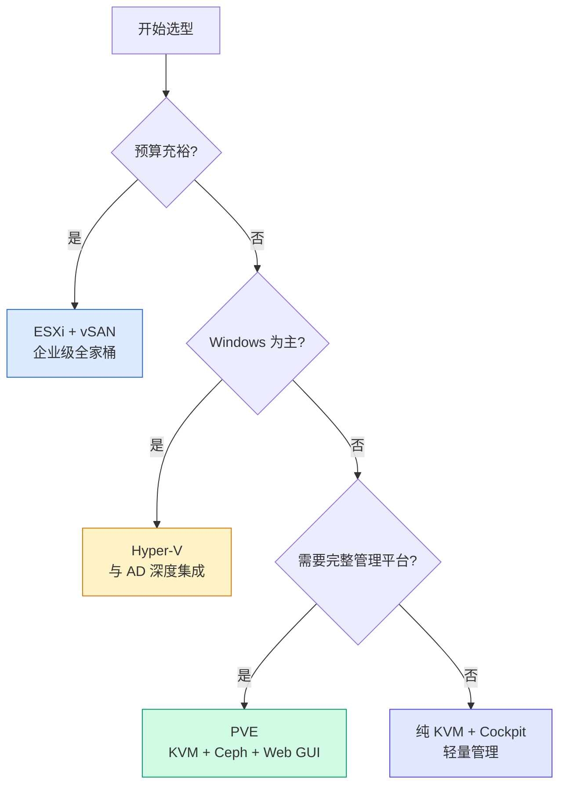

# Hypervisor 选型指南：ESXi vs KVM vs Hyper-V vs Xen

## 前言

选 Hypervisor 和选数据库一样——选错了代价巨大（迁移成本、人员技能、生态绑定）。本文从技术架构、性能、生态、成本和迁移路径五个维度，对比当前四大主流方案。

---

## 架构对比

| | ESXi | KVM | Hyper-V | Xen |
| --- | :---: | :---: | :---: | :---: |
| **类型** | Type 1（专有微内核） | Type 1（Linux 内核模块） | Type 1（Windows 集成） | Type 1（微内核） |
| **管理平台** | vCenter | oVirt / PVE / OpenStack | SCVMM / Windows Admin Center | XenCenter / XCP-ng |
| **Guest OS 支持** | 几乎所有 | 几乎所有 | Windows 深度优化 | Linux 深度优化 |
| **容器支持** | Tanzu（K8s） | LXC / K8s（原生） | Windows Containers | ✗ |
| **分布式存储** | vSAN | Ceph / Gluster | Storage Spaces Direct | 需第三方 |
| **网络虚拟化** | NSX | OVS / OVN | SDN（Azure Stack） | 有限 |
| **许可模式** | 商业许可 | **开源（GPL）** | Windows Server 自带 | **开源（GPL）** |

---

## 性能对比

| 场景 | ESXi | KVM | Hyper-V |
| --- | :---: | :---: | :---: |
| CPU（裸机级） | 98%+ | 98%+ | 97%+ |
| 内存过量分配 | ★★★★★ | ★★★☆ | ★★★★ |
| 存储性能 | ★★★★★（vSAN ESA） | ★★★★（Ceph） | ★★★★（SSD） |
| 网络吞吐 | ★★★★★（VMXNET3） | ★★★★★（VirtIO） | ★★★★ |
| Windows VM | ★★★★★ | ★★★★ | ★★★★★（原生优化） |
| Linux VM | ★★★★ | ★★★★★（原生） | ★★★★ |

---

## 生态对比

| | ESXi | KVM | Hyper-V |
| --- | :---: | :---: | :---: |
| **备份厂商** | Veeam、Commvault 等全线 | Veeam、Borg、PBS | Veeam、DPM |
| **监控** | vROps、Zabbix、PRTG | Zabbix、Prometheus | SCOM |
| **自动化** | Terraform、Ansible、PowerCLI | Terraform、Ansible | DSC、Ansible |
| **云迁移** | VMware Cloud on AWS | OpenStack → 多云 | Azure Migrate |
| **社区规模** | 企业主导 | **最大开源社区** | Windows 生态 |
| **认证** | VCP（$4,500+） | RHCE、LFCS | MCSE |

---

## 成本对比（3 节点集群 × 3 年）

| | ESXi | KVM（PVE） | Hyper-V |
| --- | :---: | :---: | :---: |
| Hypervisor 许可 | ~$30,000 | **$0** | 含在 Windows Server 中 |
| 管理平台 | ~$18,000 (vCenter) | **$0 ~ $4,500** (订阅) | 含在 Windows Server 中 |
| 存储 | ~$24,000 (vSAN) | **$0**（Ceph）或外挂 | ~$0（SSD）或外挂 |
| Windows Server 许可 | 另购 | 另购 | ~$18,000（Datacenter） |
| **3 年总计** | **~$72,000+** | **~$4,500** | **~$18,000+** |

---

## 选型决策树

---

## 迁移路径

| 从 | 到 | 工具 | 难度 |
| --- | --- | --- | :---: |
| ESXi → PVE | `qm importovf` + `ovftool` | 中 |
| ESXi → KVM | `virt-v2v` | 中 |
| Hyper-V → KVM | `virt-v2v` | 中 |
| 物理机 → 任何 | `Starwind V2V`、`Clonezilla` | 中-高 |
| Xen → KVM | 导出 OVF + 导入 | 中 |

---

## 总结

| 推荐 | 适用 |
| :---: | --- |
| **ESXi** | 不差钱、需要完整生态、合规要求高 |
| **KVM（PVE）** | 预算敏感、中小企业、HomeLab、不想被锁定 |
| **Hyper-V** | 纯 Windows 环境、已有 Windows Server 许可 |
| **Xen** | 遗留系统（AWS 早期）、XCP-ng 用户 |

> 没有最好的 Hypervisor——只有最适合你的 Hypervisor。选型不是技术决定，是预算、团队技能和长期战略的综合决策。 🚀
