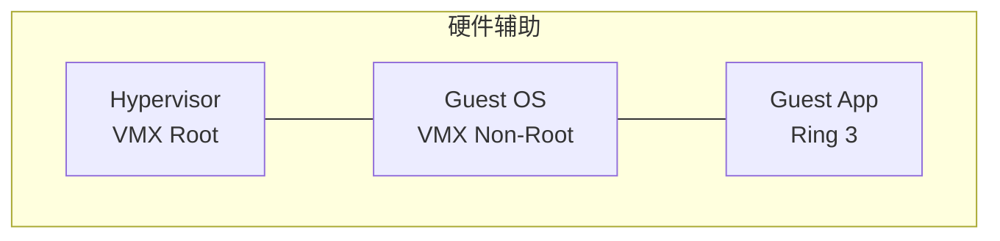

# CPU 与内存虚拟化原理

## 前言

虚拟化的核心挑战：如何让多个 Guest OS 共享同一套物理 CPU 和内存，同时让每个 Guest OS **以为自己独占硬件**？答案在 Intel VT-x/AMD-V 和 EPT/NPT 这两套硬件辅助虚拟化技术中。

---

## CPU 虚拟化

### 传统的「Ring 权限模型」

x86 架构有 4 个权限级别（Ring 0~3）：

| Ring | 运行内容 |
| :---: | --- |
| **0** | OS 内核（最高权限） |
| **1~2** | 设备驱动（几乎不用） |
| **3** | 用户应用程序（最低权限） |

OS 内核跑在 Ring 0，应用程序跑在 Ring 3。虚拟化的问题是：**Hypervisor 需要占据 Ring 0**，那 Guest OS 的内核放哪？

### 软件虚拟化时代（VT-x 之前）

在没有 VT-x 的年代，有两种方案：

| 方案 | 原理 | 缺点 |
| --- | --- | --- |
| **二进制翻译** | Hypervisor 扫描 Guest OS 的指令，把特权指令替换为安全等价指令 | 性能开销巨大（VMware 早期方式） |
| **半虚拟化（Paravirtualization）** | 修改 Guest OS 内核，让它主动调用 Hypervisor 的 API 而非执行特权指令 | Guest OS 必须被修改（Xen 的方式） |

### 硬件辅助虚拟化：Intel VT-x / AMD-V

VT-x 引入了两个新模式，在 Ring 0 之上增加了更高权限：

| 模式 | 谁运行 | 权限 |
| --- | --- | --- |
| **VMX Root Mode** | Hypervisor | 最高 |
| **VMX Non-Root Mode** | Guest OS 内核 | 受限 Ring 0 |



Guest OS 内核在 VMX Non-Root 模式下运行，当它执行特权指令时，CPU 自动触发 **VM Exit**，将控制权交还给 Hypervisor。Hypervisor 处理完毕后再通过 **VM Entry** 恢复 Guest 运行。

| 事件 | 说明 |
| --- | --- |
| **VM Exit** | Guest 执行特权指令 → CPU 暂停 Guest → 切换到 Root 模式 → Hypervisor 处理 |
| **VM Entry** | Hypervisor 处理完毕 → 恢复 Guest 运行 |

每次 VM Exit 都是开销——这就是为什么**减少虚拟化开销就是减少 VM Exit 次数**。

---

## 内存虚拟化

### 三层地址转换

没有虚拟化时，CPU 只需要一次地址转换：

```text
虚拟地址（程序看到的） → 物理地址（内存条上的）
```

有了虚拟化，变成三层：

```text
Guest 虚拟地址(GVA) → Guest 物理地址(GPA) → 宿主机物理地址(HPA)
```

### EPT / NPT：硬件辅助内存虚拟化

**EPT（Extended Page Tables，Intel）**和 **NPT（Nested Page Tables，AMD）**是内存虚拟化的硬件加速。没有 EPT 时，Hypervisor 需要维护影子页表（Shadow Page Table），开销巨大。EPT 让 CPU 直接完成 GVA → GPA → HPA 的两级转换，大幅降低 VM Exit。

### 内存过量分配（Overcommitment）

虚拟化最大的优势之一：**所有 VM 分配的内存之和可以超过物理内存**。因为 VM 通常不会同时用满分配的内存。ESXi 支持四种内存回收方式：

| 方式 | 说明 | 对 VM 的影响 |
| --- | --- | :---: |
| **TPS（透明页共享）** | 相同内容的物理页只保留一份，多 VM 共享 | 无（对 Guest 透明） |
| **Ballooning（气球驱动）** | Guest OS 内安装的驱动主动「膨胀」占用空闲内存，Hypervisor 回收膨胀部分 | 轻微（Guest 感知到内存压力） |
| **压缩（Compression）** | 将内存页压缩后留在内存中 | 无 |
| **Swap（交换到 SSD）** | 将内存页写到 SSD | **严重**（性能骤降） |

!!! warning "内存过量分配的风险"
    过度过量分配导致频繁 Swap 时，VM 性能急剧下降。监控指标：`vSphere → 主机 → 监控 → 内存 → Swap` 应为 0 或极低。

---

## NUMA 与虚拟化

多路服务器上的 CPU 和内存分成多个 NUMA 节点，跨节点访问内存延迟显著更高。

虚拟化中 NUMA 最佳实践：

| 原则 | 说明 |
| --- | --- |
| **vCPU ≤ 单个 NUMA 节点核心数** | 避免 VM 跨 NUMA 节点调度 |
| **内存 ≤ 单个 NUMA 节点容量** | 避免远程内存访问 |
| **启用 vNUMA** | 在 Guest OS 中暴露 NUMA 拓扑，让 Guest 内核优化 |

---

## 总结

1. **VT-x/AMD-V**：CPU 虚拟化的硬件基石，通过 VMX Root/Non-Root 模式实现
2. **EPT/NPT**：内存虚拟化的硬件加速，GVA→GPA→HPA 直接转换
3. **内存过量分配**：虚拟化的核心价值，但需监控 Swap 避免性能雪崩
4. **NUMA**：大 VM 需对齐 NUMA 拓扑，避免远程内存访问

理解这些原理，你就能在 vSphere 里读懂「CPU Ready Time」「Memory Balloon」「NUMA Home Node」这些关键性能指标。 🚀
