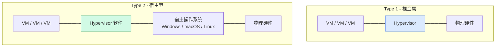
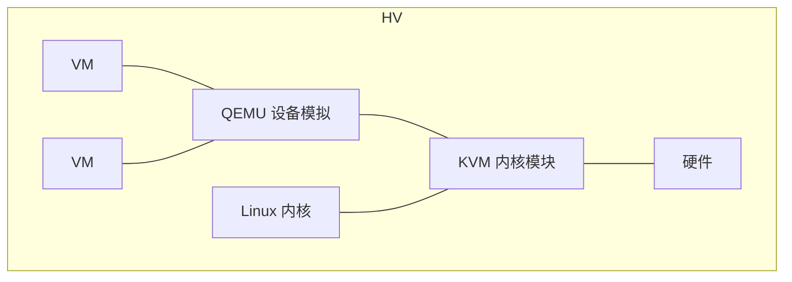

# Hypervisor 类型对比：Type 1 vs Type 2

## 什么是 Hypervisor？

Hypervisor（虚拟机监视器）是运行在物理硬件和虚拟机之间的软件层，负责将物理资源（CPU、内存、磁盘、网络）抽象并分配给多台虚拟机。

---

## Type 1：裸金属 Hypervisor

直接运行在物理硬件之上，**没有宿主操作系统**。

| 特性 | 说明 |
| --- | --- |
| **资源开销** | 极小——Hypervisor 本身就是微内核 OS |
| **性能** | 接近裸机（CPU 损耗 < 3%） |
| **安全性** | 攻击面小（无宿主 OS 可被攻击） |
| **管理** | 需要另一台机器通过 Web/客户端管理 |
| **典型产品** | VMware ESXi、Microsoft Hyper-V（Server Core）、KVM、Xen |

### 代表产品

| 产品 | 厂商 | 特点 |
| --- | --- | --- |
| **VMware ESXi** | Broadcom | 企业级标杆，生态最完善 |
| **KVM** | 开源（Linux 内核） | Linux 内核模块，与 QEMU 配合 |
| **Hyper-V** | Microsoft | Windows Server 集成，Azure 底层 |
| **Xen** | Linux Foundation | AWS EC2 底层（已逐步迁移到 KVM） |

---

## Type 2：宿主型 Hypervisor

运行在**宿主操作系统之上**，作为一个普通应用程序。

| 特性 | 说明 |
| --- | --- |
| **资源开销** | 大——宿主 OS 先占一层，Hypervisor 再占一层 |
| **性能** | 明显低于裸机 |
| **安全性** | 宿主机 OS 被攻破则所有 VM 暴露 |
| **管理** | 在宿主机桌面直接操作，直观 |
| **典型产品** | VMware Workstation、VirtualBox、Parallels |

### 代表产品

| 产品 | 适合场景 |
| --- | --- |
| **VMware Workstation** | Windows/Linux 桌面虚拟化、实验环境 |
| **VirtualBox** | 开源免费、跨平台 |
| **Parallels Desktop** | macOS 跑 Windows 最佳体验 |
| **UTM** | macOS M 系列芯片（基于 QEMU） |

---

## KVM 的特殊地位

KVM（Kernel-based Virtual Machine）是一个**有趣的混合体**：

-   它是 Linux 内核模块 → **Type 1 特性**（直接访问硬件）
-   它依赖 Linux 操作系统 → **像 Type 2**（有宿主 OS）

实际上 KVM 是 **Type 1 架构**——虚拟机通过 KVM 内核模块直接使用硬件虚拟化指令，Linux 只是充当了 KVM 的「载体」。因此性能接近原生。

---

## 选型指南

| 场景 | 推荐 | 原因 |
| --- | :---: | --- |
| 企业数据中心 | **ESXi** | 生态最完善、vCenter 集中管理、vSAN 超融合 |
| 开源/成本敏感 | **KVM + oVirt 或 PVE** | 完全免费、社区活跃 |
| Windows 为主 | **Hyper-V** | 与 AD/Windows Admin Center 深度集成 |
| 个人桌面学习 | **VMware Workstation / VirtualBox** | 安装简单、快照方便 |
| macOS 上跑 Windows | **Parallels** | 融合模式体验最佳 |
| 轻量 Linux 容器+VM | **PVE (Proxmox)** | LXC + KVM 一体，Web 管理 |

---

## 总结

-   **Type 1** = 生产环境，性能和安全优先
-   **Type 2** = 桌面学习，方便优先
-   **KVM** = 披着 Type 2 外衣的 Type 1，Linux 生态的事实标准
-   **PVE** = 把 KVM 的管理体验做到了极致，中小企业首选

选择 Hypervisor 不是技术问题，是你对「生态」、「成本」、「运维复杂度」的权衡。 🚀
