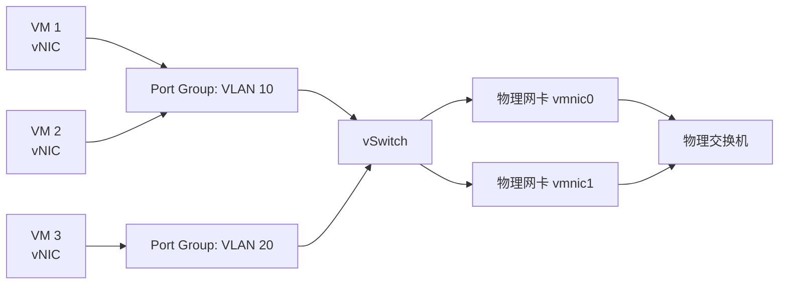
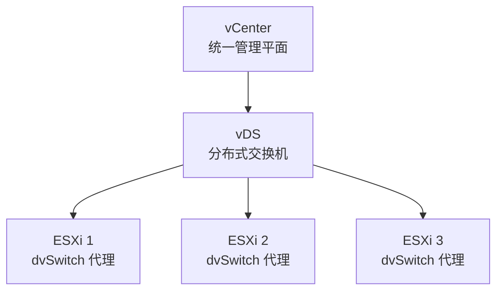

# 虚拟网络基础：vSwitch、Port Group 与 SR-IOV

## 前言

物理世界中，服务器通过网线连接到物理交换机。虚拟化世界中，VM 没有物理网卡——它通过**虚拟交换机（vSwitch）**与外界通信。

理解虚拟网络架构是虚拟化学习中最容易被跳过、但出问题最多的环节。本文覆盖从标准 vSwitch 到 SR-IOV 的全系列概念。

---

## 标准虚拟交换机（vSwitch）

| 组件 | 说明 |
| --- | --- |
| **vSwitch** | 软件模拟的交换机，在 ESXi 内核中运行 |
| **Port Group** | 一组端口配置（VLAN、安全策略、流量整形），VM 连接到 Port Group |
| **vNIC** | VM 的虚拟网卡（VMXNET3 或 E1000） |
| **vmnic** | 物理网卡，被 ESXi 识别并绑定到 vSwitch |

### Port Group 的关键属性

| 属性 | 说明 | 推荐值 |
| --- | --- | --- |
| **VLAN ID** | 将 VM 划分到指定 VLAN | 生产 VM 必须设置 |
| **安全 - 混杂模式** | 允许 VM 接收非本 MAC 的帧 | **拒绝**（安全） |
| **安全 - MAC 地址更改** | 允许 Guest OS 修改 MAC | **拒绝**（防 MAC 欺骗） |
| **安全 - 伪传输** | 允许 VM 发送源 MAC 不同的帧 | **拒绝** |

---

## 分布式虚拟交换机（vDS）

标准 vSwitch 每台 ESXi 独立配置——100 台主机需要配 100 次。vDS 解决了这个问题：

| 特性 | 标准 vSwitch | vDS |
| --- | :---: | :---: |
| **管理范围** | 单台主机 | 整个数据中心 |
| **配置一致性** | 手动逐台 | 自动同步 |
| **vMotion 时端口状态** | 丢失统计、需手动同步 | 无缝迁移 |
| **NIOC（网络 I/O 控制）** | 不支持 | 支持 |
| **LACP** | 不支持 | 支持 |
| **NetFlow** | 不支持 | 支持 |

---

## VLAN 在虚拟化中的实现

| 模式 | 说明 | 适用场景 |
| --- | --- | --- |
| **VST（Virtual Switch Tagging）** | 在 vSwitch/Port Group 层打标签 | **推荐**，最常用 |
| **EST（External Switch Tagging）** | 物理交换机负责打标签 | 简单但灵活性差 |
| **VGT（Virtual Guest Tagging）** | Guest OS 自己打标签 | 特殊用途（虚拟防火墙） |

---

## SR-IOV：绕过虚拟交换机

SR-IOV（Single Root I/O Virtualization）让一个物理网卡虚拟出多个**虚拟功能（VF）**，直接分配给 VM——**绕过 Hypervisor 的虚拟交换机**：

| 模式 | 数据路径 | 延迟 | CPU 开销 |
| --- | --- | :---: | :---: |
| **vSwitch (VMXNET3)** | VM → vSwitch → vmnic | 正常 | 正常 |
| **SR-IOV** | VM → VF → 物理端口 | **极低** | **几乎为零** |

代价：**无法使用 vMotion**。SR-IOV 的 VF 绑定到物理网卡，VM 迁移时需要重新分配 VF，可能导致网络中断。因此 SR-IOV 适用于**延迟敏感且不需要 vMotion** 的工作负载（如电信 NFV、金融交易）。

---

## 总结

1. **vSwitch + Port Group** 是虚拟网络的基本单元
2. **VLAN 标签**统一在 Port Group 层管理（VST 模式）
3. **vDS** 解决多主机统一配置问题，企业环境标配
4. **SR-IOV** 为极致性能而设计，但牺牲了 vMotion 灵活性
5. **NIOC**（vDS 特性）避免管理流量抢占业务带宽

虚拟网络的黄金法则：**生产 VM 必须指定 VLAN，关闭混杂模式和安全例外。** 🚀
