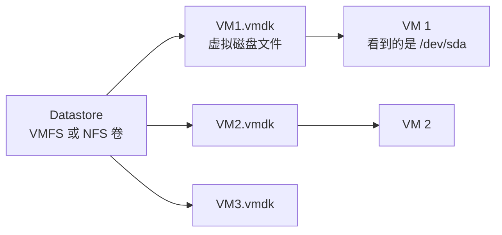
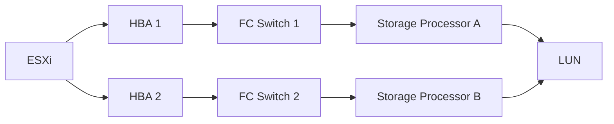

# 虚拟存储基础：Datastore、VMDK 与存储协议

## 前言

VM 的所有数据——操作系统、应用、用户数据——都存在存储上。虚拟化环境中，存储不像物理服务器那样简单「插块硬盘」，它涉及 Datastore、VMDK 文件、精简/厚置备、多路径、存储协议等一系列概念。

本文从文件到协议，梳理虚拟化存储的完整知识框架。

---

## 核心概念：Datastore 与 VMDK

| 概念 | 说明 |
| --- | --- |
| **Datastore** | ESXi 上的存储容器，可以是本地磁盘（VMFS）或 NFS/iSCSI 挂载 |
| **VMDK** | 虚拟磁盘文件，VM 看到它是「一块硬盘」，实际上是 Datastore 上的一个文件 |
| **VMFS** | VMware 专有文件系统，专为存储 VM 优化（支持并发读写、集群文件系统） |

---

## 三种磁盘置备方式

| 方式 | 描述 | 优点 | 缺点 |
| --- | --- | --- | --- |
| **厚置备延迟置零（Lazy Zeroed）** | 分配全部空间，写入时才清零 | 创建快 | 首次写入性能差 |
| **厚置备急切置零（Eager Zeroed）** | 分配全部空间 + 立即全部清零 | 写入性能好、支持 FT | 创建慢 |
| **精简置备（Thin）** | 用多少分多少，不预占空间 | 省空间 | 过量分配风险、性能略低 |

!!! tip "精简置备的陷阱"
    精简置备允许「超分配」——给 10 台 VM 各分配 100GB，但实际 Datastore 只有 500GB。如果这 10 台 VM 同时写满，Datastore 会爆掉。**监控 Datastore 使用率**是防止这场灾难的唯一方法。

---

## RDM：裸磁盘映射

RDM（Raw Device Mapping）允许 VM **直接访问 SAN LUN**，绕过 VMFS/VMDK 层：

| | VMDK | RDM |
| --- | :---: | :---: |
| **存储格式** | Datastore 上的文件 | SAN 上的 LUN |
| **快照** | 支持 | 不支持 |
| **性能** | 正常（有文件系统开销） | 接近裸机 |
| **典型场景** | 99% 的 VM | 需要 SAN 功能的集群应用（Oracle RAC） |

---

## 存储协议对比

| 协议 | 类型 | 速度 | 块/文件 | 适用场景 |
| --- | :---: | :---: | :---: | --- |
| **FC（光纤通道）** | SAN | 最高（32Gbps+） | 块 | 企业核心数据库 |
| **iSCSI** | SAN（IP） | 高（10/25Gbps） | 块 | 中小企业通用 |
| **NFS v3/v4** | NAS | 中-高 | 文件 | 简单、灵活 |
| **FCoE** | SAN | 高 | 块 | FC 数据中心到以太网融合 |
| **vSAN** | HCI | 取决于节点 | 对象 | 超融合场景 |

### NFS vs iSCSI 选型

| | NFS | iSCSI |
| --- | :---: | :---: |
| **安装复杂度** | 简单（mount 即可） | 中等（需配 Initiator/Target） |
| **Datastore 格式** | NFS 原生 | VMFS |
| **多路径** | LACP/绑定 | 原生多路径 |
| **性能** | 中等 | 高 |
| **VMware 支持** | 全部功能 | 全部功能 |
| **推荐场景** | 小型环境、文件共享 | 生产数据库、高性能 |

---

## 存储多路径

从 ESXi 到 SAN 存储通常有多条路径（多张 HBA 卡、多个交换机）：

多路径策略决定如何利用这些路径：

| 策略 | 模式 | 说明 |
| --- | --- | --- |
| **最近使用（MRU）** | 主动-被动 | 一条路径失效才切到另一条 |
| **固定（Fixed）** | 主动-被动 | 始终用指定路径 |
| **循环（Round Robin）** | **主动-主动** | 轮询使用所有路径，负载均衡 |

---

## 总结

1. **Datastore = 容器，VMDK = 文件**——VM 的磁盘本质上是文件
2. **精简置备省空间但需监控**——Datastore 耗尽 = 所有 VM 宕机
3. **NFS 简单，iSCSI 高性能**——根据规模选择
4. **多路径 = 高可用**——至少两条物理路径，策略选 Round Robin
5. **RDM 是特例**——只有 Oracle RAC 等少数场景需要

存储是虚拟化中最「静悄悄」出事故的领域——Datastore 满了、路径断了、延迟飙升了，往往是用户报修你才发现。做好存储监控和容量规划，是虚拟化运维的重中之重。 🚀
