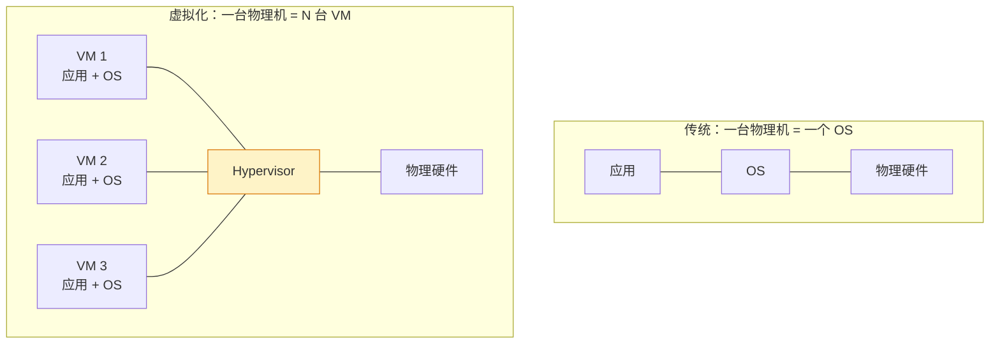
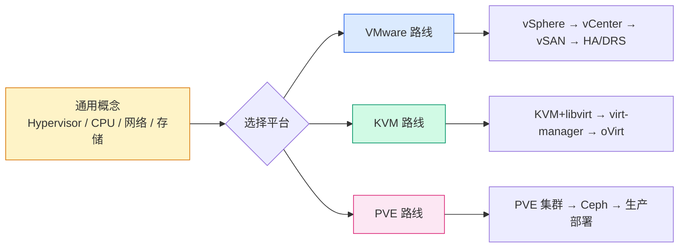

# 虚拟化技术全景：从 Hypervisor 到云原生基础设施

## 前言

虚拟化是现代数据中心的基石。在裸金属服务器上，一台物理机只能跑一个操作系统；有了虚拟化，一台物理机可以同时运行数十台虚拟机，每台 VM 有独立的 OS、独立的资源分配、独立的故障域。

本栏目聚焦虚拟化的**概念、架构与设计**——不是「怎么安装」，而是「为什么这样设计」和「如何选择与规划」。安装部署步骤请参考 [环境准备](../deployment/tutorials.md) 栏目。

---

## 栏目导航

### 通用概念

| 文章 | 说明 |
| --- | --- |
| [Hypervisor 类型对比](concepts/hypervisor-types.md) | Type 1（裸金属）vs Type 2（宿主型），ESXi/KVM/Hyper-V 归类 |
| [CPU 与内存虚拟化原理](concepts/cpu-memory-virtualization.md) | Intel VT-x/AMD-V、EPT/NPT、内存过量分配、CPU 调度 |
| [虚拟网络基础](concepts/networking-basics.md) | vSwitch、Port Group、VLAN Tagging、SR-IOV 网卡直通 |
| [虚拟存储基础](concepts/storage-basics.md) | Datastore、VMDK/qcow2、精简/厚置备、NFS/iSCSI/FC |

### VMware vSphere 生态

| 文章 | 说明 |
| --- | --- |
| [vSphere 架构总览](vmware/vsphere-architecture.md) | 组件全景、ESXi + vCenter 关系、许可版本 |
| [vCenter 架构详解](vmware/vcenter-architecture.md) | PSC 演进、VCSA 内部组件、Enhanced Linked Mode |
| [vSAN 存储架构](vmware/vsan-architecture.md) | 磁盘组设计、SPBM 存储策略、ESA vs OSA |
| [HA / DRS / FT 原理](vmware/ha-drs-ft.md) | 高可用心跳、资源调度算法、连续容错机制 |
| [vDS 与网络深入](vmware/networking-deep.md) | 分布式交换机、NIOC 流量整形、NSX Overlay 概念 |
| [生命周期管理](vmware/lifecycle-management.md) | VUM vs vLCM、固件更新、基线 vs 镜像 |

### Proxmox VE

| 文章 | 说明 |
| --- | --- |
| [PVE 架构概览](pve/pve-overview.md) | KVM + LXC + Ceph 集成、Corosync 集群通信 |
| [PVE vs VMware 对比](pve/pve-vs-vmware.md) | 功能矩阵、成本、适用场景与迁移考虑 |

### KVM 生态

| 文章 | 说明 |
| --- | --- |
| [KVM + libvirt + QEMU](kvm/kvm-libvirt.md) | 三者关系、virsh 常用命令、存储池与网络 |
| [管理工具对比](kvm/virt-manager-ovirt.md) | virt-manager、Cockpit、oVirt、OpenStack 管理层 |

### 跨平台对比

| 文章 | 说明 |
| --- | --- |
| [Hypervisor 选型指南](comparison/hypervisor-comparison.md) | ESXi vs KVM vs Hyper-V vs Xen 全维度对比 |

---

## 学习路径

---

## 与本站其他栏目的关系

| 栏目 | 关系 |
| --- | --- |
| [环境准备 / VMware](../deployment/tutorials.md) | 安装步骤——「怎么做」 |
| **虚拟化（本栏目）** | 概念与架构——「为什么」和「怎么选」 |
| [Kubernetes](../kubernetes/index.md) | K8s 与虚拟化的结合点：vSphere with Tanzu、KubeVirt |
| [Linux](../linux/index.md) | KVM 是 Linux 内核模块，虚拟化离不开 Linux 基础 |

---

## 为什么虚拟化仍然重要？

云原生时代，有人问「还需要学虚拟化吗？」答案是**必须学**：

1. **企业数据中心基石**：绝大多数企业还没有完全上公有云，vSphere + vSAN 是主流
2. **K8s 底层**：自建 K8s 集群的节点大多跑在虚拟机里；vSphere with Tanzu 直接在 vCenter 管理 K8s
3. **HomeLab 必备**：用一台机器跑 ESXi/PVE，然后在其上部署 K8s 集群——这是最高效的学习方式
4. **混合云**：VMware Cloud on AWS、Azure VMware Solution——虚拟化技能直接迁移到云

> 云原生不是取代虚拟化，而是建立在虚拟化之上的。
> —— 1HairLabs

