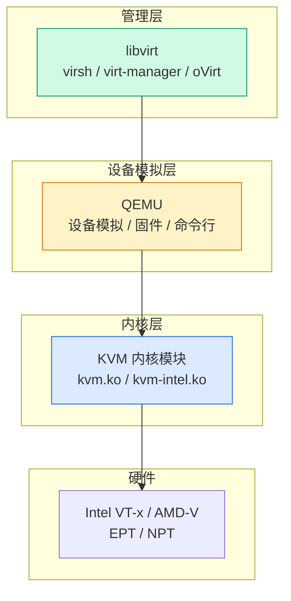

# KVM + libvirt + QEMU：开源虚拟化三剑客

## 前言

KVM 是 Linux 内核的虚拟化模块，但光有 KVM 你什么也做不了——它需要 QEMU 模拟硬件设备，需要 libvirt 提供统一管理接口。理解这三者的分工，是掌握 Linux 原生虚拟化的基础。

---

## 三层架构



| 层 | 组件 | 职责 | 类比 |
| --- | --- | --- | --- |
| **管理** | libvirt | 统一 API、virsh 命令、XML 定义 | vCenter |
| **设备模拟** | QEMU | 模拟网卡、磁盘、显卡、USB | ESXi VM 的虚拟硬件 |
| **内核** | KVM | CPU/内存虚拟化（VT-x/EPT） | ESXi 内核 |

!!! tip "KVM 和 QEMU 的精确分工"
    -   **KVM** 只做 CPU 和内存的虚拟化（通过硬件辅助）
    -   **QEMU** 负责所有设备模拟（网卡、磁盘控制器、显卡）
    -   没有 KVM，QEMU 也能跑 VM——但是纯软件模拟，性能极差
    -   没有 QEMU，KVM 无法单独启动 VM——因为没有 I/O

---

## libvirt：统一管理抽象

libvirt 提供了一套统一的 API 和 XML 描述语言，屏蔽底层 Hypervisor 差异：

| libvirt 支持 | 后端 |
| :---: | --- |
| QEMU/KVM | `qemu:///system` |
| Xen | `xen:///` |
| LXC | `lxc:///` |
| VMware ESXi | `esx:///` |
| Hyper-V | `hyperv:///` |

---

## virsh 常用命令

```bash
# 连接 Hypervisor
virsh list --all              # 列出所有 VM（含关机）
virsh start vm-name           # 启动
virsh shutdown vm-name        # 优雅关机
virsh destroy vm-name         # 强制关机（断电）
virsh reboot vm-name          # 重启

# 查看
virsh dominfo vm-name         # VM 详细信息
virsh domstats vm-name        # 性能统计
virsh vcpuinfo vm-name        # vCPU 信息
virsh domiflist vm-name       # 网卡列表
virsh domblklist vm-name      # 磁盘列表

# 控制台
virsh console vm-name         # 串口控制台（按 Ctrl+] 退出）

# 快照
virsh snapshot-create-as vm-name snap1 "Before update"
virsh snapshot-list vm-name
virsh snapshot-revert vm-name snap1

# 定义
virsh define vm.xml           # 从 XML 定义 VM（不启动）
virsh undefine vm-name        # 删除 VM 定义（保留磁盘）
```

---

## 存储池管理

```bash
# 列出存储池
virsh pool-list

# 创建目录型存储池
virsh pool-define-as images dir --target /var/lib/libvirt/images
virsh pool-start images
virsh pool-autostart images

# 创建磁盘卷
virsh vol-create-as images vm1.qcow2 20G --format qcow2
```

---

## 虚拟网络

```bash
# 列出网络
virsh net-list

# 默认 NAT 网络（virbr0）
virsh net-info default
# Bridge: virbr0
# IP range: 192.168.122.0/24
# DHCP: 192.168.122.2 - 192.168.122.254

# 创建桥接网络
virsh net-define bridged.xml
virsh net-start bridged
virsh net-autostart bridged
```

---

## 总结

KVM 技术栈的核心分工：

1. **KVM** = CPU/内存虚拟化加速（Linux 内核模块）
2. **QEMU** = I/O 设备模拟和用户态管理
3. **libvirt** = 统一抽象层，提供 virsh、XML API

这三个组件让 Linux 成为一个完整的虚拟化平台。PVE、oVirt、OpenStack 都是这个技术栈的上层封装。 🚀
