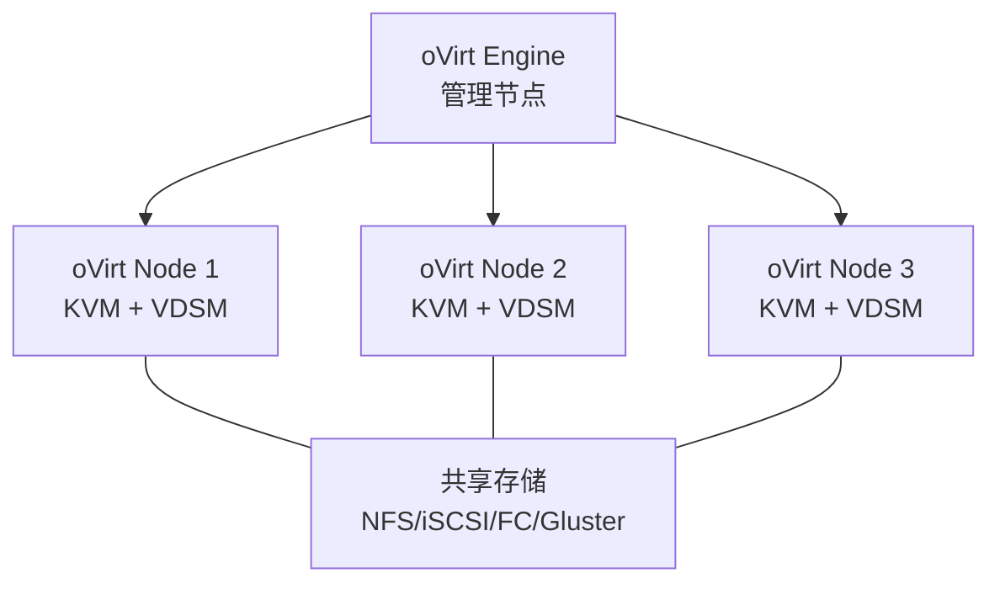

# KVM 管理工具对比：virt-manager、Cockpit 与 oVirt

## 前言

KVM 本身不提供 GUI——你需要一个管理工具来创建 VM、查看性能、管理存储。Linux 生态中有三个主流选择，从单机到数据中心各有定位。

---

## 工具总览

| | virt-manager | Cockpit | oVirt |
| --- | :---: | :---: | :---: |
| **类型** | 桌面 GUI | Web 轻量界面 | 企业级管理平台 |
| **规模** | 单机 | 单机/小集群 | 数据中心级 |
| **安装复杂度** | 极低 | 低 | 高（需 Engine + Node） |
| **集中管理** | ✗ | 有限 | ✓ |
| **高可用** | ✗ | ✗ | ✓ |
| **模板** | ✗ | ✗ | ✓ |
| **自服务门户** | ✗ | ✗ | ✓ |
| **类比** | VMware Workstation | ESXi Host Client | vCenter |

---

## virt-manager：桌面管理

```bash
sudo apt install virt-manager    # Debian/Ubuntu
sudo dnf install virt-manager    # Fedora/RHEL
```

优点：
-   图形化创建 VM 向导
-   本地远程连接（SSH 到远程 libvirt）
-   性能监控图表
-   完全免费

缺点：
-   只能管理单台机器（连接多台需逐个添加）
-   无 HA/模板/集群功能

适用：个人桌面、HomeLab 实验。

---

## Cockpit：Web 轻量管理

```bash
sudo apt install cockpit cockpit-machines
sudo systemctl enable cockpit --now
# 访问 https://<IP>:9090
```

优点：
-   Web 界面，浏览器访问
-   同时管理系统（systemd、日志、网络、存储）+ 虚拟机
-   轻量，对系统几乎无负担
-   RHEL 生态默认集成

缺点：
-   VM 管理功能不如 virt-manager 细致
-   无集群级功能

适用：单台服务器日常运维、不想装桌面的场景。

---

## oVirt：企业级平台

oVirt 是 Red Hat Virtualization（RHV）的上游开源项目，对标 vCenter：



| 组件 | 作用 |
| --- | --- |
| **oVirt Engine** | 管理平台（Java 应用 + PostgreSQL），类比 vCenter |
| **VDSM** | 每个 Node 上的代理，执行 Engine 的命令 |
| **共享存储** | 必须——oVirt 不提供分布式存储，需外挂 SAN/NAS |

优点：
-   真正企业级：模板、快照、HA、实时迁移、自服务门户
-   REST API 完整
-   完全开源

缺点：
-   部署复杂（Engine + Node + 共享存储）
-   需要至少 2 台机器（1 Engine + 1+ Node）
-   社区相对小众

适用：需要 vCenter 级别管理但不想付费的组织。

---

## 选型指南

| 场景 | 推荐 |
| --- | :---: |
| 个人学习、桌面使用 | **virt-manager** |
| 单台服务器运维 | **Cockpit** |
| 小团队、多台 KVM 主机 | **PVE**（比 oVirt 更简单） |
| 企业数据中心、需自服务 | **oVirt** |
| 替代 VMware 全家桶 | **oVirt + Gluster** 或 **PVE + Ceph** |

---

## 总结

KVM 的管理工具生态呈金字塔结构：

1. **virt-manager**：单机桌面——最简单
2. **Cockpit**：单机 Web——最轻量
3. **oVirt**：多机企业级——最强大（但也最复杂）

如果你的选择是「替代 vCenter」，oVirt 是功能最接近的选项。如果你只是管理几台 KVM 主机，PVE 比 oVirt 更易于上手。 🚀
