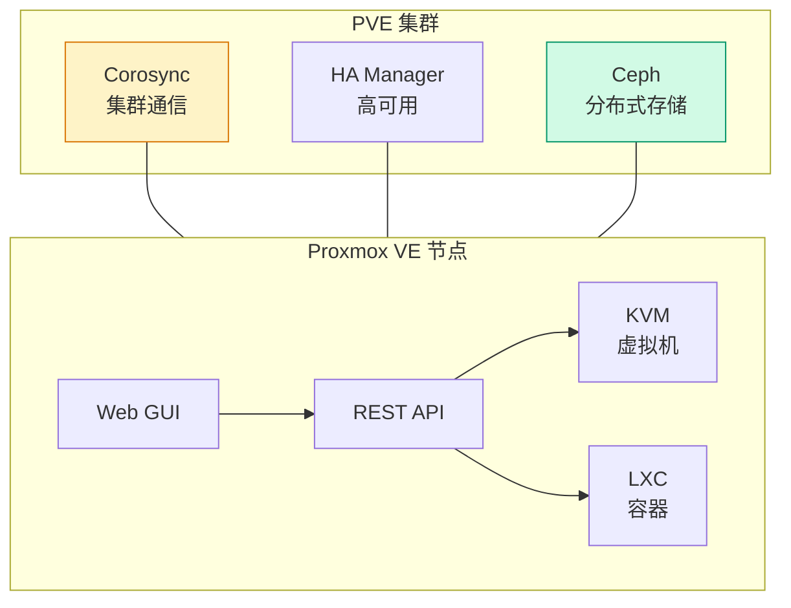
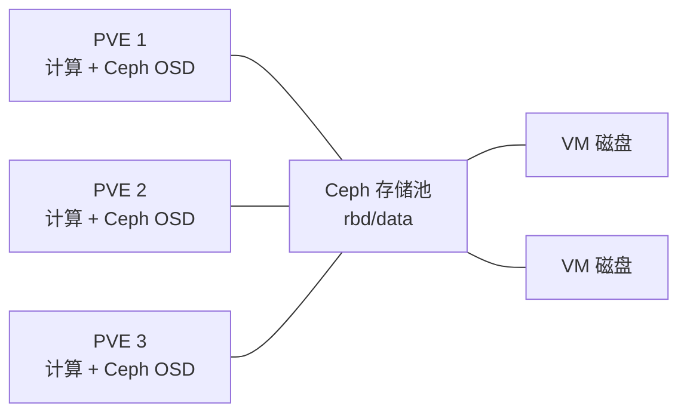

# Proxmox VE 架构概览：KVM + LXC + Ceph 集成

## 前言

Proxmox VE（PVE）是一款开源虚拟化平台，基于 Debian Linux 构建。它最大的特点是将 **KVM（虚拟机）** 和 **LXC（容器）** 统一在同一平台下，并原生集成 **Ceph 分布式存储**——安装 ISO 自带全套超融合能力。

对于不想支付 VMware 许可费用又想获得企业级虚拟化功能的团队，PVE 是当下最具吸引力的替代方案。

---

## 架构总览



---

## KVM 与 LXC：双虚拟化引擎

| | KVM（虚拟机） | LXC（容器） |
| --- | :---: | :---: |
| **隔离级别** | 完整 OS 隔离 | 共享宿主机内核 |
| **启动速度** | 秒级 | **即时** |
| **资源开销** | 中等 | **极低** |
| **操作系统** | 任何（Linux/Windows/BSD） | **仅 Linux** |
| **适用场景** | 需要独立内核、跑不同 OS | 轻量级 Linux 服务 |
| **PVE 中的管理** | `qm` 命令 | `pct` 命令 |

```bash
# PVE 命令速查
qm list               # 列出所有 VM
qm start 100          # 启动 VM ID 100
pct list              # 列出所有容器
pct enter 200         # 进入容器 200
```

!!! tip "什么时候用 LXC？"
    需要隔离但不想要 VM 的完整开销时——比如跑一个不需要特定内核版本的 MySQL、一个独立的 Nginx。LXC 共享宿主机内核，内存占用比同配置的 VM 少几百 MB。

---

## Corosync：集群通信

PVE 集群使用 **Corosync** 进行节点间通信，实现**多主集群**——任何节点都可以管理整个集群：

| 特性 | 说明 |
| --- | --- |
| **多主** | 没有「Master 节点」瓶颈，任何节点都能操作 |
| **Quorum（法定人数）** | 3 节点集群需 ≥2 节点存活才可操作 |
| **通信协议** | UDP 多播或单播（Corosync 3.x 推荐单播） |

---

## HA 高可用

PVE 内置 HA Manager，原理与 vSphere HA 类似：

| 组件 | 职责 |
| --- | --- |
| **LRM（Local Resource Manager）** | 每个节点上运行，执行启动/停止 VM 的操作 |
| **CRM（Cluster Resource Manager）** | 集群级，决定 VM 应该在哪台节点上运行 |
| **Watchdog** | 硬件或软件 Watchdog，防止节点假死 |

流程：节点宕机 → Corosync 检测 → CRM 重分配 VM → 健康节点上的 LRM 启动 VM。

---

## Ceph 集成

PVE 原生集成 Ceph，实现超融合架构：



| Ceph 组件 | PVE 中作用 |
| --- | --- |
| **MON（Monitor）** | 集群状态、Quorum |
| **OSD（Object Storage Daemon）** | 每个磁盘一个 OSD |
| **MGR（Manager）** | Web 仪表板、统计 |
| **RBD（RADOS Block Device）** | VM 磁盘的后端 |

---

## 总结

PVE 的核心优势：

1. **一体化**：一个 ISO 装完 = KVM + LXC + Web GUI + 集群 + HA
2. **无许可费用**：AGPL 开源，企业订阅可选
3. **Ceph 集成**：内置分布式存储，无需外挂 SAN/NAS
4. **多主集群**：没有单点管理节点

对于中小企业、HomeLab 和不想被 VMware 许可绑定的团队，PVE 是当下最理性的选择。 🚀
