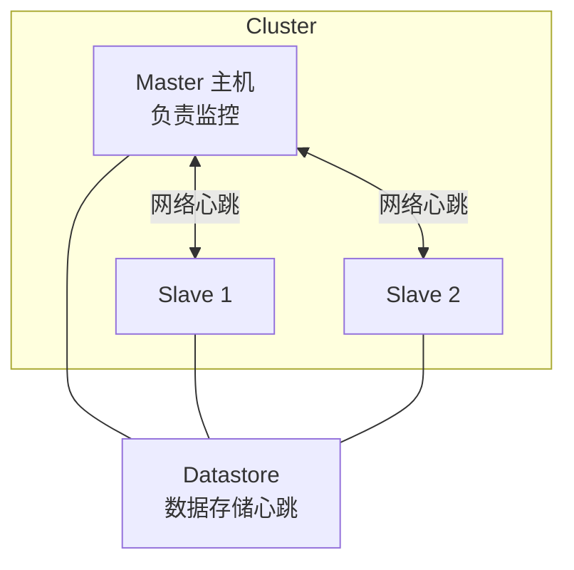
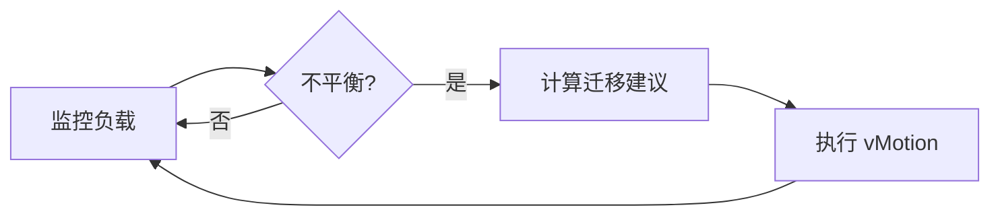
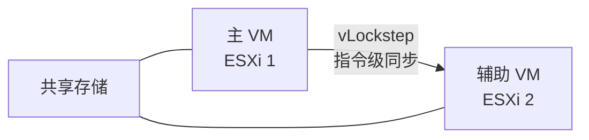

# vSphere HA、DRS 与 FT：高可用与资源调度原理

## 前言

vSphere 集群的三大核心功能——HA（高可用）、DRS（资源调度）、FT（容错）——各自解决不同层面的问题。理解它们的工作机制，你才知道一个场景下该启用哪个、怎么配参数。

---

## vSphere HA：主机故障自动恢复

### HA 做什么？

当一台 ESXi 主机宕机时，HA 自动将该主机上的 VM 在其他健康主机上**重新启动**（注意：是重启，不是无缝接管）。

### HA 心跳机制

| 心跳类型 | 传输方式 | 作用 |
| --- | --- | --- |
| **网络心跳** | 管理网络，每秒 1 次 | 检测主机是否存活 |
| **数据存储心跳** | 通过共享 Datastore | 防止网络分区误判 |

### 主机隔离响应

当 Master 通过两种心跳都检测不到 Slave 时，判定其**隔离（Isolated）**——该主机还活着（VM 还在跑），但管理网络断了。

| 响应 | 行为 | 适用场景 |
| --- | --- | --- |
| **关闭 VM 再重启** | 在隔离主机上关闭 VM → 其他健康主机重启 | 默认（安全） |
| **保持开机** | VM 继续在隔离主机上跑 | 管理网络中断但业务网络正常 |
| **关机** | 直接关机 VM | 不关心服务连续性 |

---

## DRS：分布式资源调度

### DRS 做什么？

DRS 持续监控集群中各主机的 CPU/内存负载，**自动将 VM 迁移（vMotion）到负载更低的主机**，使集群负载均衡。

### DRS 调度流程

### 自动化级别

| 级别 | 行为 |
| :---: | --- |
| **手动** | DRS 只给建议，不自动迁移 |
| **半自动** | DRS 给建议，管理员确认后迁移 |
| **全自动** | **DRS 自动执行所有迁移（生产推荐）** |

### 自动化迁移阈值

全自动模式下可以调整激进度（1~5）：

| 阈值 | 含义 |
| :---: | --- |
| 1 | 保守——只有严重不平衡才迁移 |
| 3 | 默认——适度平衡 |
| 5 | 激进——频繁迁移以追求完美平衡 |

### DRS 规则

| 规则类型 | 说明 | 示例 |
| --- | --- | --- |
| **聚集（Affinity）** | 指定 VM 必须在**同一台主机**上 | AD + DNS 低延迟通信 |
| **反聚集（Anti-Affinity）** | 指定 VM 必须在**不同主机**上 | 域控制器分散 |
| **VM-Host Affinity** | 指定 VM 必须在特定主机（组）上 | 许可绑定 |

---

## Fault Tolerance：连续容错

### FT 做什么？

FT 让一台 VM 在**两台主机上同步执行**——主 VM 和辅助 VM 的 CPU 指令完全一致。主 VM 故障时，辅助 VM **零中断**接管。

### FT vs HA 对比

| | vSphere HA | FT |
| --- | :---: | :---: |
| **恢复方式** | 重启 VM | 辅助 VM 无缝接管 |
| **中断时间** | 分钟级 | **0（零中断）** |
| **CPU 限制** | 无 | 最多 8 vCPU（8.0） |
| **性能开销** | 0 | 有一定开销（网络同步延迟） |
| **适用场景** | 绝大多数 VM | 关键任务：域控制器、金融核心 |

!!! warning "FT 的限制"
    -   vSphere 8.0 前最多支持 2 vCPU（7.0）/ 4 vCPU（7.0U2），8.0 支持到 8 vCPU
    -   不支持快照、Storage vMotion
    -   辅助 VM 不提供额外计算能力——它只是影子副本

---

## 选型指南

| 场景 | 推荐 |
| --- | :---: |
| 普通应用，能接受分钟级恢复 | **HA** |
| 需要负载均衡、避免热点 | **HA + DRS（全自动）** |
| 关键应用，不能有任何中断 | **FT** |
| 域控制器 | **FT + 反聚集规则** |

---

## 总结

1. **HA** = 主机挂了 VM 自动重启——你的保险，必须开
2. **DRS** = 让 VM 自动搬家以平衡集群负载——全自动 + 默认阈值
3. **FT** = 影子 VM 零中断——仅给最关键的 VM
4. **反聚集规则**：域控制器、数据库主从等必须分散在不同主机

三者配合使用，才是 vSphere 集群的最高境界。 🚀
