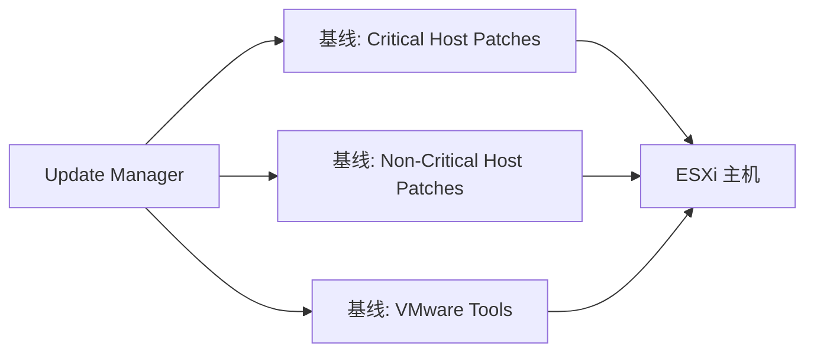
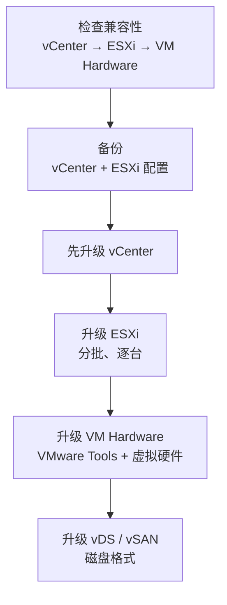

# vSphere 生命周期管理：VUM、vLCM 与固件更新

## 前言

安装 ESXi 只是开始——保持其版本一致、安全补丁及时、固件与驱动兼容，才是长期的运维挑战。vSphere 的生命周期管理经历了三代演进：VUM → vLCM → 与硬件厂商深度集成。

---

## 三代演进

| 代 | 工具 | 引入版本 | 核心模式 |
| :---: | --- | :---: | --- |
| 1 | **VUM（Update Manager）** | vSphere 4.0 | 基于**基线（Baseline）** |
| 2 | **vLCM（Lifecycle Manager）** | vSphere 7.0 | 基于**镜像（Image）** |
| 3 | **vLCM + HSM 集成** | vSphere 7.0 U2+ | 固件 + 驱动 + ESXi **统一管理** |

---

## VUM：基线模式



基线是一组补丁/更新的**筛选条件**：

| 基线类型 | 示例 |
| --- | --- |
| **关键补丁** | 安全漏洞修复 |
| **非关键补丁** | Bug 修复 |
| **VMware Tools** | Tools 版本升级 |
| **主机扩展** | 驱动、第三方 VIB |

方式：**附加（Attach）基线 → 扫描（Scan） → 修复（Remediate）**。

缺点：VUM 只管 ESXi 和 VMware Tools，**管不了固件和驱动**。

---

## vLCM：镜像模式

vLCM 颠覆了传统——不再用「基线拼凑」，而是用**一套完整镜像**定义目标状态：

```text
镜像 = ESXi 版本 + 厂商附加组件（驱动） + 固件版本 + 组件
```

| 概念 | 说明 |
| --- | --- |
| **ESXi 版本** | 基础 ISO 版本（如 8.0 U2） |
| **厂商附加组件（Vendor Addon）** | Dell/HPE/Lenovo 定制的驱动和工具 |
| **固件（Firmware）** | 通过硬件支持管理器（HSM）更新 HBA/网卡/BIOS 固件 |
| **组件（Component）** | 独立更新的驱动或 VIB |

```bash
# vLCM 管理流程
1. 定义镜像（选 ESXi 版本 + 厂商附加组件）
2. 验证合规性（检查主机是否匹配镜像）
3. 修复（自动升级到镜像定义的版本）
```

### 基线 vs 镜像

| | 基线模式（VUM） | 镜像模式（vLCM） |
| --- | :---: | :---: |
| **粒度** | 单个补丁级 | 整个堆栈级 |
| **固件更新** | 不支持 | 支持（需 HSM） |
| **合规检查** | 逐基线匹配 | 镜像完整性对比 |
| **适合场景** | 旧集群、兼容性要求 | 新集群（7.0+） |

---

## HSM：硬件支持管理器

vLCM 通过 HSM 与硬件厂商的管理平台集成：

| 厂商 | HSM 实现 |
| --- | --- |
| **Dell** | OpenManage Integration for VMware |
| **HPE** | iLO Amplifier Pack |
| **Lenovo** | XClarity Integrator |

注册 HSM 后，vLCM 可以直接查看和更新主机的固件版本，实现**固件 + 驱动 + ESXi 一条龙更新**。

---

## 升级策略最佳实践



| 原则 | 说明 |
| --- | --- |
| **先 vCenter，后 ESXi** | vCenter 版本 ≥ ESXi 版本 |
| **分批升级** | 一次只升集群中一部分主机 |
| **vMotion 清空** | 升级前把主机上 VM 迁走 |
| **回滚准备** | vCenter 备份、ESXi 配置备份 |

---

## 总结

1. **VUM = 补丁管理**——只关注软件层面
2. **vLCM = 全栈管理**——ESXi + 驱动 + 固件统一
3. **镜像模式 > 基线模式**——新部署直接上 vLCM
4. **HSM 集成**——固件更新不再是独立流程

生命周期管理是「看不见的运维」——做好了没感觉，做不好灾难频发。 🚀
