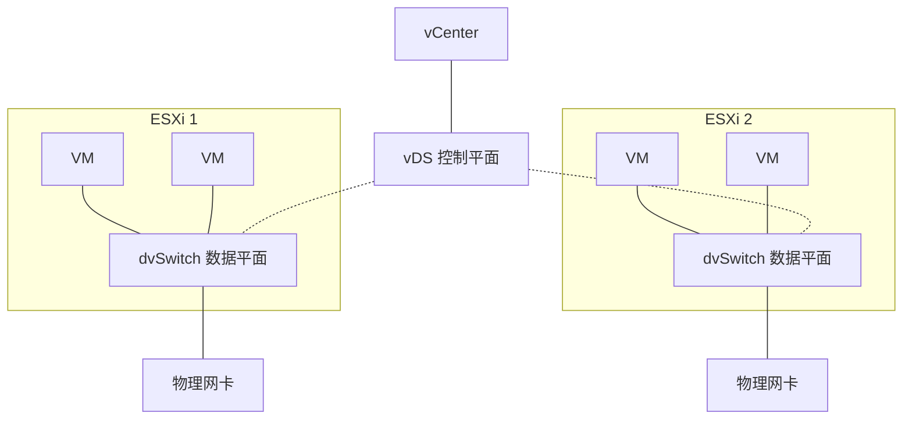

# vDS 与 NSX：分布式交换机与网络虚拟化

## 前言

标准 vSwitch 解决了单台主机的 VM 联网问题，但在集群规模下暴露了致命缺陷——每台主机独立配置、vMotion 后策略漂移、无法全局管控。vDS 和 NSX 分别从交换机和全栈网络虚拟化两个层面解决了这些问题。

---

## vDS：分布式虚拟交换机

### 架构



vDS 分成两个平面：

| 平面 | 位置 | 职责 |
| --- | --- | --- |
| **控制平面** | vCenter | 配置管理（Port Group、策略） |
| **数据平面** | 每台 ESXi | 实际的数据包转发 |

---

### NIOC：网络 I/O 控制

多租户环境中，管理流量、vMotion 流量、VM 业务流量、vSAN 流量共享同一物理网卡——**必须防止互相抢占**：

| 流量类型 | 建议份额 | 说明 |
| --- | :---: | --- |
| vSphere Fault Tolerance | 高 | 延迟敏感 |
| vMotion | 30% | 迁移时可瞬时占高带宽 |
| vSAN | 30% | 存储流量 |
| 管理 | 10% | 心跳、日志 |
| VM 业务 | 50% | 用户流量 |

NIOC 按份额（Shares）而非固定带宽分配——空闲时可以被其他流量借用。

---

### LACP 链路聚合

vDS 支持 LACP（Link Aggregation Control Protocol），将多条物理链聚合为一条逻辑链路：

| 模式 | 算法 | 说明 |
| --- | --- | --- |
| **基于 IP Hash** | 源 IP + 目的 IP Hash | 同 IP 对的流量始终走同一条物理链路 |
| **基于 MAC Hash** | 源 MAC + 目的 MAC Hash | 同上 |
| **基于物理网卡负载** | 最少使用的链路 | 动态 |

---

## NSX：全栈网络虚拟化

### NSX 解决了什么问题？

| 传统网络 | NSX |
| --- | --- |
| VLAN 上限 4096 个 | VXLAN VNI 1600 万个 |
| 防火墙基于 IP | **微分段：基于 VM 标签** |
| 网络变更需动硬件 | **纯软件定义，秒级生效** |
| 多租户隔离困难 | 原生多租户 |

### NSX 核心组件

| 组件 | 功能 |
| --- | --- |
| **NSX Manager** | 管理平面，提供 API 和 UI |
| **NSX Edge** | 南北向网关、NAT、负载均衡、VPN |
| **分布式防火墙（DFW）** | 在每台 ESXi 内核层执行防火墙规则 |
| **分布式路由器（DR）** | 东西向流量直接在源主机路由，无需经过 Edge |
| **Overlay Transport** | VXLAN/Geneve 封装，提供逻辑网络 |

### 微分段（Micro-Segmentation）

传统防火墙在物理网络边界，VM 之间通信经过物理防火墙。NSX DFW 在**每台 ESXi 内核**中执行防火墙规则：

```text
传统：VM1 → 物理交换机 → 物理防火墙 → 物理交换机 → VM2
微分段：VM1 → ESXi 内核 DFW → VM2（同主机甚至不出网卡）

策略基于 VM 标签：
  tag=web  → 不能访问 tag=db（但允许 tag=web 之间通信）
  tag=db   → 只允许 tag=web 的 3306 端口
```

---

## 总结

1. **vDS** = 集群级交换机，解决多主机统一配置问题
2. **NIOC** = 多流量类型共存时的 QoS 保障
3. **NSX** = 从交换机到防火墙到路由的全栈网络虚拟化
4. **微分段** = NSX 最具差异化的能力——防火墙跟着 VM 走，安全策略基于标签而非 IP

对于大多数环境，vDS 已经足够。当需要多租户隔离、微分段安全、自动化网络编排时，考虑 NSX。 🚀
