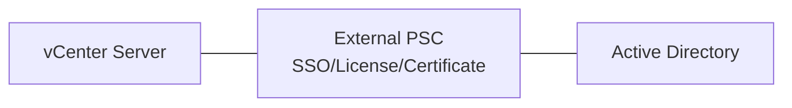
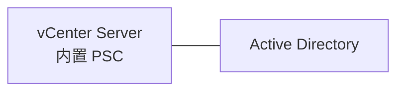
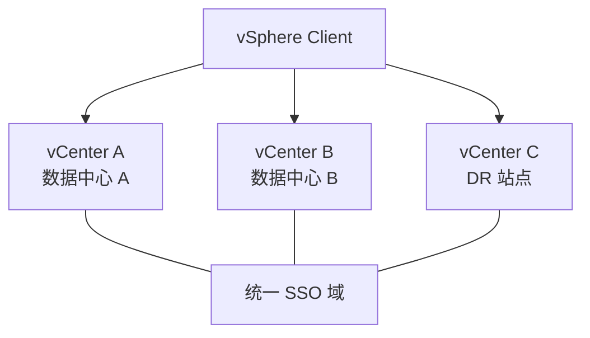

# vCenter 架构详解：PSC、VCSA 与内部组件

## 前言

vCenter 不只是「管理界面」——它内部有多个协同工作的组件。理解这些组件的作用和相互关系，你才能在 vCenter 出问题时知道从哪下手。

---

## 架构演进

### vSphere 6.x：外部 PSC



外部 PSC 模式允许多个 vCenter 共享一个 PSC，实现 SSO 统一登录。

### vSphere 7.0+：嵌入式 PSC



7.0 开始 PSC 嵌入 VCSA，简化部署。升级到 7.0 时必须先将外部 PSC 收敛到嵌入式。

### vSphere 8.0：仅嵌入式

8.0 **只支持嵌入式 PSC**。外部 PSC 彻底成为历史。

---

## VCSA 内部组件

VCSA（vCenter Server Appliance）是一个预配置的 Photon OS 虚拟机，内部运行以下关键服务：

| 服务 | 作用 | 出问题时的影响 |
| --- | --- | --- |
| **vpxd** | vCenter 核心服务，处理所有 API 请求 | Web Client 不可用 |
| **vmware-vpostgres** | 内嵌 PostgreSQL 数据库 | 所有配置丢失 |
| **vsphere-ui** | HTML5 Web Client | GUI 不可用 |
| **vmware-stsd** | SSO 安全令牌服务 | 登录失败 |
| **vmon** | VCSA 服务管理器 | 服务异常不自动恢复 |
| **lookupsvc** | 服务发现/注册 | 组件间通信异常 |

```bash
# 在 VCSA 上查看所有服务状态（SSH 登录）
service-control --status --all

# 启动/停止特定服务
service-control --start vmware-vpxd
service-control --stop vmware-vpxd
```

---

## Enhanced Linked Mode

Enhanced Linked Mode 让你在**一个 vSphere Client 中管理多个 vCenter**：



| 条件 | 说明 |
| --- | --- |
| 所有 vCenter 必须在**同一 SSO 域** | `vsphere.local` |
| 所有 vCenter 必须能**互相通信** | 443 端口 |
| vCenter 版本需兼容 | 混合版本有限支持 |

操作：vSphere Client → 菜单 → Administration → vCenter Server → 添加其他 vCenter。

---

## vCenter HA

vCenter 自身也需要高可用保护。vCenter HA 提供 Active-Passive-Witness 三节点架构：

| 节点 | 角色 |
| --- | --- |
| **Active** | 当前运行中的 vCenter |
| **Passive** | 热备，与 Active 数据实时同步 |
| **Witness** | 仲裁节点，防止脑裂（需与 Active/Passive 不同主机） |

Active 故障时，Passive 在几分钟内接管，Witness 负责防止双主。

---

## 常见问题

### vCenter Web Client 打不开

```bash
# 1. 检查 VCSA 基本连通性
ping <VCSA IP>

# 2. 访问 VAMI 管理界面（独立于 vCenter 服务）
https://<VCSA IP>:5480

# 3. SSH 登录 VCSA，检查核心服务
service-control --status vmware-vpxd
service-control --status vmware-vsphere-ui
```

### vpxd 服务频繁停止

通常是数据库或证书问题：
1. 检查 VCSA 磁盘空间（`df -h`）——`/storage/log` 满会导致 vpxd 停止
2. 检查 `vpxd.log`：`/var/log/vmware/vpxd/vpxd.log`

---

## 总结

1. **PSC 演进**：外部 → 嵌入式 → 8.0 仅嵌入式
2. **VCSA 内部**：vpxd 是核心，PostgreSQL 是数据，vmon 是管家
3. **Enhanced Linked Mode**：一个界面管所有 vCenter
4. **vCenter HA**：Active-Passive-Witness，保护好管理平台本身

vCenter 是 vSphere 的「大脑」，花时间理解它的内部结构，排障时收益巨大。 🚀
