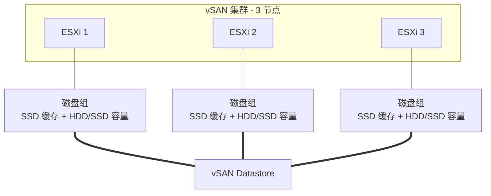

# vSAN 存储架构：磁盘组、存储策略与 ESA

## 前言

vSAN 是 VMware 的软件定义存储方案——它将 ESXi 主机的本地磁盘聚合成一个**分布式共享存储池**。不需要买昂贵的 SAN 阵列，几台服务器插上 SSD 就能搭建企业级存储。

本文拆解 vSAN 的磁盘组设计、存储策略机制和新一代 ESA 架构。

---

## vSAN 基础架构



---

## 磁盘组设计

每个 ESXi 节点贡献一个或多个**磁盘组**：

| 层 | 介质 | 作用 |
| --- | :---: | --- |
| **缓存层（Cache Tier）** | SSD / NVMe | 写缓冲（70%）+ 读缓存（30%） |
| **容量层（Capacity Tier）** | HDD 或 SSD | 持久化存储数据 |

!!! warning "缓存盘故障 = 整个磁盘组离线"
    缓存盘是磁盘组的单点故障——一块缓存盘坏了，整个磁盘组（含容量盘）全部不可用。混合配置中缓存盘必须用企业级 SSD。

---

## SPBM：基于策略的存储管理

vSAN 的独特之处在于**不按 LUN/卷管理存储，而是按「策略」**：

```bash
# 给 VM 定义存储策略（vSphere Client 操作）
FTT=1             # 允许 1 台主机故障（数据 2 副本）
RAID=1 (镜像)     # 用镜像方式保护
FTM=RAID-1        # 故障容忍方法
```

### 关键策略参数

| 参数 | 含义 | 推荐值 |
| --- | --- | --- |
| **FTT（Failure To Tolerate）** | 容忍多少台主机同时故障 | 生产至少 `1` |
| **FTM（Failure Tolerance Method）** | RAID-1（镜像）或 RAID-5/6（纠删码） | 性能型用镜像，容量型用纠删码 |
| **Stripe Width** | 数据条带数 | 高性能场景 `2+` |
| **Object Space Reservation** | 厚置备（100%）vs 精简（0%） | 数据库用厚置备 |

### 策略示例

| 场景 | FTT | FTM | Stripe |
| --- | :---: | :---: | :---: |
| 一般 VM | 1 | RAID-1 | 1 |
| 关键数据库 | 1 | RAID-1 | 2 |
| 归档/备份 | 1 | RAID-5 | 1 |
| 极高可用 | 2 | RAID-1 | 1 |

---

## OSA vs ESA

vSAN 8.0 引入 **ESA（Express Storage Architecture）**，是对传统 OSA 的重大升级：

| | OSA（传统） | ESA（8.0+） |
| --- | :---: | :---: |
| **磁盘组模型** | 缓存盘 + 容量盘 | **无磁盘组概念**——所有盘平等 |
| **RAID** | RAID-1/5/6 | RAID-1/5/6（性能大幅优化） |
| **压缩** | 软件压缩 | **硬件卸载 + 自适应** |
| **快照** | 传统快照 | **原生高性能快照** |
| **最低设备** | 1 SSD + 1 HDD | 4 NVMe SSD |
| **适用场景** | 现有集群 | 新部署、全闪存 |

!!! tip "选 ESA 还是 OSA？"
    新建 vSAN 集群只要硬件达标（4 块 NVMe SSD），直接选 ESA。已有集群无法原地升级到 ESA，需要新建集群后迁移。

---

## 见证节点与故障域

### 见证（Witness）

vSAN 中对象（Object）有多个组件（Component）。当 FTT=1、FTM=RAID-1 时，数据有 2 个副本 + 1 个见证：

| 组件 | 位置 | 作用 |
| --- | --- | --- |
| 数据副本 1 | ESXi A | 数据 |
| 数据副本 2 | ESXi B | 数据 |
| 见证 | ESXi C（或 Witness Appliance） | 仲裁——谁拥有最新数据 |

见证不存数据，只存元数据（几 KB），**不是完整副本**。

### 故障域（Fault Domain）

默认情况下 vSAN 在主机级别分散数据。但多台主机可能在同一个机架——机架断电则全部宕机。故障域允许你定义物理边界：

```text
Fault Domain 1: ESXi 1, ESXi 2  （机架 A）
Fault Domain 2: ESXi 3, ESXi 4  （机架 B）
```

vSAN 会确保对象组件分散在不同 Fault Domain 中。

---

## 总结

1. **磁盘组**：缓存盘 ≥1 + 容量盘 ≥1，缓存盘故障 = 全组离线
2. **SPBM**：不按卷管理，按策略——「我要 FTT=1，剩下 vSAN 自动办」
3. **ESA vs OSA**：新集群选 ESA，旧集群保持 OSA
4. **见证不是副本**：只做仲裁，不存数据
5. **故障域**：机架级容灾，生产必备

vSAN 让超融合变得平民化——三台服务器即成一个企业级存储集群。 🚀
