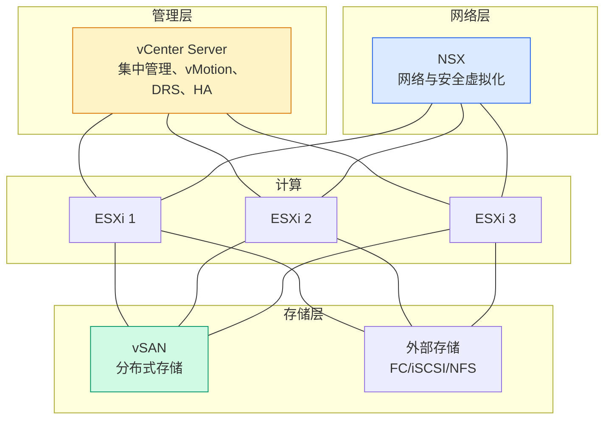

# vSphere 架构总览：组件、版本与设计理念

## 前言

vSphere 不是单一产品，而是一个**平台生态**。ESXi 是单台服务器的虚拟化层，vCenter 是管理所有 ESXi 的中枢，vSAN 提供分布式存储，NSX 提供网络虚拟化——它们协同工作，构成了完整的软件定义数据中心（SDDC）。

---

## 组件全景



| 组件 | 定位 | 核心功能 |
| --- | --- | --- |
| **ESXi** | 虚拟化层 | 运行 VM、管理 CPU/内存/网络/存储资源 |
| **vCenter** | 管理平台 | 单界面管理多台 ESXi、vMotion、DRS、HA、模板 |
| **vSAN** | 分布式存储 | 将 ESXi 本地磁盘聚合成共享存储池 |
| **NSX** | 网络虚拟化 | 微分段、分布式防火墙、Overlay 网络、负载均衡 |

---

## vSphere 版本对比

| 功能 | Standard | Enterprise Plus |
| --- | :---: | :---: |
| vCenter 管理 | ✓ | ✓ |
| vMotion（实时迁移） | ✓ | ✓ |
| vSphere HA | ✓ | ✓ |
| vSphere DRS（资源调度） | — | ✓ |
| vSAN（全功能） | — | ✓ |
| Distributed Switch (vDS) | — | ✓ |
| Storage DRS | — | ✓ |
| Fault Tolerance（最多 2 vCPU） | — | ✓ |
| NIOC（网络 I/O 控制） | — | ✓ |

!!! tip "HomeLab 选型"
    个人实验环境使用 **vSphere Standard** 足够（vMotion + HA 已经能学到很多）。如果需要 DRS、vDS、vSAN——VMUG Advantage 订阅 ($200/年) 提供全套 Enterprise Plus 许可。

---

## 核心设计理念

### 1. 软件定义数据中心（SDDC）

所有基础设施能力由软件定义，不依赖特定硬件：

| 层 | 传统方式 | 软件定义 |
| --- | --- | --- |
| 计算 | 每台服务器独立管理 | **vSphere** 统一资源池 |
| 存储 | 专用 SAN/NAS 硬件 | **vSAN** 用本地磁盘 |
| 网络 | 硬件交换机/防火墙 | **NSX** 虚拟化网络 |

### 2. 策略驱动

不再手动配置每台 VM 的网络、存储、安全——定义**策略**，vSphere 自动执行：

-   **存储策略（SPBM）**：定义 VM 的容量、性能、保护级别 → vSAN 自动放置
-   **安全策略**：NSX DFW 基于 VM 标签定义防火墙规则，VM 迁移策略跟着走

### 3. 零停机运维

| 技术 | 停机时间 |
| :---: | :---: |
| vMotion（实时迁移） | 0 |
| Storage vMotion（存储迁移） | 0 |
| vSphere HA（主机故障自动重启） | 分钟级 |
| Fault Tolerance（连续容错） | **0（指令级同步）** |

---

## 部署拓扑

### 最小集群（2 节点 + Witness）

```
ESXi 1 ←→ ESXi 2
    ↓         ↓
  vSAN      vSAN
    ↓         ↓
Witness（见证主机，可以是虚拟机）
```

适用于 ROBO（远程办公室/分支）场景，2 台主机 + 1 个见证。

### 标准集群（3+ 节点）

```
ESXi 1   ESXi 2   ESXi 3
   ↓        ↓        ↓
  vSAN 集群（分布式存储）
   ↓
vCenter 管理
```

3 台起步，HA/DRS 全功能可用。推荐的生产最小配置。

---

## 总结

vSphere 不是「ESXi 的安装程序」——它是一整套数据中心操作系统：

1. **ESXi** = 计算虚拟化
2. **vCenter** = 集中管理
3. **vSAN** = 分布式存储（软件定义存储）
4. **NSX** = 网络与安全虚拟化（软件定义网络）

理解这四个组件的关系，你就理解了为什么 VMware 能在企业市场称霸二十年。 🚀
